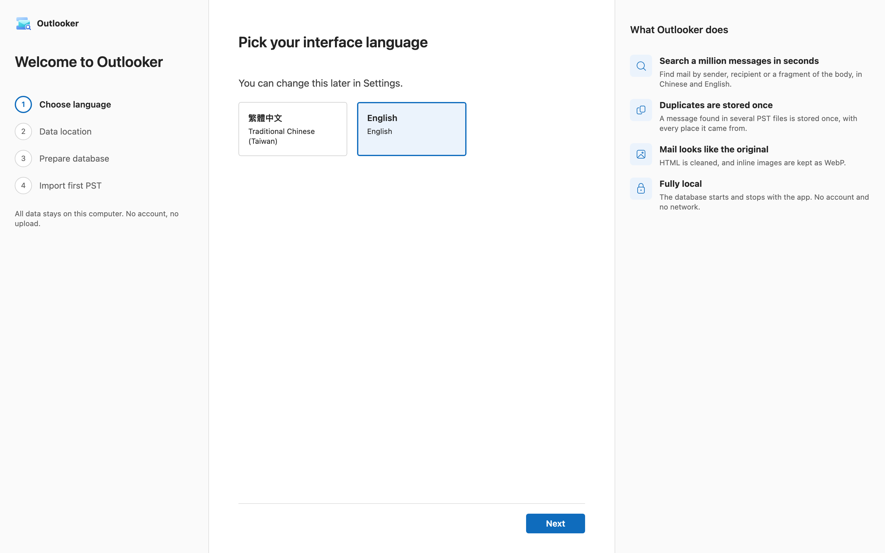
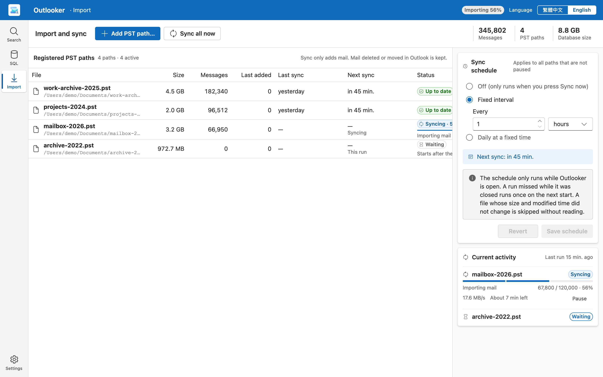
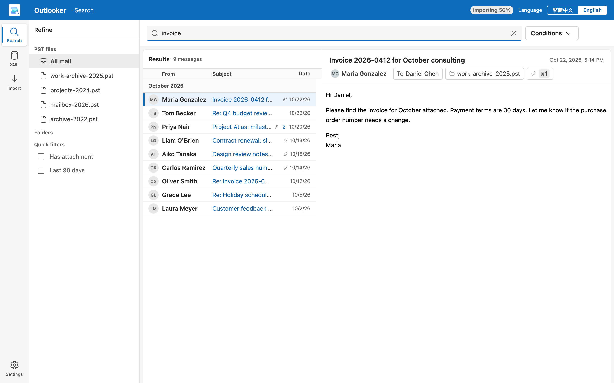
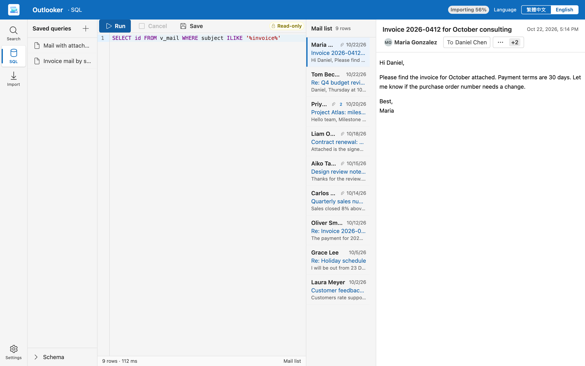
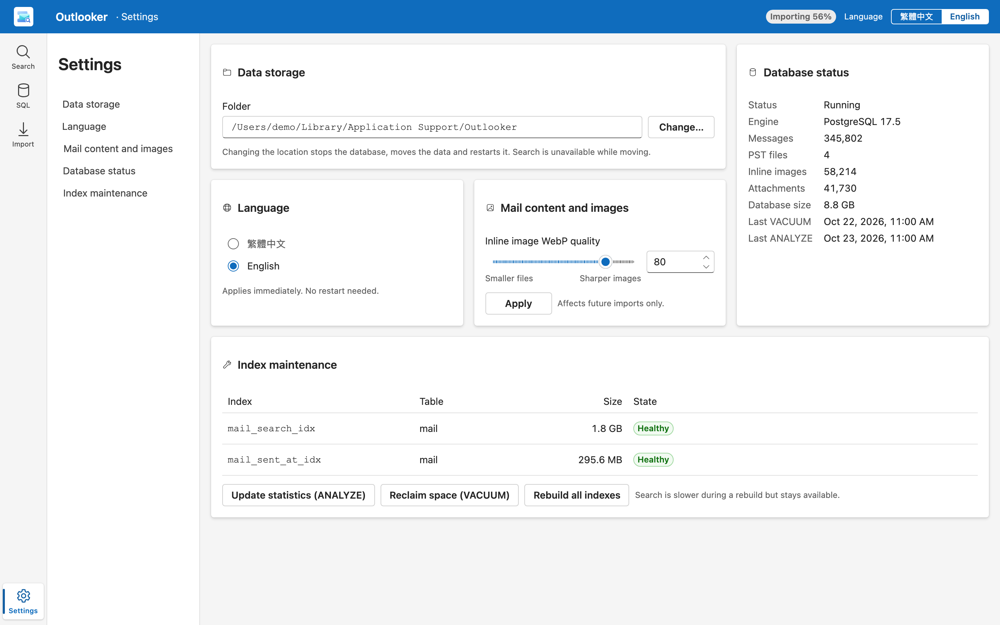

# Outlooker

[English](README.md) | [繁體中文](README.zh-TW.md)

## Purpose

Outlooker is a desktop app. It imports Outlook PST files and lets you search the mail inside them.

Outlook is slow with very large PST files. Outlooker solves this problem. It stores the mail in a local database. You find a message in seconds, also in an archive of one million messages.

All data stays on your computer. Outlooker does not need an account. It does not upload data.

## Main features

- Search by sender, recipient, subject, or body text. Chinese and English text both work.
- Build search conditions with groups. Use the fields Sender, Recipient, Subject, Body, Sent date, Folder, Has attachment, and Source PST.
- Narrow the results with the quick filters "Has attachment" and "Last 90 days".
- Store a message that is in several PST files only once. Outlooker records every place where it found the message.
- Show mail as the original. Outlooker cleans the HTML and keeps inline images as WebP.
- Sync PST files on a schedule. A sync only adds new mail. Mail that you delete or move in Outlook stays in Outlooker.
- Pause, resume, unregister, or delete each PST path.
- Run read-only SQL queries and save them.
- Change the data folder and the interface language. Choose English or Traditional Chinese.

## How to use

### 1. Start for the first time

The first start shows the "Welcome to Outlooker" guide.

1. Choose the language. You can change it later in "Settings".
2. Choose where to store the mail data. Imported data uses about 60–80% of the size of the original PST. Select "Default location" or "Another location…". Make sure the disk has enough free space.
3. Wait for "Prepare database". It runs one time and takes about 20 seconds.
4. Select "Choose PST files…" to import your first PST. Or select "Import later".

### 2. Import a PST file

1. Select "Import" in the navigation.
2. Select "Add PST path…".
3. Choose a PST file.

Outlooker imports the file in the background. You can search the mail that Outlooker already imported.

The table "Registered PST paths" shows the status of each file. The statuses are "Waiting", "Syncing", "Up to date", "Locked", "Paused", and "Failed". To start a sync, select "Sync now" for one file or "Sync all now" for all files.

Use the buttons in each row to manage a path:

- "Pause" stops the path. "Resume" continues it.
- "Unregister (keeps mail)" removes the path from the list. The imported mail stays.
- "Delete (removes its mail)" deletes the mail that is only in this PST file. Mail that is also in other PST files stays. Outlooker does not change the PST file.

To sync on a schedule, open "Sync schedule". Choose "Off (only runs when you press Sync now)", "Fixed interval", or "Daily at a fixed time". Then select "Save schedule". The schedule runs only while Outlooker is open. Outlooker runs one missed sync when it starts again.

### 3. Search

1. Select "Search" in the navigation.
2. Type a word, a name, or an address in the search box.
3. Select a message in the list. Its content shows on the right.

To add conditions, select "Conditions". Then select "Add condition" or "Add group". Use "AND" or "OR" between groups. Select "Clear all" to remove all conditions.

Use the "Refine" pane to filter by "PST files" or "Folders".

Notes:

- A search word with fewer than 3 characters is slow.
- A search accepts at most 10 words and 50 conditions.
- Outlooker shows the first 100,000 results.
- When new mail is imported, select "Refresh" to update the list.

### 4. Advanced SQL

Use "SQL" in the navigation to query the database with SQL.

1. Open "Schema" to see the views that you can query.
2. Write a SELECT statement in the "SQL editor".
3. Select "Run", or press Ctrl+Enter (⌘+Enter on macOS).
4. Select "Save" to keep the query. Open it again from "Saved queries".

The connection is "Read-only". You cannot change data. If the result has an `id` column, you can open the rows as mail.

### 5. Settings

Select "Settings" in the navigation.

- "Data storage": select "Change…" to move the data folder. Outlooker stops the database, moves the data, and starts the database again. Search is not available during the move.
- "Language": the change applies immediately.
- "Mail content and images": set "Inline image WebP quality" from 1 to 100. The value applies to future imports only.
- "Database status": see the number of messages, PST files, images, attachments, and the database size.
- "Index maintenance": select "Update statistics (ANALYZE)", "Reclaim space (VACUUM)", or "Rebuild all indexes". Search is slower during a rebuild but stays available.

## Technology stack

- Desktop shell: Tauri 2
- Back end: Rust
- User interface: React and TypeScript
- Database: PostgreSQL, bundled with the app and started by it
- Inline images: WebP

## For developers

Prerequisites:

- [mise](https://mise.jdx.dev). It pins Node through `.config/mise.toml`.
- A Rust toolchain (`app/backend/rust-toolchain.toml`).
- Bundled PostgreSQL: `cd app && mise exec -- node scripts/fetch-postgres.mjs`

Layout:

- `app/frontend`: React UI
- `app/backend`: Rust workspace and Tauri app
- `app/scripts`, `app/tests`: build, fetch, and test tools (the npm root is `app/`)
- `docs/brand`: logo

Commands:

- Build the frontend (typecheck and vite): `cd app && mise exec -- npm run build`
- Frontend unit tests: `cd app && mise exec -- npm test`
- End-to-end tests: `cd app && mise exec -- npm run e2e` (groups `flow`, `seeded`, `scroll`; `scroll` seeds 120,000 messages and is long)
- One e2e group: `cd app && mise exec -- npm run e2e:build`, then `cd app && mise exec -- node tests/e2e/run.mjs --spec tests/e2e/flow.e2e.ts`
- Desktop build: `python3 app/scripts/build.py`
- Cargo test, lint, and build commands: see `.claude/CLAUDE.md`.
