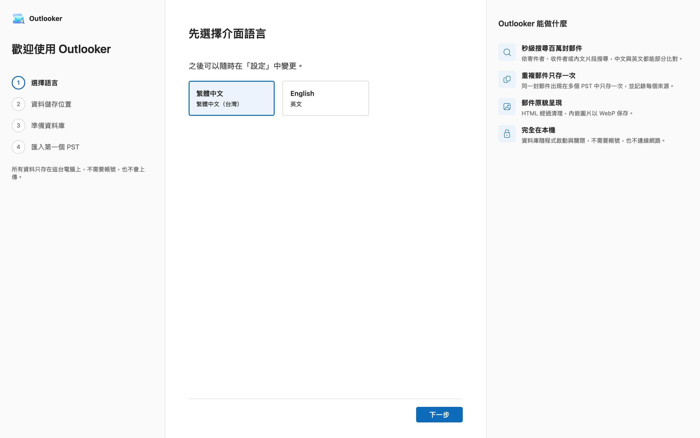
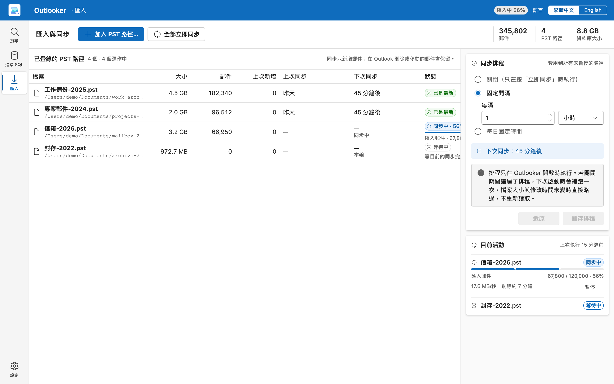
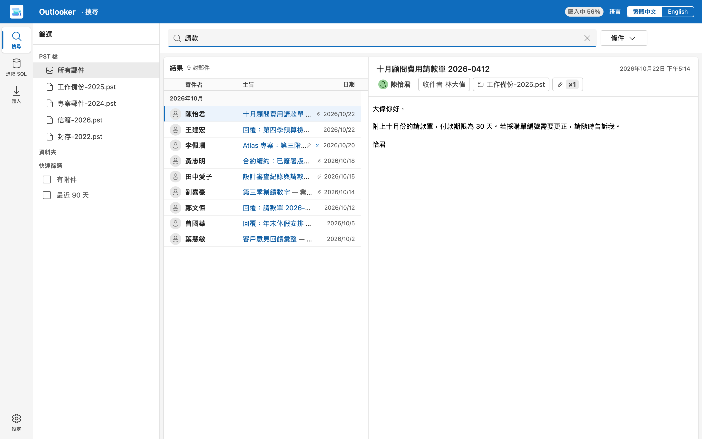
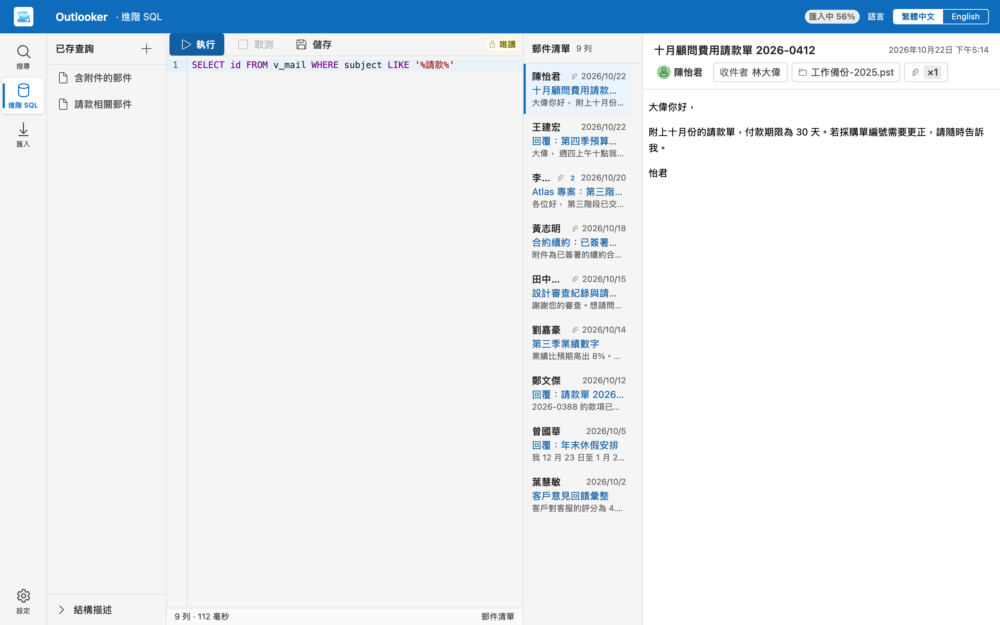
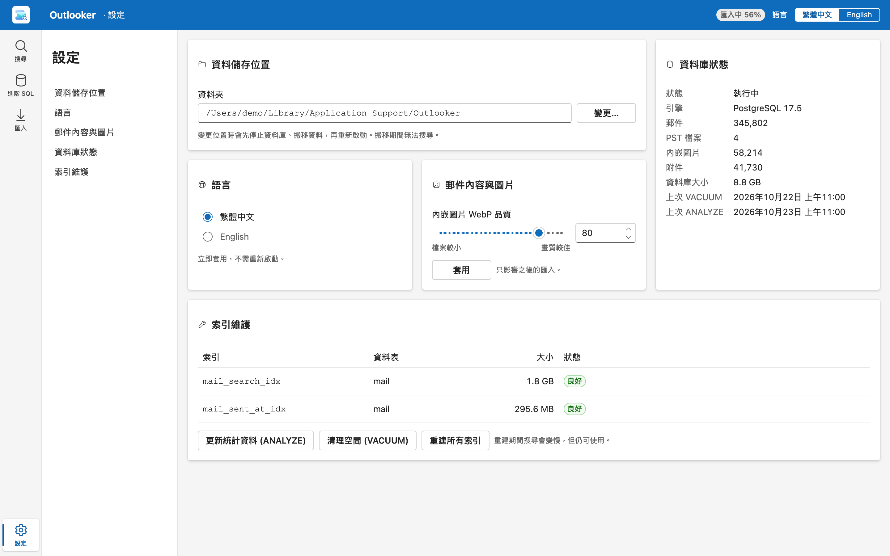

# Outlooker

[English](README.md) | [繁體中文](README.zh-TW.md)

## 用途

Outlooker 是桌面應用程式。它匯入 Outlook PST 檔案，讓你搜尋檔案內的郵件。

Outlook 開啟很大的 PST 檔案時很慢。Outlooker 解決這個問題。它把郵件存在本機資料庫。即使有一百萬封郵件，你也能在數秒內找到郵件。

所有資料只存在你的電腦上。Outlooker 不需要帳號，也不會上傳資料。

## 主要功能

- 依寄件者、收件者、主旨或內文搜尋。中文與英文都能搜尋。
- 用群組組合搜尋條件。可用的欄位有「寄件者」、「收件者」、「主旨」、「內文」、「寄件日期」、「資料夾」、「有附件」和「來源 PST」。
- 用快速篩選「有附件」和「最近 90 天」縮小結果。
- 同一封郵件出現在多個 PST 檔案時，只存一次。Outlooker 記錄每個來源。
- 郵件以原貌呈現。Outlooker 清理 HTML，並以 WebP 保存內嵌圖片。
- 依排程同步 PST 檔案。同步只新增郵件。你在 Outlook 刪除或移動的郵件會保留在 Outlooker。
- 可以暫停、繼續、取消或刪除每個 PST 路徑。
- 執行唯讀 SQL 查詢，並儲存查詢。
- 變更資料夾與介面語言。可選英文或繁體中文。

## 使用方式

### 1. 第一次啟動

第一次啟動時，畫面會顯示「歡迎使用 Outlooker」導覽。

1. 選擇語言。之後可以在「設定」中變更。
2. 選擇郵件資料的儲存位置。匯入後的資料大約是原始 PST 的 60–80%。選擇「預設位置」或「其他位置…」。請確認磁碟有足夠的剩餘空間。
3. 等待「準備資料庫」完成。它只執行一次，大約 20 秒。
4. 選擇「選擇 PST 檔案…」匯入第一個 PST。或選擇「稍後再匯入」。

### 2. 匯入 PST 檔案

1. 在導覽列選擇「匯入」。
2. 選擇「加入 PST 路徑…」。
3. 選擇一個 PST 檔案。

Outlooker 在背景匯入檔案。匯入期間，你可以搜尋已匯入的郵件。

「已登錄的 PST 路徑」表格顯示每個檔案的狀態。狀態有「等待中」、「同步中」、「已是最新」、「已鎖定」、「已暫停」和「失敗」。要開始同步，請對單一檔案選擇「立即同步」，或對所有檔案選擇「全部立即同步」。

用每一列的按鈕管理路徑：

- 「暫停」停止該路徑。「繼續」讓它接續。
- 「取消（保留郵件）」從清單移除路徑。已匯入的郵件會保留。
- 「刪除（連同只屬於它的郵件）」刪除只存在於這個 PST 檔案的郵件。也存在於其他 PST 檔案的郵件會保留。Outlooker 不會修改 PST 檔案。

要依排程同步，請開啟「同步排程」。選擇「關閉（只在按「立即同步」時執行）」、「固定間隔」或「每日固定時間」。然後選擇「儲存排程」。排程只在 Outlooker 開啟時執行。Outlooker 再次啟動時，會補跑一次錯過的同步。

### 3. 搜尋

1. 在導覽列選擇「搜尋」。
2. 在搜尋框輸入字詞、姓名或地址。
3. 在清單中選擇一封郵件。郵件內容顯示在右側。

要新增條件，請選擇「條件」。然後選擇「新增條件」或「新增群組」。在群組之間使用「AND」或「OR」。選擇「全部清除」可移除所有條件。

用「篩選」窗格依「PST 檔」或「資料夾」篩選。

注意：

- 少於 3 個字元的搜尋詞較慢。
- 一次搜尋最多接受 10 個詞和 50 個條件。
- Outlooker 只顯示前 100,000 筆結果。
- 匯入新郵件後，選擇「重新整理」更新清單。

### 4. 進階 SQL

在導覽列選擇「進階 SQL」，用 SQL 查詢資料庫。

1. 開啟「結構描述」，查看可查詢的檢視。
2. 在「SQL 編輯器」撰寫 SELECT 陳述式。
3. 選擇「執行」，或按 Ctrl+Enter（macOS 按 ⌘+Enter）。
4. 選擇「儲存」保留查詢。要再次使用，請從「已存查詢」開啟。

連線是「唯讀」。你不能修改資料。結果含 `id` 欄位時，可以把列當作郵件開啟。

### 5. 設定

在導覽列選擇「設定」。

- 「資料儲存位置」：選擇「變更…」搬移資料夾。Outlooker 會停止資料庫、搬移資料，再啟動資料庫。搬移期間無法搜尋。
- 「語言」：變更立即套用。
- 「郵件內容與圖片」：設定「內嵌圖片 WebP 品質」，範圍是 1 到 100。數值只影響之後的匯入。
- 「資料庫狀態」：查看郵件、PST 檔案、內嵌圖片、附件的數量，以及資料庫大小。
- 「索引維護」：選擇「更新統計資料 (ANALYZE)」、「清理空間 (VACUUM)」或「重建所有索引」。重建期間搜尋會變慢，但仍可使用。

## 技術架構

- 桌面外殼：Tauri 2
- 後端：Rust
- 使用者介面：React 與 TypeScript
- 資料庫：PostgreSQL，隨程式內建並由程式啟動
- 內嵌圖片：WebP

## 開發者

前置需求：

- [mise](https://mise.jdx.dev)。它透過 `.config/mise.toml` 固定 Node 版本。
- Rust 工具鏈（`app/backend/rust-toolchain.toml`）。
- 內建 PostgreSQL：`cd app && mise exec -- node scripts/fetch-postgres.mjs`

目錄結構：

- `app/frontend`：React 介面
- `app/backend`：Rust workspace 與 Tauri 應用程式
- `app/scripts`、`app/tests`：建置、下載與測試工具（npm 根目錄是 `app/`）
- `docs/brand`：標誌

指令：

- 建置前端（型別檢查與 vite）：`cd app && mise exec -- npm run build`
- 前端單元測試：`cd app && mise exec -- npm test`
- 端對端測試：`cd app && mise exec -- npm run e2e`（群組 `flow`、`seeded`、`scroll`；`scroll` 會建立 120,000 封郵件，耗時很長）
- 單一 e2e 群組：`cd app && mise exec -- npm run e2e:build`，然後 `cd app && mise exec -- node tests/e2e/run.mjs --spec tests/e2e/flow.e2e.ts`
- 桌面版建置：`python3 app/scripts/build.py`
- Cargo 測試、lint 與建置指令：見 `.claude/CLAUDE.md`。
