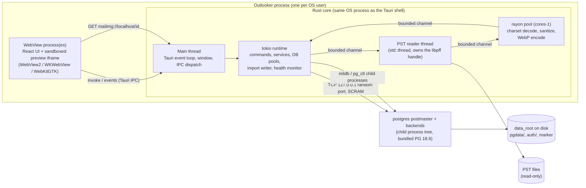
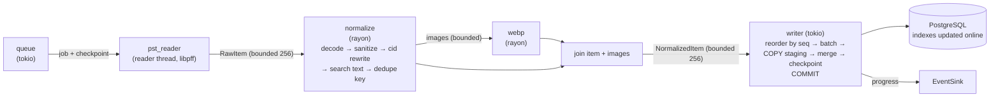

# Outlooker — Design Spec

Date: 2026-10-21. Status: implemented on macOS; Windows phase pending.
Requirements (frozen, only the user may change): `docs/specs/requirements.md`.
This spec merges the four architecture sections. Cross-references such as "01 §6", "02 §6.3" or
"`03-frontend-api.md` §5.2" point to Part 01–04 below.

## 0.1 Summary
Single-machine desktop app (Windows + macOS required, Linux nice-to-have). Tauri 2 shell, Vite + React +
Fluent UI React v9 frontend (light theme only), Rust core with in-process libpff FFI, bundled PostgreSQL 18.6
started via initdb/pg_ctl. Imports PST files through a background, cancellable, resumable pipeline: parse →
charset decode → HTML sanitize/normalize → inline images to WebP → cross-PST dedupe → binary COPY batches.
Search uses pg_trgm (Chinese + English substring) plus English tsvector, keyset paging, and a read-only role
for the Advanced SQL screen.

## 0.2 User decisions (2026-10-21)
| Decision | Value |
|---|---|
| UI design | Variant 1 "Outlook-native productivity": `docs/design/variant-1/` (prototype + `NOTES.md` token table and Fluent UI v9 component mapping). The prototype is the visual reference for every screen. |
| App identifier | `us.jhangy.outlooker` (fixed; sets per-OS data, DB and log directories). |
| Search match count | Exact up to 10,000; above that the UI shows "10,000+". |
| Result list | Loads at most 100,000 rows; beyond that the user narrows the query. |
| Advanced SQL | 30 s statement timeout, at most 10,000 returned rows. |
| Type generation | ts-rs 12.0.1 + hand-written `commands.ts` / `events.ts` wrappers (tauri-specta rejected: Tauri 2 support is pre-release only). |
| Job progress transport | Global Tauri events, at most 4 per second, payload < 1 KB. Tauri `Channel` is not used. |
| Prototype-only features | Out of scope: exact delete/keep preview before removing a PST, true pause / pause all, worker-count setting, re-convert existing images, disk-usage breakdown, SQL format, search-term highlighting, drag-and-drop import. The UI does not show these controls even though the variant-1 prototype draws them. |

## 0.3 Known risks and outcomes
| Risk | Mitigation / verification | Outcome |
|---|---|---|
| Chinese pg_trgm needs a UTF-8 libc locale; verified on macOS only. Windows locale (`en-US`, then `English_United States.65001`) unverified. | Startup self-check `SELECT similarity('測試測試','測試') > 0`; failure is fatal. First Windows build must run it. | open: Windows phase |
| Query plans, DB size (estimate ~3.15 GB per 100k messages with images, ~1.65 GB without), import throughput (target ≥ 150 msg/s) and search latency (target p95 ≤ 500 ms at 1M messages) are estimates. | 1M-message load test (Part 04 §12.3) with pre-registered pass thresholds. | open: 1M load test (not run, needs a user-approved long run) |
| The libpff fork ships no sample PST. | Test PSTs are generated on Windows with an Outlook automation script (Part 04 §12). Unverified: whether Outlook allows setting Message-ID / sent time on drafts; the script must fail loudly if not. | `tests/fixtures/external/outlook.pst` is used by the import tests and the e2e flow. `scripts/fixtures/make-pst.ps1` is kept for the Windows phase. |
| Outlook HTML wrapped in RTF has no existing converter crate. | In-house converter (~200 lines, Part 01 §5); pure-RTF mail falls back to the plain-text body. | done: in-house converter `src-tauri/crates/outlooker-core/src/importer/normalize/rtf.rs` (`deencapsulate_html`, `to_text`). |
| Webview scroll-height limit for long lists. | 100k-row cap; test scrolling on WebView2 and WKWebView. | 100k cap implemented. WKWebView covered by e2e group `scroll`. WebView2 open: Windows phase. |
| Installer size ~45–55 MB is an estimate. | Measure the first release build per platform. | macOS dmg 42,445,233 bytes (`docs/logs/gate-round2-6e46659.md` G2.5). Windows open. |

## 0.4 Out of scope
Attachment body storage/download, attachment content search, dark mode, multi-user/auth, live Outlook
(MAPI/Exchange) connection, editing or sending mail.

## 0.5 Implementation decisions
Hard-to-reverse choices made during implementation. Each one names the rejected alternative and the cost accepted.
- **DTO placement.** All ts-rs DTOs live in the leaf module `outlooker-core/src/dto/`. It imports no service module; `From<ServiceError> for AppError` mappings live in the services. Rejected: DTOs inside each service, a separate `outlooker-dto` crate. Reason: the Command Layer and the services share one type set and need no Tauri dependency for it. Cost: a module not named in Part 02 §3.
- **Type rule.** Rust DTOs are the only type definitions. TS imports them from `src/api/bindings/<TypeName>`; hand-written TS copies are forbidden.
- **Locale files split by namespace.** `src/locales/<lang>/<namespace>.json`, `<lang>` exactly `zh-TW` and `en` (namespaces `common`, `onboarding`, `import`, `settings`, `search`, `sql`). Rejected: the literal `src/locales/{zh-TW,en}.json`. Reason: i18next namespaces are native, Vite imports JSON statically, and screens do not edit the same file. This supersedes the file names in Part 01 §2 and Part 02 §3. Both languages keep identical key sets. Numbers are passed to i18next pre-formatted as `n`, never as `count` (it triggers plural lookup).
- **Start/shutdown composition lives in core** (`core::app`: `build`, `start_services`, `shutdown`), not in `src-tauri/src/lib.rs`. Reason: services stay testable without a window, and the exit and recovery order has integration tests.
- **`app_retry`.** The Failed screen retries through the command `app_retry()` served by the Lifecycle Supervisor. The command set is 24 commands including it (Part 03 §3 and §4).
- **Out-of-scope prototype controls.** The PST removal dialog shows the PST's message count only. See §0.2 "Prototype-only features" for the full list. Also not carried over: the "Sort by relevance" select (order is fixed newest first), "Restart database", "Open folder", "Open log files", "Copy link", "Open in Outlook", and the onboarding list of PST files found in common locations (no command serves them).
- **`db::Db` is a cloneable handle** (`Arc<RwLock<Option<DbConn>>>`) read by every service at call time. Rejected: passing `Pools` at construction. Reason: PostgreSQL gets a new random port on every restart (Part 02 §2.2 step 5), so a captured pool goes stale, and a service must not import the Supervisor. Cost: a cheap read-lock on every DB call.
- **Timestamps without a date-time crate.** The read side formats RFC 3339 in SQL with `to_char(... AT TIME ZONE 'UTC', ...)` using the constant `db::RFC3339_UTC_FMT`, bound as a parameter. The write side uses `std::time::SystemTime`; FILETIME is converted in Rust to Unix microseconds. Rejected: `chrono` or `time` (Part 01 lists none). Cost: every query must use the one constant.
- **Writer connection is unpooled.** One dedicated `outlooker_app` connection per running job. Reason: the writer sets `synchronous_commit = off` and creates session temp tables (Part 04 §6.2), which must not leak into a pooled connection. Cost: one extra connection per job (Part 04 §6.6 `max_connections` row "writer (1)").
- **Image blob dedupe uses a known-hash set updated only after commit.** Reason: an item with a lower `seq` can commit in an earlier batch than the item that encoded the shared image, so a hash marked known before its blob commits would lose that image. Cost: an image repeated inside one uncommitted window is encoded more than once. The `DISTINCT ON` plus `ON CONFLICT (source_hash)` insert stores it once.
- **Search query composition in the frontend.** The search box, refine pane and DSL builder compose one `SearchQuery` (`src/screens/search/compose.ts`). Search text alone gives `simple`. Anything else gives `dsl` whose root is `and(<one or(sender,recipient,subject,body) group per term>, <refine conditions>, <builder group>)`. Rejected: using only the builder tree when it is open, a new three-part command. Reason: Part 03 §5.1 has only `simple | dsl`, so no contract change. Cost: the term expansion repeats the core's simple-query rule in one function, `termGroup`.
- **Fixed-height virtual rows.** Search-screen mail rows and month headers are one 32 px virtual item (`ROW_HEIGHT` in `src/components/mail/MailList.tsx`). The cap row and loader row sit after the virtual block. Reason: Part 03 §5.2 fixes 32 px rows and a 3.2M px height budget. Cost: the Search list shows one line per mail instead of the prototype's three lines. Advanced SQL mail-list mode uses three-line compact rows (`COMPACT_ROW_HEIGHT` 73 px, `src/screens/advanced-sql/index.tsx`).
- **E2E seams are compile-time gated.** `OUTLOOKER_APP_DATA_DIR` is read only with cargo feature `e2e`. The native-picker bypass is read only when Vite builds with `VITE_E2E=1`. Reason: WebDriver cannot drive native dialogs and the E2E run must not touch the real data dir. Cost: the E2E binary is a separate debug build.
- **Dependencies added after the first spec draft.** `getrandom` (random role passwords), `sysinfo` (RAM for `shared_buffers`, free disk space, bundled-postgres PID check), `tempfile` (test data roots, behind feature `test-support`), `base64` (search cursor and `data:` image URIs), `jsonschema =0.59.0` with `default-features = false` (schema test, `outlooker-core` dev-dependency only).
- **Fixtures.** The libyal `outlook.pst` is committed with a CC-BY-4.0 notice. Outlook-generated fixtures remain a release blocker.
- **Tests that need an external artifact** (fetched PostgreSQL, `tests/fixtures/external/outlook.pst`) fail with an explicit message when it is missing. They never skip silently.
- **Windows.** Windows work runs in one phase after the macOS gates. libpff vendoring deadline 2026-11-18. No CI workflow file: local gates only.

---

# 01 — Technology Stack

Input: `docs/specs/requirements.md` (frozen 2026-10-21). This section binds 02 (system architecture), 03 (frontend API) and 04 (backend server).

All versions below were checked against their registry on 2026-10-21 (crates.io API, `npm view`, GitHub Releases, pub.dev). "Pin" means the exact version that the first `Cargo.toml` / `package.json` must declare. Implementers can accept compatible patch updates only after they check the registry again.

## 1. Stack at a glance

| Layer | Choice |
|---|---|
| Desktop shell | Tauri 2 (crate `tauri` 2.12.5, CLI 2.12.4) |
| UI | Vite 8 + React 19 + TypeScript 7 + Fluent UI React v9. Light theme only. |
| UI ↔ Rust | `@tauri-apps/api` `invoke()` for commands. Events (`emit`/`listen`) for job progress and broadcast state. `Channel` is not used. |
| Rust core | One process: tokio runtime, a libpff FFI parser, an HTML/WebP pipeline, and a PostgreSQL client |
| PST parsing | **In-process Rust FFI to the libpff C API.** The C sources compile with the app through `build.rs` and the `cc` crate. |
| Database | **PostgreSQL 18.6.** Prebuilt binaries are shipped as Tauri resources. Rust starts initdb and pg_ctl as child processes. pg_trgm is included. |
| DB driver | **tokio-postgres** + deadpool-postgres. Migrations: refinery. |
| Tests | cargo test (with a real bundled PostgreSQL), Vitest + Testing Library, WebdriverIO + Tauri embedded WebDriver for E2E |

Toolchain: Rust stable 1.99.1 (static.rust-lang.org channel file, 2026-10-13; Tauri 2.12.5 declares MSRV 1.90). Node.js 24 LTS (24.22.1 "Krypton", nodejs.org/dist/index.json). Windows builds use the MSVC toolchain (VS 2022 Build Tools). macOS builds use Xcode clang.

## 2. Frontend

| Package | Version | Source | Reason |
|---|---|---|---|
| vite | 8.3.5 | npm | Dev server and bundler. Tauri's documented frontend path. |
| @vitejs/plugin-react | 6.1.2 | npm | React transform. Its peer range is `vite ^8.0.0`. |
| react / react-dom | 19.3.1 | npm | Required UI framework. |
| typescript | 7.0.2 | npm | Type checking. react-i18next's peer range accepts `^5\|\|^6\|\|^7`. |
| @types/react / @types/react-dom | 19.3.0 | npm | React typings. |
| @fluentui/react-components | 9.74.10 | npm | Fluent 2, as required. Its peer range is `react >=16.14 <20`. Use only `webLightTheme` with one `FluentProvider`. Do not import any dark theme token set. |
| @fluentui/react-icons | 2.0.344 | npm | Fluent icon set. |
| codemirror | 6.0.2 | npm | Editor core (`basicSetup`). |
| @codemirror/lang-sql | 6.10.0 | npm | `sql({ dialect: PostgreSQL, schema })`. `dist/index.d.ts` exports `PostgreSQL` and `SQLConfig.schema`, which gives table and column completion. |
| @codemirror/state | 6.7.6 | npm | Editor state (direct import for the wrapper). |
| @codemirror/view | 6.43.15 | npm | Editor view (direct import for the wrapper). |
| @tanstack/react-virtual | 3.14.21 | npm | Row virtualization for the mail list and the generic result table. Uses `useVirtualizer` (verified in its `index.d.ts`). Its peer range is React 19. |
| @tanstack/react-query | 5.104.5 | npm | Fetching and caching of Tauri command results: `useQuery` for the preview, `useInfiniteQuery` for paged result lists. Its peer range is React 19. |
| i18next | 26.5.4 | npm | Locale engine. Locale files `src/locales/<lang>/<namespace>.json` (language directories exactly `zh-TW` and `en`, one i18next namespace per file) exist from day one. |
| react-i18next | 17.1.0 | npm | React binding (`useTranslation`). Its peer range is `i18next >=26.2.0`. |
| @tauri-apps/api | 2.12.4 | npm | `invoke`, `listen`. Matches the Rust crate's 2.12 line. |
| @tauri-apps/plugin-dialog | 2.8.3 | npm | Native "Open PST" and "choose data folder" dialogs. Pairs with crate `tauri-plugin-dialog` 2.8.3. |

Decisions:
- **CodeMirror wrapper: in-house.** It is about 30 lines (`EditorView` in a `useEffect`). We do not use `@uiw/react-codemirror` (4.25.12): it declares `@codemirror/theme-one-dark` as a peer dependency, which conflicts with the "no dark mode" rule, and it adds a dependency that we do not need.
- **No global state library.** Server state lives in TanStack Query. UI state (current screen, locale, selected mail id) is small enough for React context and `useState`. We skip zustand (5.0.15). Add it only if prop drilling crosses more than 3 levels in many places.
- **Mail preview rendering:** The sanitized HTML is rendered in a sandboxed `<iframe sandbox srcdoc>` with a strict CSP. Inline images load from a custom Tauri URI scheme served by Rust (`register_asynchronous_uri_scheme_protocol`; the protocol name and the handler are owned by 02/03). No network fetches. A new mail preview replaces `srcdoc`, so no new webview is created.
- **Virtualized 1M-row lists:** The frontend never holds 1M rows. It requests pages with keyset pagination through `useInfiniteQuery` and sets the `useVirtualizer` count to the number of rows loaded so far. A scroll container has a maximum pixel height, and that maximum differs by engine. To stay below it, the list loads at most 100k rows, which is about 3.2M px at 32 px per row (design in 03 §5.2). The total match count is shown as a number, not as scroll length.

## 3. Shell: Tauri 2

| Crate | Version | Source | Reason |
|---|---|---|---|
| tauri | 2.12.5 | crates.io | Desktop shell. Uses WebView2 on Windows, WKWebView on macOS, WebKitGTK on Linux. |
| tauri-build | 2.7.4 | crates.io | Build script for the Tauri app. |
| tauri-plugin-dialog | 2.8.3 | crates.io | File and folder pickers. |
| tauri-plugin-log | 2.10.1 | crates.io | One rotating log file in the app log dir, for Rust (`log` facade) logs only. |
| @tauri-apps/cli | 2.12.4 | npm | `tauri dev` / `tauri build`, and the installers: NSIS on Windows, .dmg on macOS, AppImage/.deb on Linux. |
| tauri-plugin-single-instance | 2.5.4 | crates.io | One app instance per user. A second launch focuses the existing window. Requires `tauri ^2.12`. We use it instead of our own lock file. PostgreSQL's `postmaster.pid` still protects the data dir as a second line of defense. |
| ts-rs | 12.0.1 | crates.io | Generates TypeScript types from the Rust command DTOs (`#[derive(TS)]`, exported by `cargo test`). A small hand-written typed `invoke` wrapper per command uses these types. We do not use tauri-specta: its only Tauri 2 line is `2.0.0-rc.25`, a pre-release (its stable 1.0.2 targets Tauri 1). |

App identifier: `us.jhangy.outlooker` (Tauri `identifier`). It sets the per-OS app data and log dirs through Tauri's path API. The user can change it before the first release. After that, a change moves the data dir.

Repo layout for native parts:
- `src-tauri/native/libpff/`: the copied, prepared libpff sdist tree (committed, not a submodule, because it contains generated files). Plus `src-tauri/native/libpff/ORIGIN` with the fork commit hash.
- `src-tauri/native/postgresql.sha256`: the pinned sha256 per target triple for theseus-rs 18.6.1.
- `scripts/fetch-postgres.mjs`: a Node script, so one script works on every OS. It downloads the target asset, verifies the hash, prunes the tree, and writes it to `src-tauri/resources/postgresql/`. That folder is gitignored and is listed in Tauri `bundle.resources`.

How the frontend talks to Rust (verified in the Tauri docs, "Calling Rust"):
- **Request/response:** `invoke('command', args)` → `#[tauri::command] async fn`. Payloads are serde JSON.
- **Job progress:** global events, throttled to at most 4 per second, each payload under 1 KB (event names are in 03). We do not use `Channel`. A Channel is bound to one `invoke` call. An import job outlives that call, survives app restarts, and must update every open screen.
- **Broadcast:** `app.emit(..)` / `listen(..)` for app-wide state (for example "database ready" or "import queue changed").
- **Binary:** large binary data (WebP images) does not go through JSON. It is served by the custom URI scheme described above.

## 4. PST parsing — decision: Rust FFI to libpff (in-process)

### 4.1 Evidence from the fork (`jhangyu/libpff`, HEAD `bb5bcc0`)
- The fork is upstream libyal/libpff with **1 commit ahead (an empty "Trigger workflow registration on fork"), 5 behind**, and no file changes (GitHub compare API, `ahead_by=1`, `files=[]`). Library version `20260625` (`configure.ac:3-5`).
- Public C API: `include/libpff.h.in`: `libpff_file_open` / `libpff_file_open_wide` (:222, :234), `libpff_file_get_root_folder` (:389), `libpff_item_get_identifier` (:490), folder traversal `libpff_folder_get_sub_folder`/`_sub_message` (:2300, :2352), message times (:2504–:2531), `libpff_message_get_recipients` (:2568), attachments `libpff_message_get_attachment`/`libpff_attachment_get_data_size` (:2549, :3837), and the generic `libpff_item_get_entry_value_utf8_string` (:1138) for any MAPI property (Message-ID = `PidTagInternetMessageId` 0x1035, codepage = `PidTagInternetCodepage` 0x3FDE).
- **Bodies (all three exposed):**
  - Plain text: `libpff_message_get_plain_text_body` (:2591). Returns UTF-8. The codepage comes from PidTagInternetCodepage, then PidTagMessageCodepage, then the library codepage (header comment :2583–:2586).
  - RTF: `libpff_message_get_rtf_body` (:2613). It is already LZFu-decompressed (`libpff/libpff_message.c:2557`, `:2681` call `libfmapi_lzfu_*`).
  - HTML: `libpff_message_get_html_body` (:2634). Returns **raw bytes with no charset conversion**. It reads only the HTML property (`libpff/libpff_message.c:2946`, `LIBPFF_ENTRY_TYPE_MESSAGE_BODY_HTML`). libpff does **not** de-encapsulate HTML from RTF (`grep fromhtml` finds nothing).
- Codepages: Big5 (950) and GBK (936) are supported (`include/libpff/codepage.h:58,60`; libyal/libuna has `libuna_codepage_windows_950.c`/`_936.c`).
- **Thread safety:** no source file under `libpff/` uses `HAVE_MULTI_THREAD_SUPPORT` or read/write locks (only `libpff/libpff_libbfio.h` mentions it). `configure` reports `Multi-threading support: no`. **Rule: a `libpff_file_t` and its items belong to one thread. To read in parallel, open separate handles on the same PST.**
- Compiler-only build route already exists: `_build.py` (pypff build) collects every `lib*/*.c` from the `SUBDIRS` in `Makefile.am`. For MSVC it **skips configure** and defines `_CRT_SECURE_NO_WARNINGS`, `UNICODE`, `WINVER=0x0501`, `HAVE_LOCAL_<LIB>` (`_build.py:44-62`, `:64-80`). `common/common.h:25-40` then includes `config_msc.h` + `config_winapi.h`. For non-MSVC it runs `configure --disable-nls --disable-shared-libs` (`_build.py:191-199`, `custom_build_ext.run`).
- That route is green in CI on the fork: run `32393676269` (workflow `build_wheels`, 2026-08-20) built from the sdist on **windows-latest, windows-11-arm, macos-26, macos-26-intel, ubuntu-24.04, ubuntu-24.04-arm**. All passed.
- Local proof on macOS (arm64): from that run's `cibw-sdist` artifact (`libpff_python-20260625.tar.gz`) we ran `sh configure --disable-nls --disable-shared-libs`. Then plain `cc -c` of all 252 `lib*/*.c` with `-DHAVE_CONFIG_H -DHAVE_LOCAL_<LIB>` took 2.5 s. We linked a static archive into a C smoke test that called `libpff_get_version()` → `20260625` and `libpff_check_file_signature()` → `0` for a non-PST file. This is the same compile step that `build.rs` will perform.
- zlib is optional: `libpff/libpff_compression.c:29,53` falls back to the built-in `libpff_deflate.c`. **Build without zlib on every platform** (`--with-zlib=no` on Unix, no `HAVE_ZLIB` on MSVC). This gives one code path and no zlib dependency.

### 4.2 Options compared
| Criterion | Rust FFI (chosen) | pypff Python sidecar | pffexport then re-parse |
|---|---|---|---|
| Windows MSVC + macOS build | `cc` crate compiles the sdist sources. Same route as `_build.py`, CI-proven on 6 targets. | Needs a bundled CPython + wheel per platform/arch. | Needs MSBuild/vstools (`build.ps1` clones `libyal/vstools` and needs Python `C:\Python314`) or autotools. A separate binary per platform. |
| 20 GB PST performance | Zero-copy into Rust buffers. N handles = N parser threads. No IPC. | Python object per property, plus IPC serialization to Rust. GIL limits parallelism to processes. | Writes every message to disk as text/HTML files, then parses them again. Doubles I/O on 20 GB. Loses item ids and structure. |
| Packaging | Statically linked into the app binary. Nothing extra to ship. | About 30–50 MB of Python runtime per platform, and code signing for an extra executable. | Extra executable per platform, plus a temp-disk explosion. |
| Resume/cancel granularity | Per message, in-process. | Needs a cross-process protocol. | Per export run only. |

**Decision: Rust FFI.** pypff and pffexport are rejected.

### 4.3 How it is built
- **Vendored source:** commit the fork's prepared sdist tree (output of `synclibs.sh` + `autogen.sh` + `make sources`; the fork's `build_wheels` "Build sdist" job produces it) under `src-tauri/native/libpff/`. A one-off script regenerates it from a given fork commit. Windows build machines then need no autotools, Python or flex/bison.
- **`build.rs` (crate `cc` 1.9.0):**
  - On Unix, it copies `src-tauri/native/libpff/` into `OUT_DIR` and runs `sh configure --disable-nls --disable-shared-libs --with-zlib=no` **in that copy** (in-tree, as `_build.py` does), then compiles the copy. Configure must not run out-of-tree: the sdist ships a Linux-generated `common/config.h` (`HAVE_ZLIB 1`), and `common/common.h` includes `"config.h"` from its own directory first, so an out-of-tree `config.h` would be ignored.
  - On MSVC, it skips configure, as `_build.py` does.
  - Then it compiles `libpff/*.c` + the 17 `lib*/*.c` local libs with `HAVE_LOCAL_<LIB>` into one static library.
- **Bindings: hand-written `extern "C"`** for the about 45 functions that we call. The API is plain C with opaque handles and `int` return codes. No bindgen (0.73.2), because bindgen needs libclang on every Windows build machine. A safe wrapper module maps `-1` returns to `Result` and frees `libpff_error_t` and handles in `Drop`.
- Do not set a global codepage with `libpff_set_codepage`. That setting is process-wide state. Each message's codepage comes from its own MAPI properties (see §5).

| Crate | Version | Source | Reason |
|---|---|---|---|
| cc | 1.9.0 | crates.io | Compiles the vendored libpff C sources in `build.rs` (MSVC and clang). |

## 5. Mail content processing

| Crate | Version | Source | Reason |
|---|---|---|---|
| encoding_rs | 0.8.42 | crates.io | Decodes HTML bodies and RTF `\'hh` runs from a Windows codepage or WHATWG label (Big5, GBK/GB2312, UTF-8, Shift_JIS …). |
| chardetng | 1.0.0 | crates.io | Guesses the charset only when neither PidTagInternetCodepage nor `<meta charset>` is present. |
| ammonia | 4.2.4 | crates.io | Allow-list HTML sanitizer on html5ever. Parse + serialize = normalization. `attribute_filter` rewrites `img src="cid:…"` to the app's image URI. `url_schemes` restricts links. `filter_style_properties` keeps safe inline CSS. |
| image | 0.25.10 | crates.io | Decodes inline images (PNG/JPEG/GIF/BMP) to RGBA. |
| webp | 0.3.1 | crates.io | Lossy WebP encode with a quality value (`Encoder::from_image(..).encode(quality: f32)`, `src/encoder.rs:24,58`). Pulls `libwebp-sys` ^0.9.3, which builds libwebp from C with `cc`. Gives the same build model as libpff. `image` itself only encodes lossless WebP. |
| rayon | 1.12.0 | crates.io | CPU pool for parallel WebP conversion and sanitizing. Keeps CPU work off the tokio runtime. libpff reader threads are plain `std::thread`s, one handle each. They are not in rayon, because they block on file I/O. |
| blake3 | 1.8.7 | crates.io | Fallback dedupe hash of (sender, sent time, subject, normalized body). |

Body selection (per message, first hit wins):
1. **HTML property present:** decode the bytes with the codepage from PidTagInternetCodepage 0x3FDE, else the `<meta charset>`, else chardetng. Then sanitize with ammonia.
2. **RTF only, with `\fromhtml1`** (the common Outlook case): de-encapsulate the HTML per [MS-OXRTFEX]. This is an **in-house tokenizer** (about 200 lines: control words, `\htmlrtf` suppression, `\*\htmltag` groups, `\'hh` bytes decoded with `\ansicpg` through encoding_rs). Then step 1. No crates.io crate implements MS-OXRTFEX: searches for "rtf", "deencapsulate" and "outlook rtf" returned only tokenizers and plain-RTF converters. `compressed-rtf` is not needed, because libpff already decompresses LZFu.
3. **RTF that is not HTML-encapsulated, or plain text only:** use `libpff_message_get_plain_text_body` (already UTF-8). Store it with `body_html` NULL. The frontend renders `body_text` as text (see 03/04). We do not render RTF formatting. This is a known limit: formatting of pure-RTF mail is lost, but the text is complete and searchable.

Search text = the plain-text body when present. Otherwise it is the text extracted from the sanitized HTML with `html2text` (row below), which shares ammonia's `html5ever ^0.40` parser, so no second HTML parser is added.

| Crate | Version | Source | Reason |
|---|---|---|---|
| html2text | 0.17.4 | crates.io | `html2text::from_read(reader, width) -> Result<String>` (`src/lib.rs:3549`). Gives search text for HTML-only mail. Depends on `html5ever ^0.40.1`, the same parser line as ammonia 4.2.4 (`html5ever ^0.40`). |

Not used: `mail-parser` (0.11.9). PST properties are already decoded MAPI values, and Message-ID is a property, so there is no RFC 822 parsing.

## 6. Bundled PostgreSQL

- **Version: PostgreSQL 18.6** (major 18). Binaries come from GitHub `theseus-rs/postgresql-binaries` release **18.6.1** (latest release, 2026-10-21). Assets exist for `x86_64-pc-windows-msvc`, `aarch64-pc-windows-msvc`, `x86_64-apple-darwin`, `aarch64-apple-darwin`, `x86_64-unknown-linux-gnu`, `aarch64-unknown-linux-gnu`. Each has a `.sha256` and a build provenance file. The source is tag `REL_18_6` (manifest `build.source`).
- **pg_trgm included, verified:**
  - The manifests list `lib/pg_trgm.dll` (Windows x64), `lib/pg_trgm.dylib` (macOS x64), and `lib/pg_trgm.so` (Linux x64).
  - The macOS arm64 tarball contains `lib/pg_trgm.dylib` and `share/extension/pg_trgm.control`.
  - Live run: `CREATE EXTENSION pg_trgm` succeeded on 18.6.
- **How it ships:**
  - A build-time fetch script downloads the asset for the target triple and checks its sha256 against a pinned value in the repo.
  - The script **prunes** `include/`, `lib/bitcode/`, `lib/libLLVM*`, `lib/llvmjit*`, `lib/*.a`, `lib/pgxs`, and `lib/Python`. The server runs with `jit=off`.
  - The tree goes into Tauri `bundle.resources`. Measured on macOS arm64: the tree is 259 MB unpruned and **100 MB pruned (34.6 MB gzip)**. The pruned tree still passes initdb, start, pg_trgm and the CJK check.
  - The macOS binaries use `@loader_path` (relocatable, `otool -L bin/postgres`).
- **Lifecycle:** Rust runs `initdb`, `pg_ctl start -w`, and `pg_ctl stop -m fast` as child processes (`tokio::process`). The process ownership and crash handling design belongs to 02. No embedded-postgres crate: `postgresql_embedded` 0.22.0 `bundled` embeds the full unpruned archive in the binary and extracts it at runtime. That doubles disk use and keeps LLVM.
- **Locale — required, verified live on macOS:** pg_trgm extracts trigrams from CJK text **only when the cluster `LC_CTYPE` is a UTF-8 libc locale**. Measured with `similarity('寄件者測試','測試')`:

  | initdb flags | datctype | result |
  |---|---|---|
  | `--no-locale` | C | 0 (no CJK trigrams) |
  | `--locale-provider=builtin --builtin-locale=C.UTF-8 --lc-ctype=C` | C | 0 |
  | `--locale-provider=icu --icu-locale=und --lc-ctype=C` | C | 0 |
  | `--locale-provider=libc --locale=en_US.UTF-8` | en_US.UTF-8 | 0.125. `ILIKE '%報價單%'` uses a Bitmap Index Scan on the `gin_trgm_ops` index. |

  **initdb must use** `-E UTF8 --locale-provider=libc --locale=en_US.UTF-8`, with environment `LC_ALL` set explicitly so that the user's OS locale cannot leak in. On Windows the libc locale name is `en-US` (UTF8 encoding). This was **not verified on Windows**. To catch it, the app runs a startup self-check `SELECT similarity('測試測試','測試') > 0` after it creates the extension. A failure is a fatal "database misconfigured" error, not a silent loss of search.

  Fallback when the first locale fails (mainly Windows):
  1. initdb tries an ordered candidate list. Windows: `en-US`, then `English_United States.65001`. macOS/Linux: `en_US.UTF-8`, then `C.UTF-8`.
  2. Each candidate cluster runs the self-check before it is kept. The first one that passes wins, and the chosen locale is logged.
  3. If none passes, the app shows the fatal error.

  Checking this on the first Windows build is a release acceptance item.

## 7. Database access

| Crate | Version | Source | Reason |
|---|---|---|---|
| tokio-postgres | 0.7.18 | crates.io | Async driver with three features we need. `simple_query` returns every column as text, which suits the Advanced SQL generic table (any type, no per-type decoding). `binary_copy::BinaryCopyInWriter` gives bulk insert during import. Typed `query` covers app queries. Cancellation: `client.cancel_token()` (`src/client.rs:721`), then `CancelToken::cancel_query(NoTls)` (`src/cancel_token.rs:34`). This sends a PostgreSQL cancel request for a running Advanced SQL or search query. Verified in the 0.7.18 crate source: `binary_copy` is at `src/lib.rs:153` and `simple_query` at `src/client.rs:663`. |
| deadpool-postgres | 0.14.2 | crates.io | Connection pool. Requires `tokio-postgres ^0.7.14`. Two pools: an app pool and a read-only pool for Advanced SQL (a separate role with `default_transaction_read_only=on` and SELECT grants only; the role design belongs to 04). |
| refinery | 0.10.0 | crates.io | Migrations as plain `.sql` files (`V1__init.sql`, …), embedded with `embed_migrations!`, run with `runner().run_async(&mut client)` at startup (context7 refinery docs). Its `refinery-core` 0.10.0 requires `tokio-postgres >=0.5, <=0.7`. |
| tokio | 1.54.0 | crates.io | Async runtime. Tauri already uses it. |

sqlx (0.9.0) is rejected. Its compile-time query checking needs a live database at build time. Its typed row model fights the "any SQL, show as table" screen. Migrations are covered by refinery.

## 8. Other Rust crates

| Crate | Version | Source | Reason |
|---|---|---|---|
| serde | 1.0.229 | crates.io | DTOs for Tauri commands. |
| serde_json | 1.0.154 | crates.io | JSON for the IPC payloads and the checkpoint blob. |
| thiserror | 2.0.21 | crates.io | One error enum that serializes to the frontend. |
| log | 0.4.34 | crates.io | Logging facade consumed by tauri-plugin-log. |
| getrandom | 0.4.3 | crates.io | OS random source for the 32-byte role passwords (Part 02 §2.3): `getrandom::fill(&mut [u8])` (`src/lib.rs:87`). MSRV 1.85. |
| sysinfo | 0.39.6 | crates.io | Three facts from one crate:<br>- Physical RAM for `shared_buffers` (Part 04 §6.6): `System::total_memory()` (`src/common/system.rs:539`).<br>- Free space of the data-dir volume (Part 02 §6.1 / §8.3): `Disks::new_with_refreshed_list()` then `Disk::mount_point()` / `available_space()` (`src/common/disk.rs:275, 77, 105`).<br>- The "PID's executable is postgres" check (Part 02 §2.2 step 4): `Process::exe()` (`src/common/system.rs:1721`).<br>Native implementations exist for Windows (`src/windows/process.rs:246`), macOS (`src/unix/apple/macos/process.rs:136`) and Linux. `exe()` returns `None` when the caller and the target process have different privileges (documented on `Process::exe`). Our own `postgres` runs as the same user, so its `exe()` is always readable. `None` therefore means "not our bundled postgres", and deleting the stale `postmaster.pid` is safe. When `exe()` is `None`, the "postgres of another user" branch of Part 02 §2.2 step 4 cannot be confirmed from the executable path. In that case use `Process::name()` (`src/common/system.rs:1676`) == `postgres` / `postgres.exe` as the signal. Whether `name()` is filled for another user's process on macOS and Windows is not verified. If it is empty, treat the process as foreign and report `Failed` / `fileAccess`. MSRV 1.95. |
| base64 | 0.23.1 | crates.io | Search cursor encoding (Part 03 §5.2): `engine::general_purpose::URL_SAFE_NO_PAD` (`src/engine/general_purpose/mod.rs:472`). |
| tempfile | 3.27.0 | crates.io | Temp dirs for test clusters and data-dir-move tests. It is a dev-dependency of the test crates. It is also an optional normal dependency of `outlooker-core`, enabled only by its `test-support` feature, which the load generator and the test helpers use. It is never in release builds. MSRV 1.63. |

## 9. Test tooling

| Layer | Tool | Version | Source | Notes |
|---|---|---|---|---|
| Rust unit | `cargo test` | built-in | Rust 1.99.1 | Covers the RTF de-encapsulator, charset decoding, sanitizer rules, and the dedupe key. |
| Rust integration with real PostgreSQL | `cargo test` + the **same bundled PG 18.6 binaries** | — | §6 | A test helper runs initdb into a temp dir with the production locale flags, starts on a free port, and runs migrations. No Docker or testcontainers (0.28.0 was rejected): the tests must use the exact binaries and locale that ship, and the CJK trigram behavior depends on them. |
| PST fixtures | libyal test data via `synctestdata.sh` (fork root) + one user-provided Big5/GBK PST, kept outside git | — | fork repo | Real PST parsing in integration tests. |
| Frontend unit | vitest | 5.0.5 | npm | Its peer range is `vite ^8`. |
| | @testing-library/react | 16.3.3 | npm | Component tests. Its peer is `@testing-library/dom` ^10. |
| | @testing-library/dom | 10.4.2 | npm | Peer of the above. |
| | jsdom | 30.1.3 | npm | DOM environment for Vitest. |
| E2E (real app) | webdriverio / @wdio/cli / @wdio/mocha-framework | 9.32.0 | npm | `@wdio/tauri-service` 1.5.0 declares the peer `webdriverio ^9.0.0`. Do not use webdriverio 10.1.0. |
| | @wdio/local-runner | 9.32.0 | npm | **Required.** It is the default runner (`runner: 'local'`) and it is a separate package: `@wdio/cli` 9.32.0 does not depend on it (`npm view @wdio/cli@9.32.0 dependencies`). Its internal deps `@wdio/types` / `@wdio/runner` are 9.32.0, the same line as the CLI. |
| | @wdio/spec-reporter | 9.32.0 | npm | Per-test pass/fail lines. The gates check test names, and without a reporter the CLI prints only the spec-file summary. Version aligned with `@wdio/cli` 9.32.0 (it depends on `@wdio/reporter` 9.32.0). `@wdio/tauri-service` 1.5.0 pulls `@wdio/spec-reporter` 9.31.2 transitively. Never rely on that nested copy: declare it directly. |
| | @wdio/tauri-service | 1.5.0 | npm | `driverProvider: 'embedded'`. The Tauri docs ("WebDriver") state that this is how macOS is supported: plain `tauri-driver` (2.1.0) supports only Windows and Linux. |
| | tauri-plugin-wdio-webdriver | 1.5.0 | crates.io | Embedded WebDriver server. Requires `tauri ^2.10.0`. Compiled only in an `e2e` cargo feature, never in release builds. |

## Appendix A — Alternatives considered

The user already chose Tauri. This appendix records why the alternatives lose on this app's specific workload. Reference versions: Electron 45.0.0 (npm), Flutter 3.47.7 stable (flutter releases JSON), fluent_ui 4.17.0 (pub.dev).

| Criterion | Tauri 2 + React (chosen) | Electron + React | Flutter + fluent_ui |
|---|---|---|---|
| (a) Switching mail preview many times per minute | Sanitized HTML goes into a sandboxed iframe `srcdoc` inside the existing system webview. Each switch costs one DOM parse. WebP images come from a custom scheme. | Same model, same cost (Chromium). Equal. | Flutter has no HTML engine. Real HTML mail needs a platform webview plugin (one native webview per preview, which is heavy and has platform-specific bugs) or an HTML-to-widget renderer that does not support Outlook's table and CSS layouts. **Weakest.** |
| (b) Virtualized list of 1M rows | `@tanstack/react-virtual` with keyset-paged fetch. Only visible rows exist in the DOM. The max scroll height limit applies (§2). | Identical (same libraries, Chromium). | `ListView.builder` virtualizes natively with no DOM height limit. **Strongest here.** But all other screens must be built without Fluent React v9, which the requirements fix. |
| (c) CodeMirror embedding | Native: CodeMirror 6 is a web library, used directly. | Native, same. | Not possible natively. Needs a webview island or a different editor (no PostgreSQL dialect completion like `@codemirror/lang-sql`). **Weakest.** |
| (d) Linux rendering | WebKitGTK. Font and CSS differences from WebView2/WKWebView exist, and E2E runs via `tauri-driver`. Acceptable, because Linux is nice-to-have and must not drive the design. | Bundled Chromium. Identical rendering on every OS. **Strongest.** | Skia/Impeller draws itself. Consistent rendering, but the webview needed for (a) is weakest on Linux. |
| (e) Installer size | App binary plus system webview, plus the pruned PG (34.6 MB gzip measured). Total about 45–55 MB estimated. **Smallest.** | Chromium + Node add about 100 MB or more on top of the same PG payload. | Engine about 20–40 MB, plus PG, plus a webview plugin. Mid-size. |
| Fit with frozen requirements | Requirements name Vite + React + Fluent UI React v9 + Tauri. | Would keep React and Fluent, but swap the shell the user picked. | Would replace React and Fluent UI React v9, which violates the requirements. |

Conclusion: Electron matches Tauri on (a)–(c) and wins only on (d), at the cost of a much larger installer (e) and a second runtime (Node) next to the Rust core that is needed anyway for libpff and PostgreSQL. Flutter wins only on (b). It loses (a) and (c), which are the two core interactions of this app (reading mail and the SQL editor). Tauri stays.


---

# 02 — System Architecture

Input: `docs/specs/requirements.md` (frozen 2026-10-21), the only source of truth.
Binding decisions taken from `01-tech-stack.md`: in-process libpff FFI (§4), PostgreSQL 18.6 shipped as resources and run with initdb/pg_ctl (§6), tokio-postgres + deadpool-postgres + refinery (§7), rayon for CPU work (§5), tauri-plugin-single-instance (§3), app identifier `us.jhangy.outlooker` (§3).
Component names match the "Serving component" column of `03-frontend-api.md` §3 and the module names of `04-backend-server.md`.

## 1. Process model



| Process / thread | Owner component | Lifetime | Notes |
|---|---|---|---|
| Outlooker process (Tauri shell + Rust core) | App Shell | App start → app exit | One per OS user, enforced by tauri-plugin-single-instance. A second launch focuses the first window and exits. |
| WebView process(es) | App Shell (created by Tauri) | Window lifetime | Untrusted mail HTML is rendered only inside the sandboxed preview iframe (§7). |
| Main thread | App Shell | Process | Runs the Tauri event loop. Never blocks: commands are `async` and run on tokio. |
| tokio runtime | App Shell creates it; services run on it | Process | All command handlers, all DB I/O, Import writer, Lifecycle health monitor. |
| PST reader thread | Import Manager (`importer::pst_reader`) | One per running import job | The only thread that calls libpff (a `libpff_file_t` has no locking, 01 §4). Blocking file I/O stays off tokio and off rayon. |
| rayon pool | Import Manager (`importer::normalize`, `importer::webp`) | Process (lazy) | `cores - 1` threads. CPU-bound work only. |
| postgres postmaster + backends | Lifecycle Supervisor (`lifecycle::pg`) | Started after app start (or after first-run init) → stopped at app exit | Started by `pg_ctl start -w`, so the postmaster is detached from the app process. Its PID and port are read from `pgdata/postmaster.pid`. Listens on `127.0.0.1` only; no Unix socket (`unix_socket_directories = ''`). |
| initdb, pg_ctl | Lifecycle Supervisor | Seconds per call | Run with `tokio::process`, with `LC_ALL` set explicitly (01 §6). |

PST parsing is in-process (01 §4). Consequence: a crash inside libpff C code ends the whole app. §6.3 ("poison item") retries the item once and skips it after a second crash, so a crash costs at most one item, never the whole import.

## 2. Lifecycle

### 2.1 State machine (Lifecycle Supervisor)

`AppPhase` (03 §4): `NeedsSetup → InitializingCluster → StartingDb → Ready`; `Ready → StoppingDb → StartingDb → Ready` (data dir move); any phase `→ Failed`; `Ready → StoppingDb` at exit. Each change emits `app:status-changed`. Every DB command returns `dbNotReady` unless the phase is `Ready`.

### 2.2 App start

1. **Single instance.** tauri-plugin-single-instance is the first plugin registered. A second instance hands its args to the first one and exits before it touches any file.
2. **Bootstrap file.** Settings Store reads `<app_local_data_dir>/settings.json` (`{ "data_dir": ..., "language": ... }`). If it is missing, or `data_dir` has no data-root marker, the phase is `NeedsSetup` and start stops here (onboarding).
3. **Data root checks.** The marker `<data_root>/outlooker-data.json` exists. `<data_root>/pgdata/PG_VERSION` equals `18`. A different major version → `Failed` (a major upgrade is not in scope).
4. **Stale `postmaster.pid` recovery** (`lifecycle::pg`):
   - No `pgdata/postmaster.pid` → go to step 5.
   - The file exists, and `pg_ctl status -D pgdata` reports a running server → it is an orphan from an earlier app run that was killed (the single-instance plugin guarantees that no other Outlooker runs as this user). Run `pg_ctl stop -m fast -w -t 30`, then go to step 5.
   - The file exists, and `pg_ctl status` reports "no server running" → PostgreSQL removes a stale lock file itself at start, so do nothing.
   - Start fails with "lock file already exists" (the PID in the file was reused by an unrelated process, seen on Windows) → read the PID from line 1, and confirm that no process with that PID has the bundled `postgres` binary as its executable. Then delete `postmaster.pid` and retry once. If the PID belongs to a `postgres` binary of another user → `Failed` with `fileAccess`.
5. **Port selection.** Bind `127.0.0.1:0`, read the OS-assigned port, close the socket, then run `pg_ctl start -w -t 60 -o "-p <port>"`. If start fails with "could not bind" (another program took the port in the gap), retry with a new port, at most 3 times. The port is not persisted: every start picks a new one.
6. **Health check.** Connect as the admin role and run `SELECT 1`. Run refinery migrations (owned by `db`, 04). Run the CJK trigram self-check `SELECT similarity('測試測試','測試') > 0` (01 §6). A failure is fatal → `Failed`.
7. **Pools.** Build the `outlooker_app` and `outlooker_ro` pools (04). Phase `Ready`.
8. **Import recovery.** Import Manager resets jobs left by a crash or kill: `Running → Queued`, `Cancelling → Cancelled`. A job that is `Queued` resumes from its checkpoint (§6.2).
9. **Index self-heal.** After `Ready`, Import Manager runs `ensure_search_indexes()` (04) as a background task that holds the Work Gate `Import` activity. It rebuilds search indexes that a crash left dropped or invalid. It does not block `Ready`: rebuilding at 1M messages can take minutes, and search still works meanwhile on the slower unindexed path. The queue worker starts after it finishes.

### 2.3 First run (`app_initialize`)

1. Validate the target directory (03 §4): absolute, writable, empty or non-existent, or an existing Outlooker data root (contains the marker → adopt it; this is also the restore path for a backup, §8.3).
2. Write `settings.json` (data_dir, language).
3. Create `<data_root>/`, the marker, and `auth/credentials` (random 32-byte passwords for `outlooker_admin`, `outlooker_app` and `outlooker_ro`; file mode 0600 on Unix; on Windows the file inherits the user-profile ACL of the default location).
4. `initdb -D <data_root>/pgdata -U outlooker_admin --pwfile=<tmp> -A scram-sha-256 -E UTF8 --locale-provider=libc --locale=<candidate>`. Locale candidates and the per-candidate self-check are defined in 01 §6. The temporary pwfile is deleted right after initdb. Unique text columns use `COLLATE "C"` (04), so a libc collation change after an OS update cannot corrupt those unique indexes.
5. Write `postgresql.auto.conf` values from 04 plus the values that this document owns: `listen_addresses = '127.0.0.1'`, `unix_socket_directories = ''`, `jit = off`, `logging_collector = on`, `log_directory = 'log'`, `log_rotation_size = 10MB`, `log_truncate_on_rotation = on`.
6. `pg_hba.conf` contains only `host all all 127.0.0.1/32 scram-sha-256`. No `trust`, no `local` lines.
7. Continue with §2.2 steps 5–8. The admin role creates `pg_trgm`, the roles, and the schema through migrations.

If any step fails, `<data_root>/pgdata` is deleted (only when it was created by this attempt), and the phase is `Failed` with the error. The user can retry with `app_retry` (03 §4), which returns to `NeedsSetup` because no cluster exists.

### 2.4 Health monitor and PostgreSQL crash

- Every 5 s, Lifecycle Supervisor runs `SELECT 1` on a pooled `outlooker_app` connection (2 s timeout).
- After 2 failures in a row, it checks `pg_ctl status`. If the server is down: phase `StartingDb`, emit `app:status-changed`, restart with §2.2 steps 4–7. PostgreSQL WAL recovery restores a consistent state by itself.
- Restart budget: 3 restarts in 10 minutes. After that: `Failed` with the last line of the PostgreSQL log in `AppError.detail`.

### 2.5 App exit

App Shell intercepts `RunEvent::ExitRequested` (window close, OS logoff, Cmd+Q) and calls `prevent_exit()`. Then it runs this sequence and exits:

1. Import Manager: set the cancel flag on the running job with the reason "shutdown". The pipeline drains and commits its last batch and checkpoint (§6.2). The job status becomes `Queued`, not `Cancelled`, so it resumes at the next start. Wait at most 15 s.
2. SQL Console Service: cancel the running statement (tokio-postgres `CancelToken::cancel_query`).
3. Close both pools.
4. Phase `StoppingDb`. `pg_ctl stop -m fast -w -t 30`. On timeout: `pg_ctl stop -m immediate` (crash-safe; WAL recovery runs at the next start).
5. Exit the process.

If the app is killed instead (task manager, power loss), §2.2 step 4 (orphan or stale server) and step 8 (job reset) recover at the next start.

### 2.6 Locking against two instances

| Layer | Guard | What it covers |
|---|---|---|
| 1 | tauri-plugin-single-instance | A second launch by the same OS user. |
| 2 | `pgdata/postmaster.pid` (PostgreSQL's own lock) | Two processes on one data root (for example, two OS users that point at one shared folder). The second start fails, and the phase becomes `Failed`. |
| 3 | Work Gate (§3) | Activities inside one app that must not overlap: import, PST removal, maintenance, data dir move. |

## 3. Components

Repo layout (one Cargo workspace + one Vite app):

```
/                              Vite + React app (frontend)
├─ README.md, CLAUDE.md        Entry-point doc, cargo invocation rule
├─ package.json, vite.config.ts, tsconfig.json, wdio.conf.ts, mise.toml, index.html
├─ src/
│  ├─ main.tsx, app/            App frame: FluentProvider (webLightTheme), i18n, navigation, boot sequence
│  ├─ api/                      commands.ts (hand-written typed invoke wrappers), events.ts (event names + listeners), dialog.ts, bindings/ (generated by ts-rs in cargo test, TS_RS_EXPORT_DIR; 03 §1.1)
│  ├─ screens/{onboarding,search,advanced-sql,import,settings}/
│  ├─ components/common/        Empty state, display helpers
│  ├─ components/{dsl,mail,sql-editor}/   DSL builder, mail list + preview frame, SQL editor wrapper
│  ├─ assets/                   outlooker-logo.svg
│  ├─ locales/<lang>/<namespace>.json   (lang = zh-TW | en)
│  └─ test/                     Vitest setup
├─ src-tauri/                   Tauri app crate "outlooker" (thin: plugins, commands, events, URI scheme)
│  ├─ Cargo.toml (workspace root), tauri.conf.json, build.rs
│  ├─ capabilities/             Tauri permission set for the main window
│  ├─ src/main.rs, src/lib.rs   App Shell
│  ├─ src/commands/{app,search,sql,import,settings}.rs   Command Layer
│  ├─ src/events.rs             Event Emitter
│  ├─ src/mailimg.rs            Inline mail image URI scheme
│  ├─ schemas/                  JSON schemas (03 §5.1)
│  ├─ native/libpff/            Vendored libpff source tree + ORIGIN (01 §3)
│  ├─ native/postgresql.sha256  Pinned PG binary hashes (01 §3)
│  ├─ resources/postgresql/     Fetched + pruned PG 18.6 (gitignored, bundle.resources)
│  └─ crates/
│     ├─ pff/                   libpff FFI: build.rs (cc) + extern "C" + safe wrapper
│     ├─ outlooker-loadgen/     Synthetic-mail seeder for load and e2e tests
│     └─ outlooker-core/        All services. No Tauri dependency, so integration tests run without a window.
│        └─ src/{app,db,dto,gate,importer,lifecycle,maintenance,paths,search,settings,sink,sql_console,test_support}/
├─ scripts/
│  ├─ fetch-postgres.mjs        (01 §3)
│  ├─ build.py                  One-command desktop build
│  ├─ vendor-libpff.py          Refresh the vendored libpff tree
│  └─ fixtures/make-pst.ps1     Outlook automation PST generator (Windows phase)
└─ tests/
   ├─ e2e/                      WebdriverIO specs (01 §9)
   └─ fixtures/external/        (tests/fixtures/external) Third-party sample PST + NOTICE
```

`outlooker-core` reports progress through one trait, `EventSink` (`fn emit(&self, event: CoreEvent)`). The Event Emitter implements it for Tauri. Tests implement it with a `Vec` recorder.

### 3.1 Component table

| Unit | Location | Responsibility (one purpose) | Interface | Depends on |
|---|---|---|---|---|
| App Frame | `src/app/` | Boot sequence (subscribe to all events, then `app_status`, `pst_list`), navigation, theme, locale switching. | React root | Typed API Client |
| Screens | `src/screens/*` | One screen each: Onboarding, Search, Advanced SQL, Import, Settings, with their empty states. | React components | Typed API Client, shared components |
| Mail Preview Frame | `src/components/MailPreview` | Shows sanitized HTML in `<iframe sandbox="" srcdoc>`. Never adds `allow-scripts` or `allow-same-origin`. | `<MailPreview html=… />` | WebView CSP, `mailimg` scheme |
| Typed API Client | `src/api/` | Typed `invoke` wrappers (`commands.ts`) and `listen` wrappers (`events.ts`) over the ts-rs types in `bindings/`. No Tauri `Channel`: progress uses global events (03 §9). The only place that calls Tauri APIs. | TS functions per command and event (03) | Tauri IPC |
| App Shell | `src-tauri/src/lib.rs` | Builds Tauri. Registers plugins (single-instance first, dialog, log), commands, the `mailimg` scheme (handler = Search Service), and the exit handler (§2.5). Creates the service instances once and puts them in Tauri managed state. | `run()` | all core services, Event Emitter |
| Command Layer | `src-tauri/src/commands/` | One thin `#[tauri::command]` function per command. It deserializes input, calls one service method, and maps errors to `AppError`. No business logic. | Commands in 03 §3 | the serving service |
| Event Emitter | `src-tauri/src/events.rs` | Implements `EventSink`. Throttles per key (`import:progress` 250 ms per PST, `library:changed` 5 s, `data-dir:move-progress` 250 ms) with a trailing flush, then calls `app.emit`. | `EventSink` | Tauri `AppHandle` |
| Paths | `core::paths` | Resolves `app_local_data_dir`, `app_log_dir`, the resource dir of the PG binaries, and the data-root sub-paths (§8). Pure functions after init. | `Paths { data_root(), pgdata(), bin(name), ... }` | Tauri path API (values passed in by App Shell) |
| Settings Store | `core::settings` | Reads and writes the bootstrap file (`data_dir`, `language`) and the DB settings row (`webp_quality`, 04). Serves `settings_get` / `settings_update`. Writes the bootstrap file atomically (write temp file, then rename). | `get() -> Settings`, `update(patch)`, `bootstrap()`, `set_data_dir(path)` | Paths, Db |
| Lifecycle Supervisor | `core::lifecycle` | Owns `AppPhase`, first-run init, start, health monitor, restart budget, exit, data dir move, DB status. Serves `app_status`, `app_initialize`, `app_retry`, `data_dir_move`, `db_status`. Emits `app:status-changed`, `data-dir:move-progress`. | `status()`, `initialize(req)`, `retry()`, `start()`, `shutdown()`, `move_data_dir(target)`, `db_status()` | PG Controller, Db, Settings Store, Work Gate, Import Manager (recovery hook), EventSink |
| PG Controller | `core::lifecycle::pg` | Runs the bundled binaries: initdb with locale candidates, conf + hba writing, port selection, `pg_ctl start/stop/status`, stale-pid recovery. Knows nothing about the schema. | `init(dir, pw) -> Locale`, `start(dir) -> Port`, `stop(dir, mode)`, `status(dir)` | Paths, `tokio::process` |
| Db | `core::db` (04) | Embedded refinery migrations, roles, the two pools (`outlooker_app` read-write, `outlooker_ro` read-only), the trigram self-check. | `migrate(admin_conn)`, `app_pool()`, `ro_pool()` | tokio-postgres, deadpool-postgres, refinery |
| Work Gate | `core::gate` | One in-memory registry of exclusive activities (`Import`, `Removal`, `Maintenance`, `DataDirMove`) with the conflict rules of 03 §7.2 and §8. Returns `busy{reason}` on conflict. | `try_enter(activity) -> Result<GateGuard, Busy>`; the guard releases on drop | — |
| Import Manager | `core::importer` (04) | Serves `pst_list`, `import_enqueue`, `import_cancel`, `import_resume`, `pst_remove`, `import_errors`. Runs the durable queue (`import_jobs`), one job at a time. Emits `import:progress`, `import:status-changed`, `library:changed`. Its sub-units follow. | `enqueue(paths)`, `cancel(id, reason)`, `resume(id)`, `remove(id)`, `errors(req)`, `list()`, `recover_after_crash()`, `pause_for_db()` | Db, Work Gate, Settings Store (webp_quality), pff, EventSink |
| · queue | `importer::queue` | Job state machine (03 §7.1), checkpoint read and write, startup recovery, cancel flag. | internal | Db |
| · pst_reader | `importer::pst_reader` | On the reader thread: open the PST, scan the folder tree (items_total), walk items in a fixed order from the checkpoint cursor, and extract raw properties, bodies, recipients, attachment metadata, and inline image bytes. Writes the in-flight marker (§6.3). | produces `RawItem { seq, folder, item_id, ... }` on a bounded channel | pff |
| · normalize | `importer::normalize` | On rayon: body selection, charset decode, RTF de-encapsulation, sanitize + normalize (ammonia), cid → `outlooker-inline:<ordinal>` rewrite, search text (html2text), and the dedupe key. | `RawItem -> NormalizedItem` | encoding_rs, chardetng, ammonia, html2text, blake3 |
| · webp | `importer::webp` | On rayon: hash the source bytes of each inline image with blake3 (`image_blobs.source_hash`, 04) before any decode, so a repeated image (for example a logo) is converted once, then decode and encode it as WebP at `webp_quality`. Images it cannot decode are logged and skipped; the message is kept. | `ImageIn -> ImageOut` | image, webp |
| · dedupe | `importer::dedupe` | The dedupe key: Message-ID, else blake3 of (sender, sent time, subject, normalized body) (requirements "Dedupe"). The key is unique in the DB, so conflicts resolve in SQL. | `key(&NormalizedItem) -> DedupeKey` | blake3 |
| · writer | `importer::writer` | A single tokio task with its own connection. It puts items back in `seq` order (reorder buffer). Per batch, in one transaction, it does binary COPY into staging tables, upsert/merge, writes errors and advances the checkpoint. | `submit(NormalizedItem)`, `flush()` | Db |
| · remove | `importer::remove` | Runs as an `import_jobs` row of kind `remove` (04; a partial unique index allows one running job globally, in addition to the Work Gate). Deletes the occurrences of one PST and every message that no other PST references, together with its images and attachment metadata. | `remove(pst_id)` | Db, Work Gate |
| pff | `crates/pff` | Compiles the vendored libpff. Exposes a safe wrapper (`File`, `Folder`, `Item`, `Message`, `Attachment`) that maps `-1` returns to `Result` and frees handles on `Drop`. `!Send`, so a handle cannot leave the reader thread. | Rust API, about 45 wrapped C functions (01 §4.3) | cc, vendored libpff |
| Search Service | `core::search` (04) | Serves `search_mail`, `search_count`, `filter_options`, `mail_get`, and the `mailimg` URI scheme handler (image bytes by `image_blobs.id`). Compiles the simple query and the DSL tree to parameterized SQL with keyset paging. | the four commands + `image(id) -> Option<Bytes>` | Db (`outlooker_app` pool) |
| SQL Console Service | `core::sql_console` | Serves `saved_query_*`, `sql_execute`, `sql_cancel`. Runs user SQL only on the `outlooker_ro` pool (§7.2). Detects mail-list mode. Keeps `execution_id → backend pid` for cancel. | the six commands | Db (both pools: saved queries on `outlooker_app`, user SQL on `outlooker_ro`) |
| Maintenance Service | `core::maintenance` | Serves `maintenance_run` (`ANALYZE`, `VACUUM (ANALYZE)`, `REINDEX ... CONCURRENTLY`). Emits `maintenance:status-changed`. | `run(task)` | Db, Work Gate, EventSink |

Commands → component (cross-check of 03 §3): `app_status`, `app_initialize`, `app_retry`, `data_dir_move`, `db_status` → Lifecycle Supervisor; `search_mail`, `search_count`, `filter_options`, `mail_get`, `mailimg:` scheme → Search Service; `saved_query_list/_create/_update/_delete`, `sql_execute`, `sql_cancel` → SQL Console Service; `pst_list`, `import_enqueue`, `import_cancel`, `import_resume`, `pst_remove`, `import_errors` → Import Manager; `settings_get`, `settings_update` → Settings Store; `maintenance_run` → Maintenance Service.

## 4. Data flow — import



1. **Queue.** The queue worker takes the oldest `Queued` job, enters the Work Gate (`Import`), and sets `Running`. It checks that the PST file size and mtime still match the values stored at enqueue. If they differ, the checkpoint is discarded and the job restarts from the beginning (dedupe makes a re-run safe).
2. **Scan** (phase `Scanning`). The reader walks the folder tree and sums the item counts → `items_total`. Folder order is depth-first by the libpff sub-folder index. That order is deterministic for an unchanged file, so a position in it is a valid resume cursor.
3. **Read** (phase `Importing`). The reader gives each item a sequence number `seq` and skips items at or before the checkpoint cursor. It sends `RawItem` on a bounded channel. Bounded channels at every stage limit memory: about 256 items in flight per stage.
4. **Charset decode, sanitize, normalize** (rayon) as 01 §5 defines. Inline image bytes go to the WebP stage. The item waits for its images, then goes on.
5. **WebP** (rayon). Parallel across images.
6. **Dedupe.** The key is computed in normalize. Resolution happens in SQL during the writer merge (unique key + `ON CONFLICT`), so two PSTs that import the same message at different times store it once and add one occurrence row each.
7. **Batched write.** The writer restores `seq` order, so the checkpoint is always "every item ≤ seq is stored". It commits a batch at 1,000 items, 64 MB of staged bytes, or 1 s, whichever comes first (04). One transaction per batch contains the binary COPY into staging, the merge into the final tables, `import_errors` rows, and the checkpoint row.
8. **Index.** Policy owned by 04:
   - **Large import** (`items_total` ≥ 50% of the current message count, so always the first import): the search indexes are dropped before the first batch and rebuilt in phase `Finalizing` (bulk build is faster than per-row GIN maintenance). Search still works during the import on the slower unindexed path.
   - **Incremental import**: indexes stay in place and PostgreSQL updates them in the same transaction as each batch.
   - `ensure_search_indexes()` runs at every job end (completed, cancelled, failed) and at app start (§2.2 step 9), so a crash never leaves indexes missing for long.
   - Then `ANALYZE` on the touched tables, job `Completed`, `library:changed`.

## 5. Data flow — search, preview, Advanced SQL

**Search.** Search screen → `search_mail` (Typed API Client → IPC) → Command Layer → Search Service → `outlooker_app` pool → parameterized SQL with keyset pagination (04) → `SearchPage { rows, nextCursor }` → TanStack Query `useInfiniteQuery` + virtualized list. Queries shorter than 3 characters are not trigram-indexable; they run as a bounded scan with the timeouts of 03 §5, and the UI shows a hint.

**Preview.** Click → `mail_get(id)` → Search Service loads the stored sanitized HTML and rewrites each `outlooker-inline:<ordinal>` to the platform `mailimg` URL (03 §5.6) → Mail Preview Frame sets `srcdoc` → the WebView requests `mailimg://localhost/<image_id>` → App Shell routes it to the Search Service scheme handler (asynchronous, off the main thread) → WebP bytes from `image_blobs`.

**Advanced SQL.** Advanced SQL screen → `sql_execute` → SQL Console Service → a connection from the `outlooker_ro` pool → `BEGIN READ ONLY` → `SET LOCAL statement_timeout = '30s'` → the user statement through a cursor, fetching at most `max_rows + 1` rows → `ROLLBACK` → mail-list mode (column `id`) or generic table (03 §6.2).

## 6. Error handling

### 6.1 Error table

| Failure | Detection | Action | User-visible result | Data effect |
|---|---|---|---|---|
| Corrupted PST item (libpff error on an item) | `pff` returns `Err` | `import_errors` row (stage `Parse`, folder path, PST item id). Skip the item and continue. | Error count in progress. List via `import_errors`. | The item is missing. Other items are stored. The import never aborts for an item. |
| Corrupted folder / sub-tree | `pff` error while the reader lists a folder | Error row (stage `Scan`). Skip the sub-tree. | Same | The sub-tree is missing. |
| Undecodable body charset | encoding_rs reports malformed bytes | Decode with replacement characters (U+FFFD). Error row (stage `Html`) only if no charset can be found. | Mail shows with replacement characters | Stored |
| Bad inline image | `image` decode error | Error row (stage `Image`). Drop that image. The message is kept. | The image shows as broken in the preview | Message stored without the image |
| Panic in a rayon task (sanitizer, decoder) | `catch_unwind` around each item | Error row (stage `Html` or `Image`). Skip the item. | Error count | Item missing |
| Crash inside libpff C code (segfault) | Process dies | At next start: §6.3 poison-item rule (retry the item once; skip it after a second crash on the same item) | The job resumes. After a second crash, that item is listed as an error. | No item lost after one crash; one item lost after two |
| PST cannot be opened or becomes unreadable mid-job | `pff` open/read error on the file itself | Job `Failed`, error row (stage `Open`/`Scan`) | `Failed` with reason. `import_resume` is possible after the file is back. | Committed batches are kept |
| Disk free space low | Writer checks free space on the data_root volume before each batch commit, and the queue checks before job start | Below 2 GiB: stop the job like a cancel (drain, commit), then `Failed` with an error row (stage `Store`, "disk space low"). The 2 GiB margin keeps PostgreSQL from reaching a real disk-full state. | `Failed` + reason. Resume after space is freed. | Committed batches are kept |
| Real disk full anyway (SQLSTATE `53100`, or PANIC on WAL write) | Writer error / health monitor | `53100`: as above. PANIC: the PostgreSQL crash path below. | Same | Last batch rolled back |
| PostgreSQL crash during import | Writer connection error + health monitor | Import Manager `pause_for_db()`: stop the reader, drop uncommitted in-flight items, keep the job `Running`. Lifecycle Supervisor restarts PG (§2.4). On `Ready`, the job restarts from its checkpoint. If the restart budget runs out → app `Failed`. The job stays `Running` and paused; nothing is written to the database while it is unreachable. It continues from its checkpoint as soon as the phase returns to `Ready`, including after `app_retry`. If the app exits while `Failed`, §2.2 step 8 re-queues the job at the next start. | Progress stops, then continues | At most one uncommitted batch is redone |
| User cancel | `import_cancel` | Cancel flag. The reader stops after the current item. The pipeline drains. The writer commits the last batch and the checkpoint. `Cancelled`. | `Cancelling → Cancelled` | Everything read before the cancel is stored |
| App exit during import | §2.5 | As cancel, but the status becomes `Queued` | Resumes at next start | As cancel |
| App killed mid-import | Next start | §2.2 step 4 stops the orphan PostgreSQL (or WAL recovery runs). Step 8 sets `Running → Queued`. | Resumes at next start | At most one uncommitted batch is redone |
| PostgreSQL fails to start | `pg_ctl start` exit code, PG log | Retries per §2.2 step 5 (port), then `Failed` with the last PG log line | Fatal screen with details and "retry" (`app_retry`, 03 §4) | None |
| CJK trigram self-check fails | §2.2 step 6 | `Failed` ("database misconfigured") | Fatal screen | None |
| Data dir move fails after copy began | Copy or verify error, or start error at the new location | Start PG again from the old location. Delete the partial copy. Old data untouched. | `data-dir:move-progress` `failed` + error | None |
| Advanced SQL write attempt | PostgreSQL `25006` (read-only transaction), `55000` (write into a non-updatable view) or `42501` on a statement without result columns — exact rule in 04 §8.1 | `readOnlyViolation` | Error in the SQL screen | None |
| Advanced SQL slow query | `57014` after `statement_timeout` | `queryTimeout` | Error in the SQL screen | None |

### 6.2 Cancel / resume semantics

- **Checkpoint granularity = one committed writer batch.** The checkpoint row (04) stores the cursor of the highest `seq` such that every item at or before it is committed, plus the running counters. It is written in the same transaction as the batch, so the data and the checkpoint can never disagree.
- **Resume** re-runs the scan, then the reader skips items at or before the cursor. Items after the cursor that were already stored before a crash (in a batch that did commit, but whose later items did not) cannot exist, because the checkpoint commits with its batch. Any re-processed item is harmless: dedupe resolves the message, and the occurrence insert is idempotent (primary key `(pst_id, pst_item_id)`, 04).
- **Changed PST file** (size or mtime differ): restart from the beginning (§4 step 1).

### 6.3 Poison item (libpff crash)

All libpff calls happen on the reader thread. The marker file `<data_root>/import-inflight` holds `{ job_id, seq, folder_path, pst_item_id, attempts }`, where `attempts` counts how many times the reader has started this item. Writes use overwrite without fsync: page-cache writes survive a process crash. After a power loss the marker can be stale or missing, which at worst gives one item one extra attempt.

Rules:
1. **Job start / resume.** Before the reader writes anything, it loads an existing marker into memory as the *pending record*, but only if the marker's `job_id` equals the job being started. A marker of another job is ignored and overwritten.
2. **Before the reader touches item `seq`:**
   - No pending record for this `seq`: write the marker with `attempts = 1`. This is the normal case, including the items between `cursor_seq` and the pending `seq` that are read again on resume.
   - The pending record names this `seq` with `attempts == 1`: the process died once while on this item. The cause can be a plain kill or power loss, not only a parser crash. Write the marker with `attempts = 2`, then retry the item once.
   - The pending record names this `seq` with `attempts >= 2`: the process died twice on the same item. Do not touch it. Write one `import_errors` row (severity `item_skipped`, stage `parse`, "parser crashed on this item", with the folder path and PST item id). The item advances the cursor like any skipped item (04 §5.9).
3. **Item done.** After the reader finishes its libpff calls for an item, the next item's marker write (rule 2) replaces the marker. Once the reader passes the pending `seq`, the pending record is dropped.
4. **Job end.** At normal job end (`Completed`, `Cancelled`, `Failed`), the marker file is deleted. On a shutdown that leaves the job `Queued` (§2.5), it is also deleted, because the item in progress completed cleanly.

Result: a one-off kill or power loss costs no item. A true poison item costs one item, after two crashes. The app never enters an endless restart loop.

## 7. Security

### 7.1 Untrusted mail HTML

Defense in depth, three layers. Each layer alone blocks script execution:

1. **Sanitize at import** (`importer::normalize`, ammonia allow-list): `<script>`, event-handler attributes, `javascript:` / `vbscript:` URLs, `<iframe>`, `<object>`, `<embed>`, `<form>`, `<base>`, and `<meta http-equiv>` are removed. URL schemes are limited to `http`, `https`, `mailto` (links) and `outlooker-inline` (images). Only safe inline CSS properties are kept; CSS `url(...)` is removed. The `src` of remote `` is removed at import (04). Layer 3 blocks remote images even if one slips through.
2. **Sandboxed iframe**: `sandbox=""` (no scripts, opaque origin, no forms, no popups, no top navigation), `referrerpolicy="no-referrer"`, content set with `srcdoc` (03 §5.6).
3. **CSP** in `tauri.conf.json` (03 §5.6): `script-src 'self'`; `img-src 'self' data: mailimg: http://mailimg.localhost`; no `connect-src` to remote hosts. Remote images in mail are therefore blocked by default, which also blocks tracking pixels.

The `mailimg` handler only accepts `GET` with an integer id and returns `image/webp` bytes (03 §5.6). It never serves a file path.

### 7.2 Read-only Advanced SQL

The boundary is PostgreSQL privileges, not string filtering. SQL text is never parsed to decide whether it is safe.

- `outlooker_ro` is `LOGIN NOSUPERUSER NOCREATEDB NOCREATEROLE NOINHERIT NOREPLICATION NOBYPASSRLS`, a member of no role, and has `default_transaction_read_only = on`.
- Grants (04 owns the list): `USAGE` on the app schema and `SELECT` on the read-only views. No `INSERT/UPDATE/DELETE/TRUNCATE` on anything. `REVOKE CREATE ON SCHEMA public FROM PUBLIC`. `REVOKE TEMP ON DATABASE ... FROM PUBLIC`. No membership in `pg_read_server_files`, `pg_write_server_files` or `pg_execute_server_program`, so `COPY ... TO/FROM file/PROGRAM` and `pg_read_file` are denied.
- Each execution runs inside `BEGIN READ ONLY ... ROLLBACK`. Even if the user statement is `SET TRANSACTION READ WRITE` or `SET default_transaction_read_only = off`, any write still fails on the missing privileges, and the `ROLLBACK` discards session changes made in the transaction.
- After each execution the connection runs `DISCARD ALL` before it goes back to the pool, so `SET`, prepared statements and cursors do not leak into the next run.
- `statement_timeout` limits run time. Fetching through a cursor up to `max_rows + 1` limits memory.
- The credentials of `outlooker_admin` and `outlooker_app` are never available in the SQL console path. Only the Rust core reads `auth/credentials`.

### 7.3 Local database access

- PostgreSQL listens on `127.0.0.1` only, on a random port, with SCRAM passwords (§2.3). Other local OS users cannot log in without the credentials file, which only the owner can read.
- The core uses `outlooker_admin` only for migrations, role setup and maintenance. Normal work uses `outlooker_app`, which owns no roles and cannot create roles.
- Every path that comes from the frontend (PST paths, data dir target) is re-validated in the core (03 §2).

## 8. Storage layout

### 8.1 Per-platform locations (Tauri path API, identifier `us.jhangy.outlooker`)

| Item | Tauri API | Windows | macOS | Linux |
|---|---|---|---|---|
| Bootstrap file `settings.json` | `app_local_data_dir` | `%LOCALAPPDATA%\us.jhangy.outlooker\settings.json` | `~/Library/Application Support/us.jhangy.outlooker/settings.json` | `~/.local/share/us.jhangy.outlooker/settings.json` |
| Default data root | `app_local_data_dir` + `data` | `%LOCALAPPDATA%\us.jhangy.outlooker\data` | `~/Library/Application Support/us.jhangy.outlooker/data` | `~/.local/share/us.jhangy.outlooker/data` |
| App log (tauri-plugin-log) | `app_log_dir` | `%LOCALAPPDATA%\us.jhangy.outlooker\logs` | `~/Library/Logs/us.jhangy.outlooker` | `~/.local/share/us.jhangy.outlooker/logs` |
| PG binaries | resource dir | install dir `\resources\postgresql` | `Outlooker.app/Contents/Resources/resources/postgresql` | AppImage / deb resource dir |

`app_local_data_dir` is used instead of `app_config_dir`, because on Windows `app_config_dir` is the roaming profile, and the data root (tens of GB) must not roam. Source: Tauri `PathResolver` docs (`local_data_dir`: Windows `{FOLDERID_LocalAppData}`, macOS `$HOME/Library/Application Support`, Linux `$XDG_DATA_HOME` or `$HOME/.local/share`; `app_log_dir` as in the table).

### 8.2 Data root contents

```
<data_root>/
├─ outlooker-data.json    marker: { format_version, created_at, pg_major: 18, locale }
├─ auth/credentials       role passwords (0600 on Unix)
├─ import-inflight        poison-item marker (§6.3); exists only while a job runs
└─ pgdata/                PostgreSQL cluster (includes pgdata/log/ server logs, rotated at 10 MB)
```

The bootstrap file sits outside the data root, because it stores the data root's own location. The language is in the bootstrap file too, because onboarding and the `Failed` screen need it while PostgreSQL is not running.

### 8.3 Relocate and back up

- **Relocate** (Settings → data storage location, `data_dir_move`, 03 §8.2). Lifecycle Supervisor: Work Gate `DataDirMove` (refused while import, removal or maintenance runs) → the target must be empty or non-existent (adopting an existing data root is only done by `app_initialize`) → check free space at the target ≥ 1.1 × current size → `StoppingDb`, `pg_ctl stop -m fast` → copy the whole data root (progress events) → verify (file count + total bytes) → `settings.json.data_dir = target` (atomic rename) → `StartingDb` from the target, including the trigram self-check → `Ready` → delete the old data root. If anything fails after the copy began: restart from the old location, delete the partial copy, and report `failed`. The data root has no absolute paths inside it (PostgreSQL uses `-D`), so a copied cluster starts as is.
- **Back up**: quit the app and copy the data root folder. A stopped cluster is consistent.
- **Restore / move to a new machine**: in onboarding, choose an existing data root. `app_initialize` adopts a folder that has the marker (§2.3 step 1). The PostgreSQL major version and the platform must match (a PostgreSQL data directory is not portable across OS or CPU architecture). Otherwise the app reports `Failed` with the reason.

## 9. Performance budget

Reference machine: the dev Mac (Apple Silicon, 8+ performance cores, SSD) and one Windows x64 machine with SSD for release acceptance. Data set: 1,000,000 messages, ≥ 50 GB of source PSTs (requirements "Scale").

| Metric | Budget | How it is measured |
|---|---|---|
| `search_mail` first page, body/sender/recipient fragment ≥ 3 chars (trigram path) | p95 ≤ 500 ms, p50 ≤ 150 ms | Perf test (below): 200 fixed queries (English words, Chinese 2–4-character words, partial addresses, DSL combinations), each run 3 times after one warm-up, timed in Rust around the service call. |
| `search_mail` next page (keyset) | p95 ≤ 100 ms | Same harness, pages 2–5 |
| `mail_get` + first `mailimg` image | p95 ≤ 100 ms | Same harness, 1,000 random ids |
| Query < 3 chars (unindexed scan) | Bounded by the 03 §5 timeouts; never blocks other commands | Same harness, checks that the timeout fires and the pool stays healthy |
| Import throughput | ≥ 150 messages/s sustained, including WebP conversion; a 20 GB / 200k-message PST in ≤ 25 min | `import_bench` example binary in `outlooker-core`: imports a given PST into a fresh cluster, prints messages/s and MB/s per phase |
| Import memory | Peak RSS ≤ 1.5 GB for the app process | Same run, sampled RSS |
| UI responsiveness during an incremental import (indexes online, §4 step 8) | Search p95 ≤ 2× the idle budget. During a large import with indexes dropped, only the bounded-scan timeouts of 03 §5 apply. | Search harness run while `import_bench` runs |

Perf data set: a seeded generator writes 1M synthetic messages (mixed Traditional Chinese and English bodies drawn from a fixed text corpus, realistic sender/recipient distributions, 10% with inline images) through `importer::writer`, so the rows, indexes and TOAST layout match real imports. The generator and the harness are `#[ignore]` integration tests (`cargo test -- --ignored perf_`). They write results to `docs/logs/perf-<date>.md`. The budgets above are the pass criteria. Import throughput is measured on a real large PST that the user provides (not in git).

## 10. Testing strategy (architecture level)

| Level | Scope | Tooling (01 §9) | Key cases |
|---|---|---|---|
| Unit | Pure units: normalize (charset, RTF de-encapsulation, sanitizer rules), dedupe key, DSL → SQL compiler output, Work Gate conflict rules, Event Emitter throttling, `AppPhase` transitions | `cargo test`, Vitest | Sanitizer corpus: `<script>`, `onerror=`, `javascript:` links, CSS `url()`, `<base>`, remote `` |
| Integration (real PG) | `outlooker-core` against the bundled PG 18.6 with production initdb flags in a temp dir | `cargo test` + a test helper (01 §9) | Lifecycle: first-run init, CJK self-check, stale `postmaster.pid`, orphan postmaster, port conflict (occupied port) |
| Importer | libyal fixture PSTs + a byte-corrupted copy + one Big5/GBK PST (outside git) | `cargo test` | Corrupted items are logged and skipped and the job completes; cross-PST dedupe; remove PST keeps shared messages |
| Fault injection | Crash, cancel, disk | `cargo test` with test-only hooks (`cfg(test)` free-space threshold override; kill the postmaster with `pg_ctl stop -m immediate` mid-batch) | Cancel then resume gives the same row counts as one uninterrupted run; a PG crash mid-import resumes with no duplicates; low disk space stops the job cleanly; a marker with `attempts = 1` makes the item retry and succeed (no error row); a marker with `attempts = 2` makes it skip with one `parse` error row; a marker of another job is ignored |
| Read-only bypass | SQL Console on `outlooker_ro` | `cargo test` | Each must fail: `INSERT/UPDATE/DELETE`, `SET TRANSACTION READ WRITE` then a write in the same run, `SET ROLE outlooker_app`, `CREATE TEMP TABLE`, `COPY ... TO '/tmp/x'`, `pg_read_file`, `DO $$...$$` with a write, `nextval`, `CREATE FUNCTION`, `ALTER ROLE` |
| Frontend | Screens and components with a mocked Typed API Client | Vitest + Testing Library | Preview iframe has `sandbox=""`; no dark-theme tokens; every UI string comes from the locale files |
| E2E | Real app on macOS and Windows (Linux if built) | WebdriverIO + `@wdio/tauri-service` embedded driver | Onboarding → import fixture → search (English and Chinese) → preview with an inline image → Advanced SQL mail-list mode → remove PST |
| Performance | §9 | `#[ignore]` perf tests + `import_bench` | Pass = §9 budgets |
| Per-platform release acceptance | Windows and macOS installers | Manual checklist + E2E | Windows initdb locale fallback (01 §6), WebView2 `http://mailimg.localhost` mapping, data dir move across volumes |


---

# 03 — Frontend ⇄ Rust Core API Contract

Scope: every Tauri command, the custom image URI scheme, and every Rust → frontend event used by the React app.
Source of truth for requirements: `docs/specs/requirements.md`. Component names refer to `02-system-architecture.md`;
table and column names refer to `04-backend-server.md`.

## 1. Conventions

| Topic | Rule |
|---|---|
| Single source of types | Rust structs/enums are the only definition. TypeScript types are generated by **ts-rs 12.0.1** into `src/api/bindings/` (see §1.1). Hand-written TS copies of these types are forbidden. |
| Naming | Rust command fns are `snake_case`; the typed wrapper exposes them as `camelCase` (`api.searchMail`) and invokes the `snake_case` name. Command arguments are passed in camelCase (Tauri 2 maps `pst_id` ↔ `pstId`). All struct fields serialize as `camelCase` (`#[serde(rename_all = "camelCase")]`). |
| Tagged unions | Rust enums with data are internally tagged with **struct variants only** (`#[serde(tag = "...")]`), a form ts-rs and serde both support exactly. TS sees `{ kind: "simple", ... } \| { kind: "dsl", ... }`. |
| Ids | Database ids are `i64` in Rust and `number` in TS. Ids are generated by PostgreSQL `bigint` identity columns and stay far below 2^53, so the number mapping is lossless. |
| Timestamps | `String`, RFC 3339 UTC (`2024-05-01T08:30:00Z`). The frontend formats for display in the local time zone. Date-range filters send RFC 3339 instants that the frontend computes from local calendar days. |
| Sizes / counts | `i64` bytes / counts → TS `number`. |
| Results | Every command returns `Result<T, AppError>`. Tauri resolves the `invoke` promise with `T` (`()` → `null`) and rejects it with the serialized `AppError`. The typed wrapper re-throws the rejection as `AppError`, so TanStack Query sees it as the query error. |
| Localization | The core never returns user-facing text. Errors carry a `kind` code and parameters; the frontend maps `kind` to a string in its locale files (`zh-TW`, `en`). `AppError.detail` is English diagnostic text for logs and the "details" disclosure only. |
| Versioning | None. The app is unreleased; frontend and core are built from one commit, so bindings are always in sync. |

### 1.1 Type generation

- Tool: `ts-rs` 12.0.1 (crate; version verified in `01-tech-stack.md` §3). Every request, response, payload and error type derives `#[derive(Serialize, Deserialize, ts_rs::TS)] #[ts(export)]`. The default `serde-compat` feature makes ts-rs follow the `serde` attributes (`rename_all`, `rename_all_fields`, `tag`, `untagged`), so one set of attributes drives both the JSON and the TS shape.
- `cargo test` writes the types (verified in the ts-rs 12.0.1 crate source, `src/lib.rs` configuration table). `src-tauri/.cargo/config.toml`:
  ```toml
  [env]
  TS_RS_EXPORT_DIR = { value = "../src/api/bindings", relative = true }
  TS_RS_LARGE_INT = "number"   # i64 → number (default would be bigint); justified by the id rule above
  ```
- Generated files are committed. CI runs `cargo test` and fails when `git diff --exit-code src/api/bindings` is non-empty.
- **Typed wrapper** `src/api/commands.ts` (hand-written, one line per command): `searchMail: (req: SearchRequest) => call<SearchPage>("search_mail", { req })`. `call` wraps `invoke` from `@tauri-apps/api/core` and re-throws `AppError`. Drift guard: a Rust unit test writes the registered command names (the same list passed to `tauri::generate_handler!`, kept as `const COMMANDS: &[&str]`) to `src/api/bindings/commands.json`; a Vitest test asserts that the wrapper's command names equal that list.
- **Events** `src/api/events.ts`: one constant per event name (§9) and a typed `listen` helper `onEvent(name, handler)` built on `listen` from `@tauri-apps/api/event`. The Rust side emits through one `EventSink` with the same names as `pub const` strings; a Rust test writes them to `src/api/bindings/events.json` and Vitest checks them the same way.

### 1.2 Error type

```rust
#[derive(Debug, Serialize, ts_rs::TS, thiserror::Error)] #[ts(export)]
#[serde(tag = "kind", rename_all = "camelCase", rename_all_fields = "camelCase")]
pub enum AppError {
    DbNotReady,                                   // cluster still starting / stopped
    NotFound { entity: String, id: String },      // entity: "mail" | "pst" | "savedQuery" | "importError" | "image"
    InvalidInput { field: String, reason: String },
    QueryTimeout { timeout_ms: u32 },
    Cancelled,
    SqlError { sqlstate: String, message: String, position: Option<u32> }, // Advanced SQL only
    ReadOnlyViolation,                            // Advanced SQL attempted a write (SQLSTATE mapping: 04 §8.1)
    Busy { reason: BusyReason },                  // operation conflicts with a running job
    FileAccess { path: String, reason: String },  // missing, unreadable, not writable, insufficient space
    NotAPst { path: String },
    AlreadyImported { pst_id: i64 },
    Internal { detail: String },
}

#[derive(Debug, Serialize, ts_rs::TS)] #[ts(export)]
#[serde(rename_all = "camelCase")]
pub enum BusyReason { ImportRunning, MaintenanceRunning, DataDirMoving, PstRemoving }
```

```ts
type AppError =
  | { kind: "dbNotReady" }
  | { kind: "notFound"; entity: string; id: string }
  | { kind: "invalidInput"; field: string; reason: string }
  | { kind: "queryTimeout"; timeoutMs: number }
  | { kind: "cancelled" }
  | { kind: "sqlError"; sqlstate: string; message: string; position: number | null }
  | { kind: "readOnlyViolation" }
  | { kind: "busy"; reason: "importRunning" | "maintenanceRunning" | "dataDirMoving" | "pstRemoving" }
  | { kind: "fileAccess"; path: string; reason: string }
  | { kind: "notAPst"; path: string }
  | { kind: "alreadyImported"; pstId: number }
  | { kind: "internal"; detail: string };
```

`SqlError.message` is the PostgreSQL message shown verbatim in the Advanced SQL screen (SQL users read PostgreSQL text; it is not localized). Each command below lists the `kind`s it can return; `internal` and `dbNotReady` are possible on every command that touches the database and are not repeated.

## 2. Screen → commands / events map

| Screen (requirements.md) | Commands | Events listened | Other channels |
|---|---|---|---|
| First-run onboarding + app status (incl. Failed screen) | `app_status`, `app_initialize`, `app_retry`, `settings_update` (language) | `app:status-changed` | dialog plugin folder picker |
| 1. Search | `search_mail`, `search_count`, `mail_get`, `filter_options` | `library:changed` | `mailimg:` scheme (preview iframe) |
| 2. Advanced SQL | `saved_query_list`, `saved_query_create`, `saved_query_update`, `saved_query_delete`, `sql_execute`, `sql_cancel`, `mail_get` | — | `mailimg:` scheme |
| 3. Import management | `pst_list`, `import_enqueue`, `import_cancel`, `import_resume`, `pst_remove`, `import_errors` | `import:progress`, `import:status-changed`, `library:changed` | dialog plugin file picker |
| 4. Settings | `settings_get`, `settings_update`, `data_dir_move`, `maintenance_run`, `db_status` | `data-dir:move-progress`, `maintenance:status-changed`, `app:status-changed` | dialog plugin folder picker |
| 5. Empty states (all screens) | `app_status` (`counts`), `pst_list` | `library:changed` | — |

Empty-state rule: a screen shows its empty state when `app_status().counts.messages == 0` (Search, Advanced SQL mail list) or `pst_list()` is empty (Import). No dedicated empty-state command.

File and folder pickers run in the frontend through the Tauri dialog plugin (`@tauri-apps/plugin-dialog` `open()`); the chosen absolute path is passed to the command. The core re-validates every path (it never trusts the picker).

## 3. Command index (serving component)

| Command | Screen | Serving component (02) | Long-running? |
|---|---|---|---|
| `app_status` | first-run / all | Lifecycle Supervisor | no |
| `app_initialize` | first-run | Lifecycle Supervisor | yes (returns at once; progress via `app:status-changed`) |
| `app_retry` | Failed screen | Lifecycle Supervisor | yes (returns at once; progress via `app:status-changed`) |
| `search_mail` | Search | Search Service | no |
| `search_count` | Search | Search Service | no (bounded) |
| `filter_options` | Search | Search Service | no |
| `mail_get` | Search, Advanced SQL | Search Service | no |
| `mailimg:` scheme | Search, Advanced SQL | Search Service (scheme handler) | no |
| `saved_query_list` / `_create` / `_update` / `_delete` | Advanced SQL | SQL Console Service | no |
| `sql_execute` | Advanced SQL | SQL Console Service | bounded by timeout |
| `sql_cancel` | Advanced SQL | SQL Console Service | no |
| `pst_list` | Import | Import Manager | no |
| `import_enqueue` | Import | Import Manager | no (job runs in background) |
| `import_cancel` | Import | Import Manager | no |
| `import_resume` | Import | Import Manager | no |
| `pst_remove` | Import | Import Manager | yes (background; status via events) |
| `import_errors` | Import | Import Manager | no |
| `settings_get` / `settings_update` | Settings, first-run | Settings Store | no |
| `data_dir_move` | Settings | Lifecycle Supervisor | yes (background; `data-dir:move-progress`) |
| `maintenance_run` | Settings | Maintenance Service | yes (background; `maintenance:status-changed`) |
| `db_status` | Settings | Lifecycle Supervisor | no |

## 4. App status and first run

### `app_status() -> AppStatus`

```rust
pub struct AppStatus {
    pub phase: AppPhase,
    pub data_dir: String,             // current or proposed default (first run)
    pub language: Language,
    pub counts: LibraryCounts,        // zeros unless phase == Ready
    pub error: Option<AppError>,      // set when phase == Failed
}
#[serde(rename_all = "camelCase")]
pub enum AppPhase { NeedsSetup, InitializingCluster, StartingDb, Ready, StoppingDb, Failed }
pub struct LibraryCounts { pub messages: i64, pub psts: i64 }
pub enum Language { #[serde(rename = "zh-TW")] ZhTw, #[serde(rename = "en")] En }   // TS: "zh-TW" | "en"
```

- `NeedsSetup`: no cluster exists → frontend shows onboarding (language → data location → "Import your first PST").
- Frontend calls `app_status` once on boot and then follows `app:status-changed`. All database commands return `dbNotReady` until `phase == Ready`.
- Errors: none beyond the general ones.

### `app_initialize(req: InitializeRequest) -> ()`

```rust
pub struct InitializeRequest { pub data_dir: String, pub language: Language }
```

Persists settings, runs cluster init (initdb, pg_trgm extension, schema migration), starts PostgreSQL. Returns as soon as work is scheduled; progress arrives as `app:status-changed` (`InitializingCluster` → `StartingDb` → `Ready` or `Failed`).
An existing Outlooker data root at `dataDir` is adopted instead of initialized (restore path, 02 §2.3 / §8.3).
Errors: `invalidInput{field:"dataDir"}` (not absolute, or not empty and not an Outlooker data root), `fileAccess` (not writable / insufficient space), `busy` (already initialized or initializing).

### `app_retry() -> ()`

Backs the "retry" button of the Failed screen (02 §2.3, §6.1). Serving component: Lifecycle Supervisor.

- Allowed only when `phase == Failed`.
- When `<data_root>/pgdata` exists: resets the restart budget (02 §2.4) and re-runs the start sequence (02 §2.2 steps 2–8); phase `StartingDb` → `Ready` or `Failed`.
- When no cluster exists (a failed first run deleted the pgdata it created): phase becomes `NeedsSetup` and the frontend shows onboarding again.
- Returns as soon as work is scheduled; progress arrives as `app:status-changed`.

Request: none. Response: `()`.
Errors: `invalidInput{field:"phase", reason:"notFailed"}` (phase is not `Failed`; this includes a second call while a retry is already running, because the phase has left `Failed`).

## 5. Search screen

### 5.1 Query model

```rust
#[serde(tag = "kind", rename_all = "camelCase")]
pub enum SearchQuery {
    Simple { text: String },          // one box: sender, recipients, subject, body
    Dsl { root: ConditionGroup },     // DSL blocks builder
}

pub struct ConditionGroup {           // the root; same shape as a nested group without the "type" key
    pub op: GroupOp,
    pub children: Vec<ConditionNode>, // 1..=50
}
#[serde(rename_all = "camelCase")]
pub enum GroupOp { And, Or }

// One internally tagged enum, struct variants only: a nested group is just another node type.
#[serde(tag = "type", rename_all = "camelCase", rename_all_fields = "camelCase")]
pub enum ConditionNode {
    Group         { op: GroupOp, children: Vec<ConditionNode> },
    Sender        { value: String },                             // partial match on "Name <addr>"
    Recipient     { value: String, kinds: Vec<RecipientKind> },  // partial; kinds empty = to+cc+bcc
    Subject       { value: String },                             // partial
    Body          { value: String },                             // substring (trigram); English also matches stems
    DateRange     { from: Option<String>, to: Option<String> },  // sent time; from inclusive, to exclusive; at least one set
    Folder        { folder_path: String, include_subfolders: bool }, // exact folder path, or path prefix when include_subfolders
    HasAttachment { value: bool },
    SourcePst     { pst_ids: Vec<i64> },                         // 1..=100; message has an occurrence in any of them
}
#[serde(rename_all = "camelCase")]
pub enum RecipientKind { To, Cc, Bcc }
```

Negation is not offered (requirements list only AND/OR). Limits: tree depth ≤ 5, total leaf conditions ≤ 50, each text `value` 1..=500 chars after trim. Violations → `invalidInput{field: "<json path>", reason}`. Mail with no sent time never matches a `dateRange`.

**Field → SQL backing** (exact fragments in `04-backend-server.md` §7.3; all user values are bind parameters, with `%`, `_`, `\` escaped before wrapping in `%…%`):

| Node | Column / table (04 §2) | Index (04 §3) |
|---|---|---|
| `sender` | `messages.sender_search` ILIKE | trigram GIN `messages_sender_trgm` |
| `recipient` | `messages.recipients_search` ILIKE; strict `kinds` subset adds an `EXISTS` recheck on `message_recipients(kind, search_text)` | trigram GIN `messages_recipients_trgm` |
| `subject` | `messages.subject` ILIKE | trigram GIN |
| `body` | `messages.body_text` ILIKE, OR the stored English tsvector `messages.body_tsv @@ websearch_to_tsquery('english', value)` when `value` contains an ASCII letter | trigram GIN `messages_body_trgm` + GIN `messages_body_fts` on `body_tsv` |
| `dateRange` | `messages.sort_at` (= `coalesce(sent_at, '-infinity')`) | btree `messages_sort` |
| `folder` | `message_occurrences.folder_id` → `folders.path` (= or prefix `LIKE path/%`) | `occurrences_folder` |
| `hasAttachment` | `messages.has_attachments` | — |
| `sourcePst` | `message_occurrences.pst_id = ANY(...)` | occurrences primary key |

**Simple query semantics:** `text` is trimmed and split on whitespace into terms (max 10). A message matches when **every** term matches **any** of sender, recipients, subject, body. It is compiled as the tree `and(or(sender t, recipient t, subject t, body t) for each term t)` through the same compiler, so there is one code path.

**Short-query rule:** a text term (simple or DSL) shorter than 3 characters cannot use the trigram index. The query still runs as a bounded non-indexed scan (short-query timeout, §5.2) and the response sets `shortQuery: true`; the UI shows the hint under the search box (locale key `search.shortQueryHint`, English text "Terms shorter than 3 characters are not indexed and search slowly"). Character count is Unicode scalar values, so `報價` counts as 2.

#### JSON schema (DSL root)

Checked in as `src-tauri/schemas/condition-group.json`; a core unit test validates the serde output of the worked example against it. Depth ≤ 5 and ≤ 50 leaves are enforced by the core because JSON Schema cannot express them cleanly.

```json
{
  "$schema": "https://json-schema.org/draft/2020-12/schema",
  "$id": "outlooker/condition-group.json",
  "type": "object",
  "required": ["op", "children"],
  "additionalProperties": false,
  "properties": {
    "op": { "$ref": "#/$defs/op" },
    "children": { "$ref": "#/$defs/children" }
  },
  "$defs": {
    "op": { "enum": ["and", "or"] },
    "children": { "type": "array", "minItems": 1, "maxItems": 50, "items": { "$ref": "#/$defs/node" } },
    "text": { "type": "string", "minLength": 1, "maxLength": 500 },
    "instantOrNull": { "oneOf": [ { "type": "string", "format": "date-time" }, { "type": "null" } ] },
    "node": {
      "oneOf": [
        { "type": "object", "additionalProperties": false, "required": ["type", "op", "children"],
          "properties": { "type": { "const": "group" }, "op": { "$ref": "#/$defs/op" }, "children": { "$ref": "#/$defs/children" } } },
        { "type": "object", "additionalProperties": false, "required": ["type", "value"],
          "properties": { "type": { "const": "sender" }, "value": { "$ref": "#/$defs/text" } } },
        { "type": "object", "additionalProperties": false, "required": ["type", "value", "kinds"],
          "properties": { "type": { "const": "recipient" }, "value": { "$ref": "#/$defs/text" },
                          "kinds": { "type": "array", "uniqueItems": true, "items": { "enum": ["to", "cc", "bcc"] } } } },
        { "type": "object", "additionalProperties": false, "required": ["type", "value"],
          "properties": { "type": { "const": "subject" }, "value": { "$ref": "#/$defs/text" } } },
        { "type": "object", "additionalProperties": false, "required": ["type", "value"],
          "properties": { "type": { "const": "body" }, "value": { "$ref": "#/$defs/text" } } },
        { "type": "object", "additionalProperties": false, "required": ["type", "from", "to"],
          "properties": { "type": { "const": "dateRange" }, "from": { "$ref": "#/$defs/instantOrNull" }, "to": { "$ref": "#/$defs/instantOrNull" } },
          "not": { "properties": { "from": { "type": "null" }, "to": { "type": "null" } } } },
        { "type": "object", "additionalProperties": false, "required": ["type", "folderPath", "includeSubfolders"],
          "properties": { "type": { "const": "folder" }, "folderPath": { "type": "string", "minLength": 1, "maxLength": 4096 },
                          "includeSubfolders": { "type": "boolean" } } },
        { "type": "object", "additionalProperties": false, "required": ["type", "value"],
          "properties": { "type": { "const": "hasAttachment" }, "value": { "type": "boolean" } } },
        { "type": "object", "additionalProperties": false, "required": ["type", "pstIds"],
          "properties": { "type": { "const": "sourcePst" },
                          "pstIds": { "type": "array", "minItems": 1, "maxItems": 100, "uniqueItems": true,
                                      "items": { "type": "integer", "minimum": 1 } } } }
      ]
    }
  }
}
```

#### Worked example

"Mail from someone at contoso.com **or** sent to alice, during 2023, that mentions 報價 (quotation) in the body and has an attachment, found in PST 3 or 7". The user is in UTC+8, so local 2023-01-01 00:00 is `2022-12-31T16:00:00Z`.

Request `search_mail`:

```json
{
  "req": {
    "query": {
      "kind": "dsl",
      "root": {
        "op": "and",
        "children": [
          { "type": "group", "op": "or", "children": [
              { "type": "sender", "value": "contoso.com" },
              { "type": "recipient", "value": "alice", "kinds": [] }
          ] },
          { "type": "dateRange", "from": "2022-12-31T16:00:00Z", "to": "2023-12-31T16:00:00Z" },
          { "type": "body", "value": "報價" },
          { "type": "hasAttachment", "value": true },
          { "type": "sourcePst", "pstIds": [3, 7] }
        ]
      }
    },
    "cursor": null,
    "pageSize": 200
  }
}
```

Compiled predicate (04 §7.3; `$n` are bind parameters):

```sql
    ( m.sender_search ILIKE $1                 -- '%contoso.com%'
   OR m.recipients_search ILIKE $2 )           -- '%alice%'
AND m.sort_at >= $3 AND m.sort_at < $4
AND m.body_text ILIKE $5                       -- '%報價%' (no ASCII letter → no tsvector branch)
AND m.has_attachments = $6
AND EXISTS (SELECT 1 FROM message_occurrences o WHERE o.message_id = m.id AND o.pst_id = ANY($7::bigint[]))
```

Execution adds `(m.sort_at, m.id) < (cursor)` and `ORDER BY m.sort_at DESC, m.id DESC LIMIT 201` (04 §7.4). `body: "報價"` has 2 characters, so it is not indexable and the response carries `shortQuery: true`; the `or` group (both branches ≥ 3 chars) is indexable, so the root `and` still uses the trigram indexes.

### 5.2 `search_mail(req: SearchRequest) -> SearchPage`

```rust
pub struct SearchRequest {
    pub query: SearchQuery,
    pub cursor: Option<String>,   // None = first page
    pub page_size: Option<u32>,   // default 200, max 500
}
pub struct SearchPage {
    pub rows: Vec<MailRow>,
    pub next_cursor: Option<String>, // None = no more rows
    pub short_query: bool,
    pub elapsed_ms: u32,
}
pub struct MailRow {
    pub id: i64,
    pub sent_at: Option<String>,       // None when the PST item has no sent time; such rows sort last
    pub from: Address,
    pub to_preview: String,            // messages.to_preview: first 3 "to" names (or addresses), ", "-joined
    pub recipient_count: u32,          // to + cc + bcc
    pub subject: String,               // "" when missing
    pub snippet: String,               // messages.snippet: first 200 chars of body text, whitespace collapsed
    pub has_attachments: bool,
    pub occurrence_count: u32,         // number of (PST, folder) occurrences
}
pub struct Address { pub name: Option<String>, pub address: Option<String> }
```

**Ordering and pagination: keyset, newest first.** `ORDER BY m.sort_at DESC, m.id DESC`, where `sort_at = coalesce(sent_at, '-infinity')` (04 §2), i.e. sent time descending with undated mail last. The cursor is the `(sort_at, id)` of the last returned row, serialized as base64url JSON (`-infinity` encoded as `null`); the frontend treats it as opaque. The keyset predicate `(m.sort_at, m.id) < ($1, $2)` is served by btree `messages_sort`; the two-phase execution is in 04 §7.4. The core fetches `page_size + 1` rows to decide `next_cursor`. Reason: OFFSET paging degrades linearly at 1M rows; keyset stays constant-time per page and is stable while imports insert new rows. Relevance ranking is not used for ordering, because a rank-ordered keyset would require recomputing rank for the whole match set on every page.

**Virtualized list** (`@tanstack/react-virtual` + TanStack Query `useInfiniteQuery`, 01 §2): row height is fixed at 32 px. The virtualizer `count` is the number of **loaded** rows (+1 loader row while `nextCursor` is set), not the total, and the next page is requested when the last rendered index is within 50 rows of the end. Loading stops at **100,000 rows** per search (500 pages of 200): the list then ends with a row "Showing the first 100,000 results — refine the search" (locale key `search.resultCap`). Reason: the scroll container is then at most 3.2M px, far below every webview's maximum element height (WebView2 / WKWebView limits are in the tens of millions of px), so no scale-factor scrolling is needed; it also bounds frontend memory. Jumping to an arbitrary position in a 1M-row result is not offered; the count from `search_count` shows the size and users refine. The 1M-row height check on WebView2 and WKWebView stays in the release acceptance list (02).

**Timeouts:** indexed queries use `statement_timeout = 10 s`; queries with `shortQuery == true` use `statement_timeout = 20 s`. Timeout → `queryTimeout`.

**Stale requests:** the frontend debounces typing by 300 ms and tags each call with a local sequence number; responses for an older sequence are dropped. The core does not cancel superseded searches; the timeouts bound their cost.

Errors: `invalidInput` (tree limits, bad cursor, page size), `queryTimeout`.

### 5.3 `search_count(query: SearchQuery) -> SearchCount`

```rust
pub struct SearchCount { pub count: i64, pub capped: bool }
```

Called in parallel with the first `search_mail` page. **Strategy: exact count, capped at 10,000.** The core runs `SELECT count(*) FROM (<filter> LIMIT 10001) s`; if the result is 10,001, it returns `{count: 10000, capped: true}` and the UI shows "10,000+". Reason: PostgreSQL planner estimates for trigram `ILIKE` predicates are often wrong by orders of magnitude, so an `EXPLAIN` estimate would show misleading numbers; an uncapped exact count on a common term scans most of 1M rows. The cap bounds the cost while giving exact numbers for the selective searches users actually refine to. Timeout 10 s → `queryTimeout`; the UI then shows no count, the list still works.

Errors: `invalidInput`, `queryTimeout`.

### 5.4 `filter_options() -> FilterOptions`

Supplies the DSL builder's pickers.

```rust
pub struct FilterOptions {
    pub psts: Vec<PstRef>,                  // all imported PSTs
    pub folders: Vec<FolderRef>,            // distinct folder paths across occurrences
}
pub struct PstRef { pub id: i64, pub display_name: String, pub path: String }
pub struct FolderRef { pub folder_path: String, pub pst_id: i64, pub message_count: i64 }
```

The folder picker groups `folders` by PST and builds a tree from `/`-separated `folder_path`. The frontend re-fetches on `library:changed`.
Errors: general only.

### 5.5 `mail_get(id: i64) -> MailDetail`

```rust
pub struct MailDetail {
    pub id: i64,
    pub message_id: Option<String>,        // RFC 5322 Message-ID
    pub subject: String,
    pub sent_at: Option<String>,
    pub received_at: Option<String>,
    pub from: Address,
    pub to: Vec<Address>,
    pub cc: Vec<Address>,
    pub bcc: Vec<Address>,
    pub body_html: Option<String>,         // sanitized at import; image URLs resolved (see 5.6)
    pub body_text: String,                 // always present; shown when body_html is None
    pub attachments: Vec<AttachmentMeta>,
    pub occurrences: Vec<Occurrence>,
}
pub struct AttachmentMeta {
    pub id: i64,
    pub file_name: String,
    pub size_bytes: i64,
    pub mime_type: String,
}
pub struct Occurrence {
    pub pst_id: i64,
    pub pst_display_name: String,
    pub pst_path: String,                  // source PST file path at import time
    pub folder_path: String,               // e.g. "Inbox/Projects"
    pub pst_item_id: i64,                  // PST internal item id (for future attachment re-read)
}
```

Attachment metadata comes with its message; source PST path and item id come from `occurrences`, satisfying the "download attachment later" requirement without extra fields. Inline (cid-referenced) images are not listed in `attachments` (they render in the body).
Errors: `notFound{entity:"mail"}`.

### 5.6 Mail preview rendering and inline images

**Decision: custom URI scheme `mailimg`, not data URLs.**

- Registered with `tauri::Builder::register_asynchronous_uri_scheme_protocol("mailimg", ...)` so reads happen off the main thread.
- Image id = `image_blobs.id` (04 §2; bigint identity, never reused, one blob shared by every message that embeds the same image). Stored `body_html` references images as `src="outlooker-inline:<ordinal>"`; `mail_get` maps each ordinal through `inline_images(message_id, ordinal) → image_blob_id`.
- URL form: the core rewrites each stored image reference in `body_html` to the platform URL before returning `mail_get`: `mailimg://localhost/<image_id>` on macOS/Linux, `http://mailimg.localhost/<image_id>` on Windows (Tauri 2 maps custom schemes to `http://<scheme>.localhost` on Windows). The frontend never builds these URLs itself.
- Response: `200`, `Content-Type: image/webp`, `Cache-Control: max-age=31536000, immutable` (image ids are never reused). Unknown id → `404`. Non-integer id → `400`. Methods other than GET → `405`.
- Reason over data URLs: a mail with many inline images would otherwise inflate the IPC payload of `mail_get` by ~33% base64 overhead and block the preview until every image is encoded; with the scheme the HTML arrives at once, images stream lazily, the webview caches them, and the image bytes are never copied into JS memory. The Tauri asset protocol is unsuitable because images live in PostgreSQL, not files.

**Iframe sandbox:** the preview is `<iframe sandbox="" srcdoc={bodyHtml} referrerpolicy="no-referrer">` — empty sandbox (no scripts, no same-origin, no forms, no popups, no top navigation). Links: the frontend does not make links clickable inside the iframe in this phase (sandbox blocks navigation); a later feature may add "open link" via the opener plugin.

**CSP (tauri.conf.json):** `img-src 'self' data: mailimg: http://mailimg.localhost` — remote `http(s)` images referenced by mail (tracking pixels, external logos) are blocked; `srcdoc` iframes inherit the parent CSP. `frame-src 'self'`; `script-src 'self'`.

## 6. Advanced SQL screen

### 6.1 Saved queries

```rust
pub struct SavedQuery { pub id: i64, pub name: String, pub sql: String, pub updated_at: String }
pub struct SavedQueryInput { pub name: String, pub sql: String }   // name 1..=200 chars, sql 1..=100_000 chars
```

| Command | Request | Response | Errors |
|---|---|---|---|
| `saved_query_list()` | — | `Vec<SavedQuery>` ordered by `name` | general |
| `saved_query_create(input: SavedQueryInput)` | `SavedQueryInput` | `SavedQuery` | `invalidInput` (empty/too long, duplicate name → `field:"name", reason:"duplicate"`) |
| `saved_query_update(id: i64, input: SavedQueryInput)` | id + input | `SavedQuery` | `notFound{entity:"savedQuery"}`, `invalidInput` |
| `saved_query_delete(id: i64)` | id | `()` | `notFound{entity:"savedQuery"}` |

Saved queries are written through the normal read-write pool (they are app data, not user SQL).

### 6.2 `sql_execute(req: SqlExecuteRequest) -> SqlResult`

```rust
pub struct SqlExecuteRequest {
    pub execution_id: String,     // UUID generated by the frontend; used by sql_cancel
    pub sql: String,              // exactly one statement
    pub max_rows: Option<u32>,    // default 1000, max 10_000
}
#[serde(tag = "mode", rename_all = "camelCase", rename_all_fields = "camelCase")]
pub enum SqlResult {
    MailList {
        rows: Vec<MailRow>,       // hydrated in the order the query returned ids
        missing_ids: u32,         // ids that matched no message (skipped)
        truncated: bool,          // more than max_rows rows existed
        elapsed_ms: u32,
    },
    Table {
        columns: Vec<ColumnMeta>,
        rows: Vec<Vec<CellValue>>,
        truncated: bool,
        elapsed_ms: u32,
    },
    Command { tag: String, elapsed_ms: u32 },   // statement returned no result columns (e.g. SET); tag = first keyword of the statement, uppercased (known limit, 04 §8.1)
}
pub struct ColumnMeta { pub name: String, pub pg_type: String }   // pg_type = type name, e.g. "int8", "text", "timestamptz"
#[serde(untagged)]
pub type CellValue = Option<String>;   // TS: string | null
```

- **Schema visible to the user:** the six read-only views `v_mail`, `v_recipients`, `v_occurrences`, `v_attachments`, `v_folders`, `v_pst_sources` (04 §8.2); role `outlooker_ro` has no privilege on base tables. The editor's autocomplete schema for `@codemirror/lang-sql` is a static constant in the frontend generated from the same view list.
- **Mode detection:** from the prepared statement's column metadata (04 §8.1 step 2): `MailList` when the result has a column named exactly `id` (case-sensitive, as returned by PostgreSQL) of type `int8`, `int4` or `int2` — e.g. any query selecting `v_mail.id`. Otherwise `Table`. In `MailList` mode the core collects the ids (first `max_rows`), loads `MailRow`s for them in one query, and keeps the query's row order. Clicking a row calls `mail_get(id)` for column 4.
- **Cell encoding (`Table`):** rows come from tokio-postgres `simple_query` (01 §7), so every value is PostgreSQL's text output (`t`/`f` for booleans, `\x…` hex for `bytea`) or `null`. Values are cut at 2,000 characters with a trailing `…`. The frontend right-aligns cells whose `pgType` is numeric (`int2`, `int4`, `int8`, `float4`, `float8`, `numeric`); it does not parse them, so no precision is lost.
- **Read-only:** runs on the dedicated read-only pool (role with only `SELECT` grants, `default_transaction_read_only = on`), inside `BEGIN READ ONLY … ROLLBACK`. Write attempts → `readOnlyViolation`. SQLSTATE mapping (one rule, defined in 04 §8.1): `25006` and `55000` → `readOnlyViolation`; `42501` → `readOnlyViolation` only when the statement prepared successfully and has no result columns (a write), otherwise `sqlError` with `sqlstate: "42501"` (e.g. `SELECT * FROM messages`, a base table without grant).
- **Limits:** `statement_timeout = 30 s`; one statement only (multiple statements → `invalidInput{field:"sql", reason:"multipleStatements"}`); `max_rows` cap enforced by `DECLARE … CURSOR` + `FETCH FORWARD max_rows + 1` (04 §8.1 step 4). SQLSTATE `57014` maps to `cancelled` when `sql_cancel` was called for this execution, otherwise to `queryTimeout{timeoutMs: 30000}`.
- **Mail-list hydration:** the `id` text values are parsed as integers and loaded with the same hydrate query as `search_mail` (04 §7.4) on the app pool.
- **Concurrency:** one running execution at a time. The frontend disables Run while executing; the core enforces it with `invalidInput{field:"executionId", reason:"alreadyRunning"}`.

Errors: `sqlError` (syntax/runtime; `position` is the 1-based character offset for the editor marker), `readOnlyViolation`, `queryTimeout`, `cancelled`, `invalidInput`.

### 6.3 `sql_cancel(execution_id: String) -> ()`

The SQL Console Service keeps `execution_id → tokio_postgres::CancelToken` (from `client.cancel_token()`) while a statement runs, and `sql_cancel` calls `CancelToken::cancel_query(NoTls)`, which sends a PostgreSQL cancel request over a new socket (01 §7). The pending `sql_execute` then resolves with `cancelled`. Unknown or finished id → `Ok(())` (idempotent; avoids a race between finishing and cancelling).
Errors: general only.

## 7. Import management screen

### 7.1 Types

```rust
pub struct PstSource {
    pub id: i64,
    pub path: String,
    pub display_name: String,          // file name without extension
    pub file_size_bytes: i64,
    pub status: ImportStatus,
    pub progress: Option<ImportProgress>,  // last known; None for Completed with no history
    pub message_count: i64,            // import_checkpoints.stored + duplicates
    pub new_message_count: i64,        // import_checkpoints.stored (messages first stored by this PST)
    pub error_count: i64,
    pub queued_at: String,
    pub finished_at: Option<String>,
}
#[serde(rename_all = "camelCase")]
pub enum ImportStatus { Queued, Running, Cancelling, Cancelled, Failed, Completed, Removing }

pub struct ImportProgress {
    pub pst_id: i64,
    pub phase: ImportPhase,
    pub items_total: Option<i64>,      // None until the scan phase finishes
    pub items_done: i64,               // stored + duplicates + errors + skipped_non_mail
    pub stored: i64,                   // new messages
    pub duplicates: i64,               // dedupe hits (occurrence recorded, message not stored again)
    pub errors: i64,                   // items skipped by error
    pub skipped_non_mail: i64,         // contacts, calendar items, tasks
    pub images_converted: i64,
    pub bytes_per_sec: Option<i64>,    // throughput over the last 10 s
    pub eta_seconds: Option<i64>,
}
#[serde(rename_all = "camelCase")]
pub enum ImportPhase { Scanning, Importing, Finalizing }
```

`status` is derived from the newest `import_jobs` row of the PST (04 §2.1); `ImportProgress` fields map 1:1 to `import_checkpoints` columns (04 §2) plus the in-memory throughput/ETA. State machine: `Queued → Running → Completed | Failed | Cancelling → Cancelled`; `Cancelled | Failed → Queued` via resume; `Queued | Cancelled | Failed | Completed → Removing → (row deleted)`. One job runs at a time across all PSTs, import or removal (WebP conversion is parallel inside an import job). Removal is not cancellable.

### 7.2 Commands

| Command | Request | Response | Behaviour | Errors |
|---|---|---|---|---|
| `pst_list()` | — | `Vec<PstSource>` ordered: running, queued (queue order), then others by `queued_at` desc | Single list backs both the "imported PSTs" and "queue" panels (filtered by status). | general |
| `import_enqueue(paths: Vec<String>)` | 1..=100 absolute paths from the dialog picker | `Vec<EnqueueResult>` (one per path, same order) | Validates each path (exists, readable, PST header magic `!BDN`), creates a `Queued` source, starts the queue worker if idle. Per-path failures do not fail the batch. | `invalidInput` (empty list, >100) |
| `import_cancel(pst_id: i64)` | id | `()` | `Queued → Cancelled` at once; `Running → Cancelling`, the worker stops after the current item and commits its checkpoint, then `Cancelled`. | `notFound{entity:"pst"}`, `invalidInput{reason:"notCancellable"}` |
| `import_resume(pst_id: i64)` | id | `()` | `Cancelled | Failed → Queued`; the worker resumes from the last committed checkpoint (already-imported items are skipped). Also re-validates the file. | `notFound`, `invalidInput{reason:"notResumable"}`, `fileAccess`, `notAPst` |
| `pst_remove(pst_id: i64)` | id | `()` | Allowed when the status is `Queued`, `Cancelled`, `Failed` or `Completed`. A queued import job of this PST is cancelled first. Queues a removal job (status `Removing` at once); when it runs it deletes this PST's occurrences and every message no other PST references (with their inline images and attachment metadata), deletes the source row and emits `import:status-changed` with `removed: true`. | `notFound`, `busy{reason:"importRunning"}` (this PST is `Running`/`Cancelling` — cancel first), `busy{reason:"pstRemoving"}` (already `Removing`) |
| `import_errors(req: ImportErrorsRequest)` | `{ pstId, cursor: Option<String>, limit: Option<u32> }` (default 100, max 500) | `ImportErrorPage { rows: Vec<ImportErrorEntry>, nextCursor: Option<String> }` | Keyset on `(occurred_at, id)` ascending. | `notFound` |

```rust
#[serde(tag = "result", rename_all = "camelCase", rename_all_fields = "camelCase")]
pub enum EnqueueResult {
    Queued { pst: PstSource },
    Rejected { path: String, error: AppError },   // fileAccess | notAPst | alreadyImported
}
pub struct ImportErrorEntry {
    pub id: i64,
    pub occurred_at: String,
    pub folder_path: Option<String>,
    pub pst_item_id: Option<i64>,
    pub stage: ImportErrorStage,
    pub severity: ImportErrorSeverity,
    pub message: String,               // English diagnostic text from the parser/converter
}
#[serde(rename_all = "camelCase")]
pub enum ImportErrorStage { Open, Scan, Parse, Html, Image, Store }
#[serde(rename_all = "camelCase")]
pub enum ImportErrorSeverity { ItemSkipped, Degraded, JobFailed }   // DB values item_skipped | degraded | job_failed
```

`alreadyImported`: the same absolute path, size and modification time already exists as a source. Re-importing a different copy of the same mailbox is allowed; dedupe handles overlapping messages.

Errors from a running job (e.g. PST becomes unreadable) set the source to `Failed`; the reason is the `ImportErrorEntry` with severity `jobFailed`.

## 8. Settings screen

### 8.1 `settings_get() -> Settings` / `settings_update(patch: SettingsPatch) -> Settings`

```rust
pub struct Settings {
    pub language: Language,
    pub webp_quality: u8,          // 1..=100, default 80; applies to images converted after the change
    pub data_dir: String,          // read-only here; change via data_dir_move
}
pub struct SettingsPatch { pub language: Option<Language>, pub webp_quality: Option<u8> }
```

Storage (04 §2): `language` and `data_dir` live in the bootstrap file `settings.json` (readable while PostgreSQL is down, 02 §2.2); `webp_quality` lives in the `settings` table row. The Settings Store merges both, so `settings_get` works in every `AppPhase`, and `settings_update` with only `language` works before `Ready` (used by onboarding); a `webpQuality` patch before `Ready` → `dbNotReady`. Language switch is applied by the frontend immediately (i18next `changeLanguage`) and persisted through `settings_update`. Errors: `invalidInput{field:"webpQuality"}`, `dbNotReady`.

### 8.2 `data_dir_move(target: String) -> ()`

Moves the whole data directory (PostgreSQL cluster + app data). Flow: reject if any import, removal or maintenance runs (`busy`); validate target (absolute, empty or non-existent, writable, free space ≥ current size × 1.1; 02 §8.3); stop PostgreSQL; copy; verify (file count + total bytes); persist new location; start PostgreSQL from the new location; delete the old directory only after a successful start. On failure after the copy began, the app restarts PostgreSQL from the old location and leaves it untouched.
While moving, `app_status().phase` goes `StoppingDb → StartingDb → Ready` and database commands return `dbNotReady`; the Settings screen shows a blocking progress dialog fed by `data-dir:move-progress`.
Errors: `busy`, `invalidInput{field:"target"}`, `fileAccess`.

### 8.3 `maintenance_run(task: MaintenanceTask) -> ()`

```rust
#[serde(rename_all = "camelCase")]
pub enum MaintenanceTask { Analyze, Vacuum, Reindex }
```

- `analyze` → `ANALYZE`; `vacuum` → `VACUUM (ANALYZE)` plus orphan cleanup; `reindex` → `REINDEX INDEX CONCURRENTLY` one index at a time (no write lock on tables). Exact SQL: 04 §9.1.
- Runs in the background; one task at a time. Rejected while an import or removal job runs (`busy{reason:"importRunning" | "pstRemoving"}`) or another task runs (`busy{reason:"maintenanceRunning"}`), because jobs hold heavy write load and maintenance would compete for I/O. Imports cannot start while maintenance runs (the queue waits; enqueue still succeeds).
- Status via `maintenance:status-changed`.
Errors: `busy`.

### 8.4 `db_status() -> DbStatus`

```rust
pub struct DbStatus {
    pub phase: AppPhase,
    pub postgres_version: String,      // server_version
    pub data_dir: String,
    pub database_size_bytes: i64,      // pg_database_size
    pub counts: LibraryCounts,
    pub image_count: i64,
    pub attachment_count: i64,
    pub indexes: Vec<IndexStatus>,
    pub last_vacuum_at: Option<String>,
    pub last_analyze_at: Option<String>,
    pub maintenance: Option<MaintenanceState>,   // currently running task
}
pub struct IndexStatus { pub name: String, pub table: String, pub size_bytes: i64, pub valid: bool }
```

`valid` comes from `pg_index.indisvalid` (a failed concurrent reindex leaves an invalid index; the UI then recommends `reindex`). Errors: general only (`dbNotReady` when not running; the screen then shows `phase` from `app_status`).

## 9. Events (Rust → frontend)

All events are global (`AppHandle::emit` from `tauri::Emitter`). Payload types derive `ts_rs::TS`; names are the constants of §1.1 (`src/api/events.ts`).

**Events, not `Channel`, for import progress.** A Tauri `Channel` belongs to one `invoke` call, but an import job outlives the `import_enqueue` call that created it, survives app restarts (durable queue) and must update whichever screen is open (Import screen, the status badge in the shell). A global event reaches every listener with no re-subscription protocol. Payloads are small (< 1 KB) and throttled to ≤ 4 per second, far below the volume where the Tauri docs recommend channels. This contract therefore uses no `Channel`.

PostgreSQL crashes and restarts are reported through `app:status-changed` (`Ready → StartingDb → Ready`, or `Failed`); there is no separate database event.

| Event name | Payload | Emitted when | Rate limit | Emitter |
|---|---|---|---|---|
| `app:status-changed` | `AppStatus` | every `AppPhase` change | on change only | Lifecycle Supervisor |
| `import:progress` | `ImportProgress` | during `Running` | at most every 250 ms per PST (trailing value always sent), plus once at each phase change | Import Manager |
| `import:status-changed` | `ImportStatusChanged { pstId, status: ImportStatus, removed: bool, source: Option<PstSource> }` | every `ImportStatus` change and on removal (`removed: true`, `source: None`) | on change only | Import Manager |
| `library:changed` | `LibraryChanged { counts: LibraryCounts }` | messages added (import) or deleted (removal) | at most every 5 s, plus once when a job ends | Import Manager |
| `data-dir:move-progress` | `DataDirMoveProgress { phase: "stoppingDb" \| "copying" \| "verifying" \| "startingDb" \| "done" \| "failed", bytesCopied, bytesTotal, error: Option<AppError> }` | during `data_dir_move` | at most every 250 ms during `copying`; each phase change | Lifecycle Supervisor |
| `maintenance:status-changed` | `MaintenanceState { task: MaintenanceTask, state: "running" \| "done" \| "failed", startedAt, finishedAt: Option, error: Option<AppError> }` | start and end of each task | on change only | Maintenance Service |

Throttling is done in the core (a per-job "last emitted" timestamp plus a trailing flush), so the frontend never debounces events. On `library:changed` the Search screen does **not** reload the current result list (that would move the user's scroll position); it shows a "New mail imported — refresh" bar and refreshes `filter_options` and empty-state counts.

Frontend boot sequence: subscribe to all events first, then call `app_status` and `pst_list`, so no transition is missed between the snapshot and the subscription.


---

# 04 — Backend: Import Pipeline, PostgreSQL Schema, Search SQL

Scope: everything between a PST file on disk and a row returned to a Tauri command — the import pipeline,
the PostgreSQL schema (DDL, constraints, indexes), dedupe, the search SQL compiler, the read-only Advanced SQL
surface, bulk-load tuning, maintenance operations and the backend test plan.
Source of truth for requirements: `docs/specs/requirements.md`. Component names come from
`02-system-architecture.md`; library names and versions come from `01-tech-stack.md`; command names and
payload types come from `03-frontend-api.md`.

Conventions in this document:
- "Verified" facts cite the PostgreSQL documentation page or source file they were checked against (section 13).
- "Expected" numbers are design estimates with their reasoning; each one has a measurement gate in section 12.

---

## 1. Cluster requirements

The Lifecycle Supervisor / PG Controller (02 §2.3) runs `initdb` with
`-E UTF8 --locale-provider=libc --locale=<candidate>` and the CJK trigram self-check
`SELECT similarity('測試測試','測試') > 0` (02 §2.2 step 6; candidates and live measurements in 01 §6). This
document depends on that result and adds three facts:

1. **Why the locale matters (verified in source).** pg_trgm keeps only "word" characters
   (`ISWORDCHR` = `t_isalnum_with_len`, `contrib/pg_trgm/trgm.h`). In PostgreSQL 17 and 18 `t_isalnum` calls libc
   `iswalnum()` for multibyte characters unless `database_ctype_is_c`, which is set when the database
   `LC_CTYPE` is `C` or `POSIX` (`src/backend/tsearch/ts_locale.c`, `src/backend/utils/init/postinit.c`). With a C
   ctype every CJK character is a non-word character and no trigram is extracted — matching the measurements in
   01 §6. A different collation provider does not change this, because `LC_CTYPE` is always the libc value.
2. **Collation drift guard.** The libc locale also becomes the default collation. Text columns that carry a
   unique btree index (`pst_sources.path`, `addresses.email`, `saved_queries.name`) and `folders.path` are declared
   `COLLATE "C"` in §2, so a libc collation change after an OS update cannot invalidate those indexes. Trigram and
   tsvector GIN indexes do not depend on collation order.
3. **Roles** (02 §2.3 creates them; 02 §7 owns credentials):

| Role | Privileges | Used by |
|---|---|---|
| `outlooker_admin` | Bootstrap superuser from initdb; owns all schema objects. | Migrations (`pg_trgm`, schema, roles, grants); Maintenance Service; the search-index drop/rebuild of §6.4 (only the table owner may `CREATE INDEX`/`DROP INDEX`). |
| `outlooker_app` | `LOGIN`, not superuser. `SELECT, INSERT, UPDATE, DELETE, MAINTAIN` on all tables (MAINTAIN = `VACUUM`, `ANALYZE`, `REINDEX`; PostgreSQL 17+, docs 5.8); `USAGE` on identity sequences; no `CREATE` on any schema. | Import Manager (writer, post-job `VACUUM (ANALYZE)`), Search Service, Settings Store, SQL Console saved queries. |
| `outlooker_ro` | `LOGIN`, `SELECT` on the six views in §8 only. | SQL Console `sql_execute` only. |

`pg_trgm` is a trusted extension (`contrib/pg_trgm/pg_trgm.control`: `trusted = true`), but it is created by
`outlooker_admin` in the first migration anyway.

---

## 2. Schema (DDL)

One migration set, embedded in the core binary and applied in order at startup by the migration runner chosen in
01. All integrity rules that can be expressed in PostgreSQL are expressed there; application code does not
duplicate them.

```sql
CREATE EXTENSION IF NOT EXISTS pg_trgm;

-- ---------------------------------------------------------------- PST sources and folders
CREATE TABLE pst_sources (
    id               bigint GENERATED ALWAYS AS IDENTITY PRIMARY KEY,
    path             text COLLATE "C" NOT NULL CHECK (length(path) BETWEEN 1 AND 4096),
    display_name     text        NOT NULL CHECK (length(display_name) BETWEEN 1 AND 512),
    file_size_bytes  bigint      NOT NULL CHECK (file_size_bytes > 0),
    file_mtime       timestamptz NOT NULL,
    created_at       timestamptz NOT NULL DEFAULT now(),
    CONSTRAINT pst_sources_same_file_once UNIQUE (path, file_size_bytes, file_mtime)  -- AppError::AlreadyImported
);

CREATE TABLE folders (
    id             bigint GENERATED ALWAYS AS IDENTITY PRIMARY KEY,
    pst_id         bigint NOT NULL REFERENCES pst_sources(id) ON DELETE CASCADE,
    pst_folder_id  bigint NOT NULL CHECK (pst_folder_id >= 0),          -- libpff_item_get_identifier()
    parent_id      bigint REFERENCES folders(id) ON DELETE CASCADE,
    name           text   NOT NULL,
    path           text COLLATE "C" NOT NULL CHECK (length(path) BETWEEN 1 AND 4096),  -- see 5.2
    CONSTRAINT folders_pst_folder_once UNIQUE (pst_id, pst_folder_id),
    CONSTRAINT folders_id_pst UNIQUE (id, pst_id),                     -- target of composite FK below
    CHECK (parent_id IS DISTINCT FROM id)
);

-- ---------------------------------------------------------------- addresses
CREATE TABLE addresses (
    id            bigint GENERATED ALWAYS AS IDENTITY PRIMARY KEY,
    email         text COLLATE "C" NOT NULL CHECK (length(email) BETWEEN 1 AND 2048 AND email = lower(email)),
    address_type  text NOT NULL CHECK (address_type IN ('smtp', 'ex', 'other')),
    CONSTRAINT addresses_email_once UNIQUE (email)
);

-- ---------------------------------------------------------------- messages (deduped)
CREATE TABLE messages (
    id                 bigint GENERATED ALWAYS AS IDENTITY PRIMARY KEY,
    dedupe_key         bytea   NOT NULL CHECK (length(dedupe_key) = 32),        -- BLAKE3-256, see §4
    dedupe_kind        text    NOT NULL CHECK (dedupe_kind IN ('message_id', 'content_hash')),
    message_id         text    CHECK (length(message_id) BETWEEN 1 AND 998),    -- normalized, see 4.1
    subject            text    NOT NULL DEFAULT '',
    sent_at            timestamptz,                                              -- PidTagClientSubmitTime
    received_at        timestamptz,                                              -- PidTagMessageDeliveryTime
    sort_at            timestamptz NOT NULL
                       GENERATED ALWAYS AS (coalesce(sent_at, '-infinity'::timestamptz)) STORED,
    sender_address_id  bigint  REFERENCES addresses(id),
    sender_name        text,
    sender_search      text    NOT NULL DEFAULT '',     -- "Name <addr>"
    recipients_search  text    NOT NULL DEFAULT '',     -- every to/cc/bcc "Name <addr>", '\n'-joined
    recipient_count    integer NOT NULL DEFAULT 0 CHECK (recipient_count >= 0),
    to_preview         text    NOT NULL DEFAULT '',     -- first 3 to-recipient names (or addresses), ", "-joined
    body_source        text    NOT NULL CHECK (body_source IN ('html', 'rtf_html', 'text', 'rtf_text', 'none')),
    body_html          text,                            -- sanitized fragment, NULL when no HTML/RTF-HTML body
    body_text          text    NOT NULL DEFAULT '',     -- plain text used for search and text-only display
    body_tsv           tsvector NOT NULL
                       GENERATED ALWAYS AS (to_tsvector('english'::regconfig, left(subject || ' ' || body_text, 100000))) STORED,  -- §3, §7.4
    snippet            text    NOT NULL DEFAULT '' CHECK (length(snippet) <= 200),
    has_attachments    boolean NOT NULL DEFAULT false,  -- true iff at least one row in attachments
    first_pst_id       bigint  REFERENCES pst_sources(id) ON DELETE SET NULL,
    imported_at        timestamptz NOT NULL DEFAULT now(),
    CONSTRAINT messages_dedupe_once UNIQUE (dedupe_key),
    CHECK ((dedupe_kind = 'message_id') = (message_id IS NOT NULL)),
    CHECK ((body_html IS NULL) = (body_source IN ('text', 'rtf_text', 'none')))
);

CREATE TABLE message_recipients (
    message_id    bigint  NOT NULL REFERENCES messages(id) ON DELETE CASCADE,
    ordinal       integer NOT NULL CHECK (ordinal >= 0),         -- order in the PST recipient table
    kind          text    NOT NULL CHECK (kind IN ('to', 'cc', 'bcc')),
    address_id    bigint  REFERENCES addresses(id),
    display_name  text,
    search_text   text    NOT NULL,                              -- "Name <addr>" for this recipient
    PRIMARY KEY (message_id, ordinal),
    CHECK (address_id IS NOT NULL OR display_name IS NOT NULL)
);

-- One row per (PST, PST item). A message stored once can have many occurrences.
CREATE TABLE message_occurrences (
    pst_id       bigint NOT NULL REFERENCES pst_sources(id) ON DELETE CASCADE,
    pst_item_id  bigint NOT NULL CHECK (pst_item_id >= 0),     -- libpff_item_get_identifier() of the message
    message_id   bigint NOT NULL REFERENCES messages(id) ON DELETE CASCADE,
    folder_id    bigint NOT NULL,
    PRIMARY KEY (pst_id, pst_item_id),
    FOREIGN KEY (folder_id, pst_id) REFERENCES folders (id, pst_id) ON DELETE CASCADE  -- folder is in the same PST
);

-- ---------------------------------------------------------------- inline images (WebP)
CREATE TABLE image_blobs (
    id           bigint  GENERATED ALWAYS AS IDENTITY PRIMARY KEY,   -- id in mailimg URLs (03 §5.6); never reused
    source_hash  bytea   NOT NULL CHECK (length(source_hash) = 32),  -- BLAKE3-256 of the *source* image bytes
    webp         bytea   NOT NULL CHECK (length(webp) > 0),
    width        integer NOT NULL CHECK (width  BETWEEN 1 AND 2048),
    height       integer NOT NULL CHECK (height BETWEEN 1 AND 2048),
    source_mime  text    NOT NULL,
    CONSTRAINT image_blobs_source_once UNIQUE (source_hash)
);
ALTER TABLE image_blobs ALTER COLUMN webp SET STORAGE EXTERNAL;   -- WebP is already compressed; skip pglz attempt

CREATE TABLE inline_images (
    message_id     bigint  NOT NULL REFERENCES messages(id) ON DELETE CASCADE,
    ordinal        integer NOT NULL CHECK (ordinal >= 0),        -- matches src="outlooker-inline:<ordinal>" in body_html
    content_id     text,                                         -- normalized cid (5.6); NULL for data: URI images
    image_blob_id  bigint  NOT NULL REFERENCES image_blobs(id),  -- NO ACTION: a blob is deleted only when unreferenced
    PRIMARY KEY (message_id, ordinal)
);

-- ---------------------------------------------------------------- attachments (metadata only)
CREATE TABLE attachments (
    id                bigint  GENERATED ALWAYS AS IDENTITY PRIMARY KEY,
    message_id        bigint  NOT NULL REFERENCES messages(id) ON DELETE CASCADE,
    attachment_index  integer NOT NULL CHECK (attachment_index >= 0),  -- index for libpff_message_get_attachment()
    file_name         text    NOT NULL CHECK (length(file_name) BETWEEN 1 AND 1024),
    size_bytes        bigint  NOT NULL CHECK (size_bytes >= 0),
    mime_type         text    NOT NULL CHECK (length(mime_type) BETWEEN 1 AND 255),
    attach_method     integer NOT NULL,                                -- PidTagAttachMethod (0x3705)
    CONSTRAINT attachments_index_once UNIQUE (message_id, attachment_index)
);
-- Re-reading an attachment later = any occurrence of the message (pst path + pst_item_id) + attachment_index.

-- ---------------------------------------------------------------- import queue, checkpoints, errors
CREATE TABLE import_jobs (
    id           bigint GENERATED ALWAYS AS IDENTITY PRIMARY KEY,     -- queue order
    pst_id       bigint NOT NULL REFERENCES pst_sources(id) ON DELETE CASCADE,
    kind         text   NOT NULL CHECK (kind IN ('import', 'remove')),
    state        text   NOT NULL CHECK (state IN ('queued', 'running', 'cancelling', 'cancelled', 'failed', 'completed')),
    created_at   timestamptz NOT NULL DEFAULT now(),
    started_at   timestamptz,
    finished_at  timestamptz,
    CHECK (kind = 'import' OR state NOT IN ('cancelling', 'cancelled')),           -- removals are not cancellable
    CHECK ((state IN ('cancelled', 'failed', 'completed')) = (finished_at IS NOT NULL)),
    CHECK (state NOT IN ('running', 'cancelling') OR started_at IS NOT NULL)
);

CREATE TABLE import_checkpoints (
    pst_id             bigint PRIMARY KEY REFERENCES pst_sources(id) ON DELETE CASCADE,
    job_id             bigint NOT NULL REFERENCES import_jobs(id) ON DELETE CASCADE,  -- job that wrote it last
    phase              text   NOT NULL CHECK (phase IN ('scanning', 'importing', 'finalizing')),
    items_total        bigint CHECK (items_total >= 0),       -- NULL until the scan finishes
    cursor_seq         bigint NOT NULL DEFAULT 0 CHECK (cursor_seq >= 0),  -- every item with seq <= cursor_seq is committed (5.9)
    pst_file_size      bigint NOT NULL,                       -- file identity the cursor is valid for (02 §4 step 1)
    pst_file_mtime     timestamptz NOT NULL,
    stored             bigint NOT NULL DEFAULT 0 CHECK (stored >= 0),           -- new messages
    duplicates         bigint NOT NULL DEFAULT 0 CHECK (duplicates >= 0),       -- dedupe hits
    errors             bigint NOT NULL DEFAULT 0 CHECK (errors >= 0),           -- items skipped by error
    skipped_non_mail   bigint NOT NULL DEFAULT 0 CHECK (skipped_non_mail >= 0), -- contacts, calendar, tasks...
    images_converted   bigint NOT NULL DEFAULT 0 CHECK (images_converted >= 0),
    batches_committed  bigint NOT NULL DEFAULT 0 CHECK (batches_committed >= 0),
    updated_at         timestamptz NOT NULL DEFAULT now()
);

CREATE TABLE import_errors (
    id           bigint GENERATED ALWAYS AS IDENTITY PRIMARY KEY,
    pst_id       bigint NOT NULL REFERENCES pst_sources(id) ON DELETE CASCADE,
    job_id       bigint REFERENCES import_jobs(id) ON DELETE SET NULL,
    occurred_at  timestamptz NOT NULL DEFAULT now(),
    stage        text   NOT NULL CHECK (stage IN ('open', 'scan', 'parse', 'html', 'image', 'store')),
    severity     text   NOT NULL CHECK (severity IN ('item_skipped', 'degraded', 'job_failed')),
    folder_path  text,
    pst_item_id  bigint CHECK (pst_item_id >= 0),
    message      text   NOT NULL CHECK (length(message) BETWEEN 1 AND 4000),
    CHECK (severity <> 'item_skipped' OR pst_item_id IS NOT NULL)
);

-- ---------------------------------------------------------------- app data
CREATE TABLE saved_queries (
    id          bigint GENERATED ALWAYS AS IDENTITY PRIMARY KEY,
    name        text COLLATE "C" NOT NULL CHECK (length(name) BETWEEN 1 AND 200 AND name = btrim(name)),
    sql         text   NOT NULL CHECK (length(sql) BETWEEN 1 AND 100000),
    created_at  timestamptz NOT NULL DEFAULT now(),
    updated_at  timestamptz NOT NULL DEFAULT now(),
    CONSTRAINT saved_queries_name_once UNIQUE (name)          -- invalidInput{field:"name", reason:"duplicate"}
);

CREATE TABLE settings (                                       -- exactly one row
    singleton     boolean  PRIMARY KEY DEFAULT true CHECK (singleton),
    webp_quality  smallint NOT NULL DEFAULT 80 CHECK (webp_quality BETWEEN 1 AND 100),
    updated_at    timestamptz NOT NULL DEFAULT now()
);
INSERT INTO settings DEFAULT VALUES;
```

`data_dir` and `language` are not stored in the database: both must be readable while PostgreSQL is not running
(onboarding, `StartingDb`, `Failed`). They live in the bootstrap file `settings.json` (02 §2.2); the Settings Store
merges it with this row.

### 2.1 Status derivation (no duplicated state)

`PstSource.status` (03 §7.1) is derived from the newest `import_jobs` row of that PST
(`ORDER BY id DESC LIMIT 1`):

| Newest job | `ImportStatus` |
|---|---|
| kind `import`, state `queued`/`running`/`cancelling`/`cancelled`/`failed`/`completed` | same name |
| kind `remove`, state `queued` or `running` | `Removing` |
| kind `remove`, state `failed` | `Failed` |

A completed removal deletes the `pst_sources` row, which cascades to its jobs, so no status is needed for it.
`queued_at` = `created_at` of the newest job; `finished_at` = its `finished_at`.

---

## 3. Indexes

```sql
-- Integrity / lookup
-- (implicit) messages_pkey, messages_dedupe_once, addresses_email_once, image_blobs_source_once, ...
CREATE UNIQUE INDEX import_jobs_one_active_per_pst ON import_jobs (pst_id) WHERE state IN ('queued', 'running', 'cancelling');
CREATE UNIQUE INDEX import_jobs_one_running        ON import_jobs ((true)) WHERE state IN ('running', 'cancelling');
CREATE INDEX import_jobs_pst_newest     ON import_jobs (pst_id, id DESC);
CREATE INDEX import_jobs_queue          ON import_jobs (id) WHERE state = 'queued';
CREATE INDEX import_errors_page         ON import_errors (pst_id, occurred_at, id);
CREATE INDEX occurrences_message        ON message_occurrences (message_id, pst_id);
CREATE INDEX occurrences_folder         ON message_occurrences (folder_id, message_id);
CREATE INDEX recipients_address         ON message_recipients (address_id);
CREATE INDEX inline_images_blob         ON inline_images (image_blob_id);
CREATE INDEX messages_sender_address    ON messages (sender_address_id);
CREATE INDEX messages_first_pst         ON messages (first_pst_id) WHERE first_pst_id IS NOT NULL;

-- Search
CREATE INDEX messages_sort              ON messages (sort_at, id);
CREATE INDEX messages_body_trgm         ON messages USING gin (body_text gin_trgm_ops)         WITH (gin_pending_list_limit = 65536);
CREATE INDEX messages_subject_trgm      ON messages USING gin (subject gin_trgm_ops);
CREATE INDEX messages_sender_trgm       ON messages USING gin (sender_search gin_trgm_ops);
CREATE INDEX messages_recipients_trgm   ON messages USING gin (recipients_search gin_trgm_ops) WITH (gin_pending_list_limit = 16384);
CREATE INDEX messages_body_fts          ON messages USING gin (body_tsv);
```

| Index | Purpose (query it serves) |
|---|---|
| `messages_dedupe_once` (unique) | Arbiter for `INSERT … ON CONFLICT (dedupe_key) DO NOTHING`; never dropped, even during bulk import. |
| `pst_sources_same_file_once` (unique) | `import_enqueue` duplicate-file check → `alreadyImported`. |
| `folders_pst_folder_once` (unique) | Folder upsert during scan; resolves libpff folder id → row id. |
| `folders_id_pst` (unique) | Target of the composite FK that forces occurrence folder and occurrence PST to match. |
| `addresses_email_once` (unique) | Address upsert per batch; sender/recipient → address id. |
| `image_blobs_source_once` (unique) | Image dedupe across messages (`ON CONFLICT (source_hash) DO NOTHING`); seeds the importer's known-hash set. |
| `attachments_index_once` (unique) | One row per PST attachment slot; also serves `mail_get` attachment list by `message_id`. |
| `saved_queries_name_once` (unique) | Duplicate saved-query names → `invalidInput`. |
| PK `message_occurrences (pst_id, pst_item_id)` | Exactly-once occurrence per PST item (idempotent re-runs); PST removal (`WHERE pst_id = $1`). |
| PK `message_recipients (message_id, ordinal)` | `mail_get` recipient list; EXISTS recheck for `kinds`-restricted recipient conditions. |
| PK `inline_images (message_id, ordinal)` | `mail_get` ordinal → blob id rewrite. |
| `import_jobs_one_active_per_pst` (partial unique) | At most one queued/running job per PST — enforced by the DB, not the app. |
| `import_jobs_one_running` (partial unique, constant key) | At most one running job globally (imports and removals are serialized). |
| `import_jobs_pst_newest` | Status derivation (§2.1) per PST. |
| `import_jobs_queue` (partial) | Queue worker picks the oldest queued job. |
| `import_errors_page` | `import_errors` keyset paging `(occurred_at, id)` per PST. |
| `occurrences_message` | `sourcePst` filter (`EXISTS … o.message_id = m.id AND o.pst_id = ANY($)`), index-only; `occurrence_count`; removal anti-join. |
| `occurrences_folder` | `folder` filter and `filter_options` per-folder counts, index-only. |
| `recipients_address` | Orphan-address cleanup; Advanced SQL joins by address. |
| `inline_images_blob` | Orphan-blob cleanup after removal. |
| `messages_sender_address` | Orphan-address cleanup; FK checks. |
| `messages_first_pst` (partial) | `ON DELETE SET NULL` of `first_pst_id` when a PST is deleted. |
| `messages_sort` | Keyset pagination `(sort_at, id) < ($1,$2)` scanned backward; date range filter; phase A window (§7.4). |
| `messages_body_trgm` | Body substring (`ILIKE '%…%'`), Chinese and English. Pending list 64 MB (value in kB) for incremental imports. |
| `messages_subject_trgm` | Subject substring. |
| `messages_sender_trgm` | Sender partial match on display name or address. |
| `messages_recipients_trgm` | Recipient partial match (to/cc/bcc). Pending list 16 MB. |
| `messages_body_fts` | English stemming match + ranking via `ts_rank`, on the stored column `body_tsv`. The generation expression of `body_tsv` is the Rust constant `TSV_EXPR` (byte-identical in the migration). |

Deliberately **not** indexed: `has_attachments` (boolean, low selectivity — a filter on rows already narrowed),
`folders.path` (folders is small: thousands of rows), `messages.message_id` (dedupe goes through
`dedupe_key`; Advanced SQL lookups by Message-ID are rare and a sequential scan of the narrow heap is acceptable).

Why `body_tsv` is a stored generated column and not only an expression index: phase A of §7.4 evaluates the body
predicate as a filter on up to W rows, without the index. With an expression index every row that fails `ILIKE`
recomputes `to_tsvector`. Measured by planner-6 on the 3,000-message loadgen library, newest 2,949 rows, term
`zygotic`, warm cache:
- recomputed `to_tsvector`: 897.8 ms;
- stored `body_tsv`: 122.0 ms;
- `ILIKE` alone: 106.9 ms.
So the stored column removes about 98% of the extra cost. Cost of the column:
- ≈ 2.5 KB per message of TOAST (§6.7);
- the writer backend computes `to_tsvector` once per inserted row (≈ 0.3 ms/row, the same work the index build
  did before; the build now reads the stored value).
`messages_body_fts` is dropped and rebuilt by §6.4 like before; the column itself is never dropped.

---

## 4. Dedupe

### 4.1 Key

```
if Message-ID present after normalization:
    dedupe_kind = 'message_id'
    dedupe_key  = BLAKE3-256( "M" 0x00 normalized_message_id )            -- UTF-8 bytes
else:
    dedupe_kind = 'content_hash'
    dedupe_key  = BLAKE3-256( "H" 0x00 sender 0x1F sent 0x1F subject 0x1F body )
```

Message-ID source: `PidTagInternetMessageId` (property `0x1035`, read with
`libpff_message_get_entry_value_utf8_string(item, 0x1035, …)`); if absent, the `Message-ID:` header parsed from
`PidTagTransportMessageHeaders` (`0x007D`, `LIBPFF_ENTRY_TYPE_MESSAGE_TRANSPORT_HEADERS`; header names
case-insensitive, folded continuation lines unfolded).

Message-ID normalization (exact):
1. Trim leading/trailing Unicode `White_Space`.
2. If the result starts with `<` and ends with `>`, remove exactly those two characters.
3. Trim Unicode `White_Space` again.
4. Case is preserved (RFC 5322 does not make the left part case-insensitive).
5. Valid only if 1–998 characters and it contains no whitespace and no control characters; otherwise treat as absent.

Fallback field normalization (exact). "Whitespace" = Rust `char::is_whitespace` (the Unicode `White_Space`
property); "lowercase" = Rust `str::to_lowercase`. No Unicode normalization form is applied: two copies of one
message in PST files carry the same code points, and avoiding NFC keeps the dependency list at 01's crates.

| Field | Source | Normalization |
|---|---|---|
| `sender` | sender address as stored in `addresses.email` (5.4); if none, sender display name | trim whitespace → lowercase. Empty string if none. |
| `sent` | `PidTagClientSubmitTime` (`0x0039`) | Truncate to whole seconds, UTC, format `YYYY-MM-DDTHH:MM:SSZ`. Empty string if absent. |
| `subject` | `PidTagSubject` (`0x0037`) | Replace every whitespace run with one U+0020 → trim. Prefixes such as `RE:` are kept. Case kept. |
| `body` | `body_text` as stored (5.5) | Delete every whitespace character and U+200B, U+200C, U+200D, U+2060, U+FEFF. Case kept. |

Fields are joined with U+001F; the prefix `"H" 0x00` (and `"M" 0x00` for Message-IDs) keeps the two key kinds
from ever colliding. Deleting all whitespace in `body` makes the key insensitive to line wrapping and CRLF/LF
differences between copies, while any change of a visible character changes the key.

Known limit: if one copy of a message has a Message-ID and another copy of the same message lacks it, the copies
get different keys and are stored twice (each with its own occurrences).

### 4.2 Concurrency-safe upsert

All writes of a batch run in one transaction on the writer connection (§6.3). The statement that stores messages:

```sql
WITH ins AS (
    INSERT INTO messages (dedupe_key, dedupe_kind, message_id, subject, sent_at, received_at,
                          sender_address_id, sender_name, sender_search, recipients_search, recipient_count,
                          to_preview, body_source, body_html, body_text, snippet, has_attachments, first_pst_id)
    SELECT DISTINCT ON (s.dedupe_key)
           s.dedupe_key, s.dedupe_kind, s.message_id, s.subject, s.sent_at, s.received_at,
           a.id, s.sender_name, s.sender_search, s.recipients_search, s.recipient_count,
           s.to_preview, s.body_source, s.body_html, s.body_text, s.snippet, s.has_attachments, $1
    FROM stage_messages s
    LEFT JOIN addresses a ON a.email = s.sender_email
    ORDER BY s.dedupe_key, s.seq
    ON CONFLICT (dedupe_key) DO NOTHING
    RETURNING id, dedupe_key
)
INSERT INTO stage_new_ids (message_id, dedupe_key) SELECT id, dedupe_key FROM ins;
```

- `DISTINCT ON` removes duplicates inside the batch before the insert (the first item in batch order wins).
- `ON CONFLICT … DO NOTHING` resolves duplicates against committed rows and against any concurrent writer: the
  unique index arbitrates, and a concurrent inserter of the same key waits on the conflicting transaction and
  then skips (PostgreSQL `INSERT` docs, ON CONFLICT clause). Only one import runs at a time
  (`import_jobs_one_running`), but correctness does not depend on that.
- Child rows (recipients, attachments, inline images) are inserted only for `stage_new_ids`. A dedupe hit adds
  only an occurrence row. The first stored copy is canonical.
- Occurrences are inserted for every staged item, joined to `messages` by `dedupe_key` (new or existing), with
  `ON CONFLICT (pst_id, pst_item_id) DO NOTHING`.

### 4.3 Removing a PST

`pst_remove` on a PST whose import job is `queued` first sets that job to `cancelled` and then inserts the `remove`
job, in one transaction (required by `import_jobs_one_active_per_pst`). A `remove` job (queued like an import, so it
never overlaps an import) runs chunks of 5,000 occurrences, each
in its own transaction:

```sql
WITH chunk AS (
    SELECT pst_item_id FROM message_occurrences
    WHERE pst_id = $1 ORDER BY pst_item_id LIMIT 5000
), gone AS (
    DELETE FROM message_occurrences o USING chunk c
    WHERE o.pst_id = $1 AND o.pst_item_id = c.pst_item_id
    RETURNING o.message_id
)
DELETE FROM messages m
WHERE m.id IN (SELECT message_id FROM gone)
  AND NOT EXISTS (SELECT 1 FROM message_occurrences o2
                  WHERE o2.message_id = m.id AND o2.pst_id <> $1);
```

- The `o2.pst_id <> $1` condition is required: all parts of one statement see the same snapshot, so the outer
  `DELETE` still sees the occurrences that the CTE deletes. Occurrences of the same PST in later chunks are
  removed by the cascade or by later chunks; both are correct because every occurrence of this PST goes.
- Deleting a message cascades to `message_recipients`, `attachments`, `inline_images`.
- Loop until the statement deletes no occurrence. Then, in one transaction:

```sql
DELETE FROM image_blobs b WHERE NOT EXISTS (SELECT 1 FROM inline_images i WHERE i.image_blob_id = b.id);
DELETE FROM addresses a
WHERE NOT EXISTS (SELECT 1 FROM messages m WHERE m.sender_address_id = a.id)
  AND NOT EXISTS (SELECT 1 FROM message_recipients r WHERE r.address_id = a.id);
DELETE FROM pst_sources WHERE id = $1;   -- cascades folders, jobs, checkpoint, errors; SET NULL first_pst_id
```

The orphan cleanup is global (anti-join over the small `image_blobs`/`addresses` tables through
`inline_images_blob`, `messages_sender_address`, `recipients_address`), so it also repairs any leftover from an
interrupted removal. A crash mid-removal leaves the job `running`; at startup the queue marks it `queued` again
and the loop continues (idempotent). Finally `VACUUM (ANALYZE)` on the affected tables (§9).

---

## 5. Import pipeline

### 5.1 Stages and concurrency

Thread model and channels follow 02 §4 (component `core::importer`); this section fixes what each stage computes.

```
 [pst_reader] 1 thread, libpff ──RawItem(seq)──▶ [normalize] rayon ──images──▶ [webp] rayon
                                                       │                           │
                                                       └──── NormalizedItem ◀──────┘
                                                                   │
                                                                   ▼
                                                [writer] 1 tokio task, 1 connection, reorder by seq
```

| Stage | Concurrency | Work defined here |
|---|---|---|
| `pst_reader` | 1 thread; the only thread that calls libpff (01 §4: a `libpff_file_t` belongs to one thread) | Folder tree (5.2) → `items_total`; walk items depth-first by sub-folder index then item index, numbering them `seq` 1, 2, …; skip `seq ≤ cursor_seq` (5.9); message-class filter (5.3); read properties (5.4), the three bodies (5.5), attachment metadata (5.8) and the bytes of image attachments that carry a content id. |
| `normalize` | rayon pool, `cores − 1` threads (shared with `webp`) | Charset decode, RTF de-encapsulation, sanitize + cid rewrite (5.6), `body_text`, `snippet`, search strings, dedupe key (§4). |
| `webp` | same rayon pool | Hash source bytes (BLAKE3), skip known hashes, decode, resize, encode (5.7). |
| `writer` | 1 tokio task | Reorder by `seq`, batch, COPY to staging, upsert, checkpoint, commit (§6). |

- Bounded channels of 256 items per stage (02 §4), plus a byte budget of 256 MB of pending HTML + image bytes, so a
  PST full of large images cannot exhaust memory.
- Per-item failures (libpff error on one item, undecodable body, panic inside `normalize`) become one
  `import_errors` row (`severity = 'item_skipped'`, stage `parse`/`html`/`image`) and the item still advances the
  cursor. Errors that make the file unreadable (stage `open`/`scan`) fail the job (`job_failed`). A crash inside
  libpff is handled by 02 §6.3 (in-flight marker file with `attempts`: retry once, skip after a second crash on the same item).
- Cancellation: shared flag; reader stops after the current item, the pipeline drains, the writer commits the last
  batch and its checkpoint (03 §7.2, 02 §6).
- Disk guard: before each batch the writer checks free space on the data-dir volume; below 2 GB the job fails with
  `AppError::FileAccess{reason:"insufficientSpace"}` before PostgreSQL itself can hit a full disk.

### 5.2 Folders

- Folder path = names from the IPM subtree root down to the folder, joined with `/`. The IPM subtree root is the
  folder whose identifier equals the NID in the last 4 bytes of `PidTagIpmSubtreeEntryId` (`0x35E0`) on the
  message store (`libpff_file_get_message_store`); the EntryID layout is flags(4) + provider UID(16) + NID(4)
  (MS-PST). This gives `Inbox/Projects` instead of `Top of Personal Folders/Inbox/Projects`, independent of the
  PST's language.
- Folders outside the IPM subtree (search folders, etc.) get a path relative to the PST root, prefixed with `~/`.
- A `/` inside a folder name is replaced by U+2215 `∕` in `path` only; `name` keeps the original.

### 5.3 Message selection

An item is imported when its `PidTagMessageClass` (`0x001A`) starts, case-insensitively, with one of:
`IPM.Note`, `IPM.Schedule.Meeting`, `REPORT.IPM.Note`. Other items (contacts, appointments, tasks, notes) are
counted in `skipped_non_mail` and not stored.

### 5.4 Properties and participants

| Column | MAPI source (property id) | Fallback |
|---|---|---|
| `subject` | `PidTagSubject` 0x0037 | `''` |
| `sent_at` | `PidTagClientSubmitTime` 0x0039 | NULL |
| `received_at` | `PidTagMessageDeliveryTime` 0x0E06 | NULL |
| sender address | `PidTagSenderSmtpAddress` 0x5D01 → `PidTagSentRepresentingSmtpAddress` 0x5D02 → `PidTagSenderEmailAddress` 0x0C1F (with `PidTagSenderAddressType` 0x0C1E) | NULL |
| `sender_name` | `PidTagSenderName` 0x0C1A → `PidTagSentRepresentingName` 0x0042 | NULL |
| recipient address | per recipient row: `PidTagSmtpAddress` 0x39FE → `PidTagEmailAddress` 0x3003 (+ `PidTagAddressType` 0x3002) | NULL |
| recipient name | `PidTagDisplayName` 0x3001 | NULL |
| recipient kind | `PidTagRecipientType` 0x0C15: 1 → `to`, 2 → `cc`, 3 → `bcc` (other values → `to`) | |

- All strings are read through libpff's UTF-8 getters, which apply the message codepage when the property is
  8-bit (libpff.h: "it tries to read PidTagMessageCodepage").
- Address normalization: trim, lowercase. `address_type` = `smtp` when the value came from an SMTP property or the
  address type is `SMTP`; `ex` when the type is `EX` (legacyExchangeDN); else `other`.
- `search_text` / `sender_search` = `Name <addr>`, or `Name` alone, or `addr` alone.
- `recipients_search` = all recipient `search_text` values in ordinal order joined by `\n`.
- `to_preview` = first 3 `to` recipients' names (address if no name), joined with `, `.

### 5.5 Body selection, charset, text extraction

Display body (01 §5), first available wins, recorded in `body_source`:

1. **`html`** — `libpff_message_get_html_body` (PidTagHtml 0x1013, raw bytes) → charset decode → sanitize (5.6).
2. **`rtf_html`** — `libpff_message_get_rtf_body` (already LZFu-decompressed by libpff, `libpff_message.c`
   `libfmapi_lzfu_decompress`) whose header contains `\fromhtml1` → in-house MS-OXRTFEX de-encapsulator (01 §5:
   keep `{\*\htmltag…}` content and text outside `\htmlrtf … \htmlrtf0`; decode `\'hh` with `\ansicpg` through
   encoding_rs, and `\uN`) → sanitize (5.6).
3. **`text`** — `libpff_message_get_plain_text_body` (UTF-8; libpff applies PidTagInternetCodepage, then
   PidTagMessageCodepage). `body_html` = NULL; the frontend shows `body_text` (03 §5.5).
4. **`rtf_text`** — RTF without `\fromhtml1` and no plain-text body: the same tokenizer emits text only (control
   words dropped, `\par`/`\line` → `\n`, `\'hh`/`\uN` decoded). `body_html` = NULL.
5. **`none`** — no body; `body_html` = NULL, `body_text` = `''`.

HTML charset decode (bytes → UTF-8), first rule that yields an encoding wins:
1. BOM (UTF-8, UTF-16LE, UTF-16BE).
2. `PidTagInternetCodepage` (`0x3FDE`) through a fixed table in code from Windows code page number to an
   encoding_rs encoding (65001 UTF-8, 1200/1201 UTF-16LE/BE, 936 GBK, 950 Big5, 932 Shift_JIS, 949 EUC-KR,
   1250–1258 windows-125x, 20127/28591 windows-1252, 28592–28605 ISO-8859-x, 51932 EUC-JP, 50220 ISO-2022-JP,
   20866 KOI8-R, 874 windows-874); a number not in the table → next rule.
3. `<meta charset=…>` or `<meta http-equiv="Content-Type" content="…charset=…">` in the first 1,024 bytes.
4. chardetng over the whole body.
5. windows-1252.
Invalid sequences become U+FFFD; decoding never fails.

Size limit: an HTML body larger than 16 MB after decoding is not sanitized; the message falls through to rule 3
and gets a `degraded` error row (stage `html`).

`body_text` (search text, 01 §5):
- the plain-text body (`libpff_message_get_plain_text_body`) when present — Outlook stores it next to HTML;
- otherwise text from the **sanitized** HTML via
  `html2text::config::plain_no_decorate().raw_mode(true).string_from_read(html.as_bytes(), 1_000_000)` — no
  markup decorations, table cells as separate lines, and a width so large that no line is wrapped (a wrapped line
  would break substring matches across the wrap);
- otherwise the `rtf_text` output; otherwise `''`.
Then: CRLF/CR → LF, runs of spaces/tabs → one space, 3+ consecutive LF → 2, trim.
`snippet` = first 200 characters of `body_text` after replacing every whitespace run with one space.

### 5.6 HTML sanitize and normalize (exact policy)

Implemented with the allow-list HTML sanitizer from 01 (ammonia `Builder`; API members used:
`tags`, `clean_content_tags`, `generic_attributes`, `tag_attributes`, `url_schemes`, `url_relative`, `link_rel`,
`strip_comments`, `filter_style_properties`, `attribute_filter` — verified against docs.rs). One `Builder` is
built per message because the `attribute_filter` closure captures that message's cid map.

**Allowed tags (everything else is removed, its children kept):**
`a abbr b blockquote br caption center cite code col colgroup dd del div dl dt em font h1 h2 h3 h4 h5 h6 hr i img ins li ol p pre q s small span strike strong sub sup table tbody td tfoot th thead tr u ul`

**Tags removed together with their content (`clean_content_tags`):**
`script style head title iframe frame frameset object embed applet form input button select option textarea svg math noscript template link meta base audio video canvas`

**Attributes:**
| Scope | Allowed |
|---|---|
| all allowed tags | `style title dir lang align valign width height bgcolor` |
| `a` | `href` |
| `img` | `src alt border hspace vspace` |
| `font` | `color face size` |
| `table` | `border cellpadding cellspacing` |
| `td`, `th` | `colspan rowspan nowrap` |
| `col`, `colgroup` | `span` |
| `ol` | `start type` |
| `li` | `value type` |
Removed always: every `on*` attribute, `class`, `id`, `name`, `data-*`, `srcset`, `background`, `formaction`,
`xmlns*`. Comments are stripped (`strip_comments(true)`), which also removes Outlook conditional comments.

**URLs:** `url_relative(Deny)`. Allowed schemes: `http`, `https`, `mailto` (links) and `outlooker-inline` (images,
produced only by the `attribute_filter` below) — the same list as 02 §7.1. `link_rel(Some("noopener noreferrer"))`.

**`attribute_filter` rules (run before scheme checks):**
| Element / attribute | Input | Output |
|---|---|---|
| `a href` | `http:`, `https:`, `mailto:` | unchanged |
| `a href` | anything else (incl. `data:`, `javascript:`, `cid:`, `file:`) | attribute removed |
| `img src` | `cid:<id>` found in the message's cid map | `outlooker-inline:<ordinal>` |
| `img src` | `cid:<id>` not found, or the image is skipped/failed (5.7) | attribute removed (the `` keeps `alt`, `width`, `height`, so layout holds) |
| `img src` | `data:image/(png\|jpeg\|gif\|bmp\|webp);base64,…` | decoded → converted like a cid image → `outlooker-inline:<ordinal>` (`content_id` NULL) |
| `img src` | `http:`/`https:` (remote) | attribute removed: remote images are never fetched (stricter than leaving them to the CSP of 03 §5.6; no tracking request is possible even if the CSP changes) |
| `img src` | anything else | attribute removed |
| any `style` | value containing (case-insensitive) `url(`, `expression(`, `javascript:`, `@import`, `behavior`, `\`, `/*` or `<` | attribute removed |

**Allowed CSS properties inside `style` (`filter_style_properties`):**
`color background-color font font-family font-size font-weight font-style font-variant text-decoration text-align text-indent text-transform vertical-align line-height letter-spacing word-spacing white-space margin margin-top margin-right margin-bottom margin-left padding padding-top padding-right padding-bottom padding-left border border-top border-right border-bottom border-left border-width border-style border-color border-collapse border-spacing width height max-width min-width max-height min-height display list-style-type direction`
Not allowed (examples): `position`, `top/left/z-index`, `background`, `background-image`, `content`, `cursor`,
`list-style-image`, `float`, every `mso-*` property. `<style>` blocks are removed (content included); Outlook's
class-based rules (`MsoNormal`) are lost, inline styles carry the essential formatting.

**cid normalization (for matching):** strip surrounding `<` `>`, trim, compare case-insensitively.
Attachment content id = `PidTagAttachContentId` (`0x3712`). The cid map is built from all attachments with a
content id; an attachment referenced by at least one `cid:` becomes an inline image and is **not** stored in
`attachments`. Attachments with a content id that the HTML never references stay normal attachments.

**Normalization of the output:** the sanitizer parses with an HTML5 parser and serializes a body fragment in
UTF-8 (html/head/body tags dropped, their children kept); the `<meta charset>` is gone, so the stored HTML has
exactly one encoding.

### 5.7 Inline image → WebP

| Rule | Value | Reason |
|---|---|---|
| Inputs | PNG, JPEG, GIF (first frame), BMP — the formats enabled for the `image` crate in 01 | Covers mail images. Anything else (EMF, WMF, TIFF, …) → `src` removed + `degraded` error row (stage `image`). |
| Source size limit | 25 MB of source bytes; 40 megapixels decoded (decoder allocation limit set accordingly) | Decompression-bomb guard. Over limit → `src` removed + `degraded`. |
| Skip | width ≤ 2 or height ≤ 2 | Spacers and tracking pixels. `src` removed; no blob stored. |
| Resize | longest side > 2,048 px → downscale to 2,048 with Lanczos3, aspect ratio kept | Mail preview width ≤ 1,920 px; bounds storage. |
| Encode | lossy WebP via the `webp` crate (`Encoder::from_image(..).encode(quality)`, 01), quality = `settings.webp_quality` (default 80, read at the start of each batch), RGBA input so alpha is kept | 80 is visually near-lossless for photos and screenshots at roughly a quarter to a third of PNG size. Lossy-only keeps one code path. |
| Dedupe | BLAKE3 of the **source** bytes, computed before decoding; known-hash set loaded from `image_blobs.source_hash` at job start and updated after each commit | Repeated signature logos are decoded and encoded once per library, not once per message. |
| Ordinals | assigned in order of first reference in the HTML | Stable mapping `outlooker-inline:<n>` ↔ `inline_images.ordinal`. |

`mail_get` rewrites `outlooker-inline:<n>` to the platform `mailimg` URL with `image_blobs.id`
(03 §5.6); an unknown ordinal loses its `src`.

### 5.8 Attachment metadata

| Column | Source |
|---|---|
| `file_name` | `PidTagAttachLongFilename` 0x3707 → `PidTagAttachFilename` 0x3704 → `PidTagDisplayName` 0x3001 → `attachment-<index>`; embedded messages (method 5): subject + `.msg` |
| `size_bytes` | data attachments: `libpff_attachment_get_data_size`; others: `PidTagAttachSize` 0x0E20 |
| `mime_type` | `PidTagAttachMimeTag` 0x370E → guess from the file extension → `application/octet-stream`; embedded message: `application/vnd.ms-outlook` |
| `attach_method` | `PidTagAttachMethod` 0x3705 |
| `attachment_index` | index passed to `libpff_message_get_attachment` |

No attachment bytes are stored (requirements: metadata only). `has_attachments` = at least one row here.

### 5.9 Checkpoint and resume

What a checkpoint stores (`import_checkpoints`, one row per PST, rewritten in the **same transaction** as each
batch, so data and checkpoint never disagree — 02 §6.2):

| Column | Meaning |
|---|---|
| `job_id`, `phase` | Job that wrote it; `scanning` / `importing` / `finalizing`. |
| `items_total` | Sum of folder item counts from the scan. |
| `cursor_seq` | Highest `seq` such that every item with `seq ≤ cursor_seq` is committed (stored, deduplicated, skipped as non-mail, or recorded as `item_skipped`). The writer's reorder buffer advances it only over a gap-free prefix. |
| `pst_file_size`, `pst_file_mtime` | The file identity the cursor is valid for. |
| `stored`, `duplicates`, `errors`, `skipped_non_mail`, `images_converted`, `batches_committed` | Running counters. `ImportProgress.items_done` = `stored + duplicates + errors + skipped_non_mail`. |

Resume:
1. The queue compares the PST's current size and mtime with `pst_file_size`/`pst_file_mtime`. Different → reset
   the checkpoint (cursor 0, counters 0) and import from the start; dedupe makes the re-run safe (02 §4 step 1).
2. The reader re-scans the folder tree (cheap) and numbers items in the same deterministic order.
3. Items with `seq ≤ cursor_seq` are skipped before any property or body is read.
4. Items after the cursor are processed again. If some of them were stored before (impossible for committed
   batches, possible only for re-runs after a file reset), `ON CONFLICT (dedupe_key)` and
   `ON CONFLICT (pst_id, pst_item_id)` make the repeat harmless.
5. Counters continue from the checkpoint values, so progress does not jump back.

Crash recovery at app start (02 §2.2 step 8): `running` → `queued`, `cancelling` → `cancelled`.

---

## 6. Bulk write path

### 6.1 COPY into staging + set-based upsert (chosen) vs batched INSERT

| | COPY (binary) → temp staging → `INSERT … SELECT … ON CONFLICT` | Multi-row parameterized INSERT |
|---|---|---|
| Round trips per batch | 1 stream per staging table + ~8 statements | 1 per table chunk; bind-parameter limit 65,535 → ≤ 3,000 rows × 20 columns |
| Large bytea (images, HTML) | streamed | all inside one Bind message |
| Dedupe / child-row resolution | set-based joins inside PostgreSQL | must be reproduced per row in the app |
| Decision | **chosen** | rejected |

Staging tables are session temp tables created once per writer connection with `ON COMMIT DELETE ROWS`
(temp tables are not WAL-logged): `stage_messages`, `stage_recipients`, `stage_occurrences`,
`stage_attachments`, `stage_inline_images`, `stage_errors`, `stage_new_ids`. COPY uses the binary format of the
PostgreSQL driver chosen in 01.

### 6.2 Batch and checkpoint size

**Batch = 1,000 messages, or 64 MB of staged bytes, or 1 second since the first item (02 §4 step 7) — whichever comes first.
One batch = one transaction = one checkpoint.**

Reasoning:
- At 1,000 messages a batch carries ≈ 20 MB (≈ 5 KB text + 15 KB HTML average) plus images; COPY of that is
  ≈ 0.1–0.3 s on a laptop SSD, so per-transaction overhead (commit, checkpoint row) is < 1%.
- A crash or cancel loses at most one batch (≤ 1 s of work).
- The 64 MB cap stops image-heavy batches from holding hundreds of MB in the writer and in WAL per commit.
- The 1 s cap keeps progress events and `library:changed` fresh on slow PSTs.
- The importer session sets `synchronous_commit = off`: an OS crash can lose the last ≈ 0.6 s of commits
  (3 × `wal_writer_delay`), which resume re-imports; it cannot corrupt data. Other sessions keep the default `on`.

### 6.3 Per-batch transaction (Writer)

```
BEGIN;
COPY stage_messages, stage_recipients, stage_occurrences, stage_attachments, stage_inline_images, stage_errors
     FROM STDIN (FORMAT binary);      -- tokio-postgres binary_copy::BinaryCopyInWriter, one per table
INSERT INTO addresses (email, address_type) SELECT DISTINCT … FROM stage_* ON CONFLICT (email) DO NOTHING;
<4.2 messages upsert → stage_new_ids>
INSERT INTO message_recipients … SELECT … FROM stage_recipients JOIN stage_new_ids … JOIN addresses …;
INSERT INTO attachments … SELECT … FROM stage_attachments JOIN stage_new_ids …;
INSERT INTO image_blobs (source_hash, webp, width, height, source_mime)
       SELECT DISTINCT ON (source_hash) … FROM stage_inline_images WHERE webp IS NOT NULL ON CONFLICT (source_hash) DO NOTHING;
INSERT INTO inline_images … SELECT … FROM stage_inline_images JOIN stage_new_ids … JOIN image_blobs USING (source_hash);
INSERT INTO message_occurrences … SELECT … FROM stage_occurrences JOIN messages USING (dedupe_key)
       ON CONFLICT (pst_id, pst_item_id) DO NOTHING;
INSERT INTO import_errors … SELECT … FROM stage_errors;
INSERT INTO import_checkpoints … ON CONFLICT (pst_id) DO UPDATE
       SET cursor_seq = $new_cursor, <counters> = <counters> + <batch deltas>, batches_committed = batches_committed + 1, updated_at = now();
COMMIT;   -- staging rows vanish (ON COMMIT DELETE ROWS)
```

`stage_inline_images.webp` is NULL when the source hash was already known; the row still links the message to
the existing blob.

### 6.4 Search index policy during import

- **Deferred build** when the job's remaining items (`items_total − cursor_seq`) ≥ 50% of the current `messages`
  row count — always true for the first import: before the first batch, `DROP INDEX IF EXISTS` the six search
  indexes (`messages_body_trgm`, `messages_subject_trgm`, `messages_sender_trgm`, `messages_recipients_trgm`,
  `messages_body_fts`, `messages_sort`). Unique and FK-support indexes stay (dedupe needs `messages_dedupe_once`).
  In phase `finalizing` they are recreated with `SET maintenance_work_mem = '1GB'` (or RAM/8 if smaller) and
  `max_parallel_maintenance_workers = 2`. Reasons: building an index on loaded rows is faster than updating it per
  row (PostgreSQL docs 14.4.3); GIN build time "is very sensitive to maintenance_work_mem" (docs 64.4.5);
  PostgreSQL 18 builds GIN indexes in parallel (18 release notes); with `wal_level = minimal` (§6.6) the new index's
  contents are not WAL-logged. Drop and create run on a short-lived `outlooker_admin` connection, because only the table owner
  may create or drop indexes (§1).
- **Incremental** otherwise (02 §4 step 8 behaviour): indexes stay online and searches see new mail as batches
  commit. GIN `fastupdate` (default on) buffers new entries in the pending list (64 MB for body, 16 MB for
  recipients, 4 MB default for the others) and merges them in bulk (docs 64.4.4.1). `VACUUM` at job end empties the
  pending lists so searches do not scan them.
- Recreation is one idempotent routine `ensure_search_indexes()` (`CREATE INDEX IF NOT EXISTS` with the exact DDL of
  §3). It runs in `finalizing` of every job that dropped indexes, also when that job ends `cancelled` or `failed`.
  After a crash, startup does not block on it: after `Ready` it runs as a background task holding the Work Gate
  `Import` activity, and the queue worker starts only when it has finished (02 §2.2 step 9). Progress comes from `pg_stat_progress_create_index`
  (`blocks_done / blocks_total`).
- While indexes are dropped, searches still work (ordered scan, §7.4) but slowly; the Search screen already shows
  an import running.

### 6.5 After each job

`VACUUM (ANALYZE) messages, message_recipients, message_occurrences, attachments, inline_images, image_blobs, addresses;`
— sets the visibility map (index-only scans for `occurrences_*`, `messages_sort`), refreshes statistics, empties GIN
pending lists. Autovacuum stays on with defaults; insert-triggered autovacuum may also run during long imports.

### 6.6 PostgreSQL configuration (written by the PG Controller into `postgresql.auto.conf`, 02 §2.3 step 5)

RAM = physical memory detected at startup.

| Setting | Value | Reason |
|---|---|---|
| `shared_buffers` | clamp(RAM/16, 256MB, 1GB) | Desktop app shares the machine; OS cache does the rest. |
| `effective_cache_size` | RAM/4 | Planner hint for index vs. scan. |
| `work_mem` | 32MB | Exact (non-lossy) bitmaps for 1M-row bitmap scans; top-N sorts in memory. |
| `maintenance_work_mem` | 256MB (importer raises to 1GB per session for index builds, §6.4) | GIN build speed. |
| `max_parallel_maintenance_workers` | 2 | Parallel index build without starving the UI. |
| `max_parallel_workers_per_gather` | 2 | Parallel seq scan for short-query fallback and counts. |
| `wal_level` | `minimal` | No replication or archiving. Minimal level "logs no row information for permanent relations in transactions that create or rewrite them" (docs 19.5.1, 14.4.2) — this covers a search index created in `finalizing`. |
| `max_wal_senders` | 0 | Required by `wal_level = minimal` (the server does not start otherwise — docs 19.5.1). |
| `archive_mode` | off | |
| `max_wal_size` | 4GB | Avoids checkpoint storms during multi-GB imports. |
| `min_wal_size` | 256MB | |
| `checkpoint_timeout` | 15min | Fewer full-page writes during import. |
| `synchronous_commit` | on (server); importer session `off` | §6.2. |
| `fsync`, `full_page_writes` | on (never disabled) | Crash safety of user data. |
| `jit` | off | JIT compile time exceeds the run time of short interactive queries; the JIT libraries are pruned from the bundle anyway (01 §6). |
| `random_page_cost` | 1.1 | SSD. |
| `max_connections` | 20 | Pools: app (≤ 8), read-only (2), writer (1), maintenance (1), cancel (1). |
| `plan_cache_mode` | `force_custom_plan` | Search predicates must be planned with the actual pattern values. |
| `timezone` | `UTC` | Timestamps cross the API as RFC 3339 UTC (03 §1). |

### 6.7 Expected size per 100k messages

Assumptions (typical corporate mailbox; measured by the load test in §12.3): body text 4 KB average
(UTF-8; CJK ≈ 3 bytes/char), sanitized HTML 15 KB, 5 recipients, 0.5 attachments, 1.2 occurrences, and
**15 KB of unique WebP image bytes per message after blob dedupe** (≈ 30% of mails carry a unique ~50 KB image;
repeated logos stored once).

| Component | Per message | Per 100k |
|---|---|---|
| `messages` heap (non-TOAST columns: subject, snippet, search strings, previews, keys) | ≈ 0.8 KB | 80 MB |
| TOAST `body_html` (pglz ≈ 35%) | ≈ 5 KB | 500 MB |
| TOAST `body_text` (pglz ≈ 50%) | ≈ 2 KB | 200 MB |
| `messages_body_trgm` | ≈ 3 KB | 300 MB |
| `messages_body_fts` | ≈ 1.5 KB | 150 MB |
| TOAST `body_tsv` (stored generated column, added after the first load test, see §3) | ≈ 2.5 KB | 250 MB |
| subject/sender/recipients trigram indexes | ≈ 0.5 KB | 50 MB |
| `message_recipients` + indexes | ≈ 0.8 KB | 80 MB |
| occurrences, attachments, inline_images + indexes, btrees | ≈ 0.4 KB | 40 MB |
| `image_blobs` (WebP, uncompressed storage) | ≈ 15 KB | 1,500 MB |
| **Total** | **≈ 31.5 KB** | **≈ 3.15 GB (≈ 1.65 GB without images)** |

At 1M messages this is ≈ 31.5 GB, consistent with the "50 GB+ of PST" target because attachments (usually most of
a PST's bytes) are not stored. The image share is the largest uncertainty; the load test reports each line
from `pg_total_relation_size` / `pg_relation_size` and the gate in §12.3 fails if the measured total deviates from
this table by more than 2× in either direction, which triggers a revision of this section.

Expected write throughput (gate in §12.3): ≥ 1,500 messages/s through the Writer with search indexes deferred
(1M messages ≈ 11 min of write time); end-to-end import speed is bounded by PST reading and WebP encoding.

---

## 7. Search

### 7.1 Chinese + English handling

| Concern | Handling |
|---|---|
| Chinese substring | pg_trgm treats a run of CJK characters as one word (no spaces) and extracts every 3-character sequence. `ILIKE '%報價單%'` extracts the single trigram `報價單` and finds it in the GIN index; the heap recheck confirms the exact substring. Requires a UTF-8 libc `LC_CTYPE` (§1), enforced by the startup self-check (02 §2.2 step 6). |
| English substring | Same trigram path, case-insensitive (pg_trgm default build is case-insensitive; `ILIKE` recheck too). |
| English stemming | `to_tsvector('english', …)` index; body conditions with at least one ASCII letter add `OR m.body_tsv @@ websearch_to_tsquery('english', $raw)`, so `invoice` also matches `invoices`/`invoiced`. Queries made only of stop words produce an empty tsquery, which matches nothing; the ILIKE branch still applies. |
| Mixed text in one message | Both indexes cover the same column; each term uses whichever matches. |
| Mixed term (`Q3報價`) | Letters, digits and CJK are all word characters, so the term is one word; its trigrams (`q3報`, `3報價`) index it. |
| Ranking | `ts_rank(body_tsv, websearch_to_tsquery('english', $raw))` is available in Advanced SQL (`v_mail.body_tsv`). Search results are ordered by time (03 §5.2). |
| Known limits | Full-width vs half-width forms (`ＡＢＣ` vs `ABC`) and Traditional vs Simplified Chinese are not unified. Lexemes ≥ 2 KB (long CJK runs) are dropped from the tsvector by PostgreSQL (docs 12.11); CJK is served by trigrams anyway. |

### 7.2 Short queries (< 3 characters)

A pattern with no extractable trigram degenerates to a full GIN index scan (pg_trgm docs F.33.4). The compiler
therefore marks a text condition with fewer than 3 Unicode scalar values as **non-indexable**: it is emitted as a
plain filter (`ILIKE` on the column) and never drives a bitmap scan. Execution then follows the ordered scan
(§7.4 mode "ordered"), which stops as soon as the page is full; the 20 s timeout of 03 §5.2 bounds a rare term.
`shortQuery: true` is returned whenever any text condition is short.

### 7.3 DSL → parameterized SQL

The compiler walks the `ConditionGroup` tree (03 §5.1) and produces `(sql_fragment, Vec<param>)`. User values only
ever appear as bind parameters `$n`; the SQL text is assembled only from constant fragments in this table.

`like(v)` = `'%' || escape(v) || '%'` computed in Rust, where `escape` replaces `\` → `\\`, `%` → `\%`, `_` → `\_`
(backslash is the default `LIKE` escape character).

| Condition | Fragment (`$p` = new parameter) | Indexable |
|---|---|---|
| `sender{value}` | `m.sender_search ILIKE $p` (`like(value)`) | if ≥ 3 chars |
| `recipient{value, kinds}` with kinds empty or all three | `m.recipients_search ILIKE $p` | if ≥ 3 chars |
| `recipient{value, kinds}` with a strict subset | `(m.recipients_search ILIKE $p AND EXISTS (SELECT 1 FROM message_recipients r WHERE r.message_id = m.id AND r.kind = ANY($k) AND r.search_text ILIKE $p))` | if ≥ 3 chars |
| `subject{value}` | `m.subject ILIKE $p` | if ≥ 3 chars |
| `body{value}` | `(m.body_tsv @@ websearch_to_tsquery('english', $q) OR m.body_text ILIKE $p)` (tsquery branch first, §7.4); the tsquery branch only when `value` contains `[A-Za-z]`; `$q` = raw trimmed value | if ≥ 3 chars |
| `dateRange{from,to}` | `m.sort_at >= $f` if `from`, else `m.sort_at > '-infinity'`; `AND m.sort_at < $t` if `to` (NULL sent times never match a date range) | no (served by `messages_sort` in ordered mode) |
| `folder{folderPath, includeSubfolders}` | `EXISTS (SELECT 1 FROM message_occurrences o WHERE o.message_id = m.id AND o.folder_id = ANY (SELECT f.id FROM folders f WHERE f.path = $p` + (`OR f.path LIKE $pp` with `$pp = escape(path) || '/%'` when `includeSubfolders`) + `))` | no |
| `hasAttachment{value}` | `m.has_attachments = $p` | no |
| `sourcePst{pstIds}` | `EXISTS (SELECT 1 FROM message_occurrences o WHERE o.message_id = m.id AND o.pst_id = ANY($p::bigint[]))` | no |
| group `and` | `(c1 AND c2 …)` | if **any** child indexable |
| group `or` | `(c1 OR c2 …)` | if **all** children indexable |

`TSV_EXPR` = `to_tsvector('english'::regconfig, left(subject || ' ' || body_text, 100000))` — the generation expression of `messages.body_tsv` (§2). The compiler never emits it; queries
use the stored column `m.body_tsv`, so neither phase recomputes a tsvector.

The simple query (03 §5.1) is compiled through the same function as the tree
`and(or(sender t, recipient t, subject t, body t) for each term t)`; with 4 indexable branches each term becomes a
`BitmapOr` of 5 index scans, and terms combine with `BitmapAnd`.

### 7.4 Execution (two phases)

Trigram row estimates for `ILIKE '%…%'` are unreliable (PostgreSQL has no statistics for values wider than
1 KB, so `body_text` selectivity is a fixed heuristic), and every trigram candidate needs a heap recheck that
de-TOASTs `body_text`. Neither plan is safe alone at 1M rows: a bitmap plan on a common term rechecks hundreds of
thousands of bodies; an ordered scan on a rare term reads every body. The Search Service therefore runs, inside one
transaction with `SET LOCAL statement_timeout` (10 s, or 20 s when `shortQuery`):

**Mode "ordered"** (root not indexable): one query.
```sql
SELECT m.id, m.sort_at FROM messages m
WHERE <predicate> AND (m.sort_at, m.id) < ($cs, $ci)
ORDER BY m.sort_at DESC, m.id DESC
LIMIT $n;                                -- n = page_size + 1
```
(First page: cursor = (`'infinity'`, 0) so the row comparison is always present and the statement text is stable.)

**Mode "two-phase"** (root indexable):

Phase A — newest window:
```sql
SELECT w.id, w.sort_at
FROM (SELECT m0.* FROM messages m0
      WHERE (m0.sort_at, m0.id) < ($cs, $ci)
      ORDER BY m0.sort_at DESC, m0.id DESC
      LIMIT 5000) AS m                      -- W = 5,000
WHERE <predicate>
ORDER BY m.sort_at DESC, m.id DESC
LIMIT $n;
```
If it returns `n` rows: done. Otherwise find the window end
(`… ORDER BY sort_at DESC, id DESC OFFSET 4999 LIMIT 1`, index-only on `messages_sort`); if there is none, the
window covered everything: done.

Phase B — rest via the indexes:
```sql
SET LOCAL enable_indexscan = off;            -- removes the ordered-scan alternative
SET LOCAL enable_seqscan = off;
SELECT m.id, m.sort_at FROM messages m
WHERE <predicate> AND (m.sort_at, m.id) < ($ws, $wi)
ORDER BY m.sort_at DESC, m.id DESC
LIMIT $n_remaining;
```
`RESET enable_indexscan; RESET enable_seqscan;` follows phase B. Results = phase A rows followed by phase B rows (already in order). Then one hydrate query loads `MailRow`
fields for the ids (`WHERE m.id = ANY($ids)`, joined to `addresses`, with
`(SELECT count(*) FROM message_occurrences o WHERE o.message_id = m.id)` for `occurrence_count`), re-ordered in Rust.

Why it is bounded: phase A touches at most W rows and stops as soon as `n` rows match. The measured filter cost is
≈ 41 µs per row (de-TOAST + `ILIKE` + `@@` on the stored `body_tsv`; planner-6, see §3). So a term that is rare in
the newest window costs ≈ 205 ms in phase A at W = 5,000, against ≈ 410 ms at W = 10,000. That second figure leaves
no margin under the 500 ms p95 budget, which is why W = 5,000. Phase B runs only when the term matches fewer than
n/W ≈ 4% of the newest window; for terms with uniform density over time that means ≤ ≈ 4% of the table (≤ ≈ 40k
trigram candidates at 1M, of which only false positives and stem-only rows are rechecked). Terms near that 4%
density are the slowest case; the load test (§12.3) measures them. W is a calibration constant validated in §12.3.
Inside the body OR, the `body_tsv @@ …` branch is written first, so rows that match by stem skip the `ILIKE`. Known worst case: a term rare in recent
mail but very common in old mail (an old project name) makes phase B recheck all of its matches; the timeout
bounds it and the result is `queryTimeout`.

`search_count`: `SELECT count(*) FROM (SELECT 1 FROM messages m WHERE <predicate> LIMIT 10001) s` with
`enable_seqscan = off` and `enable_indexscan = off` when the root is indexable (bitmap heap scan stops after 10,001
matches), unchanged otherwise.

### 7.5 Expected plans for the three key queries

Expected shapes (to be confirmed with `EXPLAIN (ANALYZE, BUFFERS)` on the 1M dataset, §12.3).

**Sender `contoso.com`** — predicate `m.sender_search ILIKE '%contoso.com%'`.
```
Phase A
Limit (rows ≤ 201)
  -> Subquery Scan on m   Filter: (sender_search ~~* '%contoso.com%')
       -> Limit (rows = 5000)
            -> Index Scan Backward using messages_sort on messages m0
                 Index Cond: (ROW(sort_at, id) < ROW($1, $2))
Phase B (only if A found < 201)
Limit
  -> Sort  Sort Key: sort_at DESC, id DESC  (top-N heapsort)
       -> Bitmap Heap Scan on messages m
            Recheck Cond: (sender_search ~~* '%contoso.com%')
            Filter: (ROW(sort_at, id) < ROW($3, $4))
            -> Bitmap Index Scan on messages_sender_trgm
                 Index Cond: (sender_search ~~* '%contoso.com%')
```
Reasoning: `sender_search` is short (< 2 KB) and stored in the heap row, so phase A's filter costs only heap tuple
reads (5k rows ≈ 0.5–1 MB). The pattern yields ≈ 9 trigrams (`contoso` and `com` words, `.` is a word boundary),
so the GIN intersection is tiny and phase B rechecks only real matches.

**Recipient `alice`** (kinds empty) — predicate `m.recipients_search ILIKE '%alice%'`.
Same shapes with `messages_recipients_trgm`. Recheck reads `recipients_search` in the heap; for very long
distribution lists (> 2 KB) the value is TOASTed and de-TOASTed only for those rows. With kinds `[cc]` the plan
adds `SubPlan: Index Scan using message_recipients_pkey (message_id = m.id) Filter: kind = ANY … AND search_text ~~* …`
as a per-candidate recheck.

**Body `報價單`** — predicate `m.body_text ILIKE '%報價單%'` (no ASCII letter, so no tsquery branch).
```
Phase B
Limit
  -> Sort (top-N heapsort)
       -> Bitmap Heap Scan on messages m
            Recheck Cond: (body_text ~~* '%報價單%')
            -> Bitmap Index Scan on messages_body_trgm
                 Index Cond: (body_text ~~* '%報價單%')
```
Reasoning: the pattern has one trigram, so the index returns exactly the rows containing those 3 characters in
sequence; recheck de-TOASTs only those bodies. Phase A here costs up to 5k body de-TOASTs (≈ 10 MB compressed
reads), which is the price of making common terms fast; this is the term the W calibration in §12.3 is tuned on.
For English `invoice` the bitmap becomes
`BitmapOr(Bitmap Index Scan on messages_body_trgm, Bitmap Index Scan on messages_body_fts)` and the recheck
evaluates the OR against the stored `body_tsv` (no `to_tsvector` recomputation anywhere).

### 7.6 Other read paths

| Command (03) | SQL |
|---|---|
| `app_status.counts` | `SELECT (SELECT count(*) FROM messages), (SELECT count(*) FROM pst_sources)` (index-only after VACUUM). |
| `filter_options` | PSTs: `SELECT id, display_name, path FROM pst_sources ORDER BY display_name`. Folders: `SELECT f.path, f.pst_id, count(o.message_id) FROM folders f JOIN message_occurrences o ON o.folder_id = f.id GROUP BY f.pst_id, f.path` (index-only on `occurrences_folder`). |
| `mail_get` | `messages` row + `addresses` (sender); `message_recipients` ordered by ordinal (split into to/cc/bcc); `attachments` by `message_id`; `message_occurrences` joined to `pst_sources`, `folders`; `inline_images` by `message_id` → ordinal → `image_blob_id` rewrite. |
| `mailimg:` scheme | `SELECT webp FROM image_blobs WHERE id = $1`. |
| `pst_list` | `pst_sources` + newest job (`LATERAL (SELECT … FROM import_jobs j WHERE j.pst_id = s.id ORDER BY j.id DESC LIMIT 1)`) + `import_checkpoints` (`message_count = stored + duplicates`, `new_message_count = stored`) + `(SELECT count(*) FROM import_errors e WHERE e.pst_id = s.id)`. |
| `import_errors` | `WHERE pst_id = $1 AND (occurred_at, id) > ($2, $3) ORDER BY occurred_at, id LIMIT $4` on `import_errors_page`. |
| `saved_query_*` | Plain CRUD on `saved_queries`; unique violation `23505` on `saved_queries_name_once` → `invalidInput{field:"name", reason:"duplicate"}`. |
| `settings_get` / `settings_update` | `SELECT … FROM settings`; `UPDATE settings SET … , updated_at = now()`; check violation `23514` → `invalidInput{field:"webpQuality"}`. |
| `db_status` | §9.2. |

---

## 8. Advanced SQL (read-only)

### 8.1 Role and session limits

```sql
CREATE ROLE outlooker_ro LOGIN NOSUPERUSER NOCREATEDB NOCREATEROLE NOINHERIT NOREPLICATION NOBYPASSRLS CONNECTION LIMIT 2;
ALTER ROLE outlooker_ro SET default_transaction_read_only = on;
ALTER ROLE outlooker_ro SET statement_timeout = '30s';
ALTER ROLE outlooker_ro SET idle_in_transaction_session_timeout = '60s';
ALTER ROLE outlooker_ro SET work_mem = '64MB';
ALTER ROLE outlooker_ro SET temp_file_limit = '2GB';        -- superuser-only parameter: set by the bootstrap superuser
ALTER ROLE outlooker_ro SET search_path = public;
REVOKE ALL ON SCHEMA public FROM PUBLIC;
REVOKE TEMP ON DATABASE outlooker FROM PUBLIC;
GRANT TEMP ON DATABASE outlooker TO outlooker_app;          -- writer staging tables (§6.1)
GRANT USAGE ON SCHEMA public TO outlooker_app, outlooker_ro;
GRANT SELECT, INSERT, UPDATE, DELETE, MAINTAIN ON ALL TABLES IN SCHEMA public TO outlooker_app;
GRANT USAGE ON ALL SEQUENCES IN SCHEMA public TO outlooker_app;
-- "ON ALL" covers objects existing at grant time: every migration file ends by re-running the grants above.
GRANT SELECT ON v_mail, v_recipients, v_occurrences, v_attachments, v_folders, v_pst_sources TO outlooker_ro;
```

`outlooker_ro` is a member of no role and has no privilege on any base table, sequence or `image_blobs` (02 §7.2).

Per execution (03 §6.2), on one connection of the read-only pool, with tokio-postgres (01 §7):

1. `BEGIN READ ONLY; SET LOCAL statement_timeout = '30s';`
2. `Client::prepare(sql)` (extended-protocol Parse). PostgreSQL rejects more than one statement with
   SQLSTATE 42601 "cannot insert multiple commands into a prepared statement" (`src/backend/tcop/postgres.c`) →
   `invalidInput{field:"sql", reason:"multipleStatements"}`. Any other error → `sqlError` with its position.
   The prepared statement's `columns()` give `ColumnMeta { name, pg_type: type().name() }`.
3. No result columns → **Command** mode: `simple_query(sql)`, return `tag` = the first keyword of the statement,
   ASCII-uppercased (`SET`, `DO`, …). Known limit: tokio-postgres 0.7.18 reports only the row count of
   `CommandComplete` (`SimpleQueryMessage::CommandComplete(u64)`), so the server's command tag is not available.
4. Result columns → `simple_query("DECLARE outlooker_c NO SCROLL CURSOR FOR " || sql)`, then
   `simple_query("FETCH FORWARD <max_rows + 1> FROM outlooker_c")`. `simple_query` returns every value as text,
   which feeds the generic table directly (01 §7). The server produces at most `max_rows + 1` rows.
   `DECLARE` accepts only `SELECT`/`VALUES` (docs sql-declare); if it fails for a row-returning statement such as
   `SHOW` or `EXPLAIN`, the service rolls back, repeats step 1 and runs `simple_query(sql)` directly, keeping the
   first `max_rows + 1` rows (these statements return small results).
5. `ROLLBACK; DISCARD ALL;` — undoes any `SET` the user issued (02 §7.2).

- SQLSTATE → `AppError` mapping, applied to an error from any of steps 2–4 (single rule; 03 §6.2 refers here):
  | SQLSTATE | Result |
  |---|---|
  | `42601` with message "cannot insert multiple commands into a prepared statement" | `invalidInput{field:"sql", reason:"multipleStatements"}` |
  | `25006` read-only transaction (a write that reaches the executor inside `BEGIN READ ONLY`) | `readOnlyViolation` |
  | `55000` object not in prerequisite state (write into a non-updatable view, e.g. `DELETE FROM v_mail`; raised at prepare — measured on PostgreSQL 18.6 by planner-2) | `readOnlyViolation` |
  | `42501` insufficient privilege, statement prepared and has **no** result columns (a write) | `readOnlyViolation` |
  | `42501` on a statement with result columns, or raised at prepare (e.g. `SELECT * FROM messages`) | `sqlError{sqlstate:"42501", …}` — the user can fix the query by using the views |
  | `57014` query canceled | `cancelled` if `sql_cancel` was called for this execution, else `queryTimeout{timeoutMs: 30000}` |
  | any other | `sqlError{sqlstate, message, position}` |
  `428C9` (generated column) is not mapped: no view exposed to `outlooker_ro` has a generated column.
- `temp_file_limit` (superuser-only parameter) cannot be changed by the user; `statement_timeout` changes are
  undone by the rollback.
- Server-side file and program access (`COPY … TO PROGRAM`, `pg_read_file`, `lo_import`) needs superuser or
  `pg_read_server_files` / `pg_execute_server_program`, which `outlooker_ro` does not have.
- The privilege model, not text inspection, is the security boundary (02 §7.2); steps 2–4 only choose the fetch
  mode.

### 8.2 Views (the Advanced SQL schema)

Plain views (owner `outlooker_app`), not `security_barrier`, so user predicates push down into `messages` and use
its indexes.

```sql
CREATE VIEW v_mail AS
SELECT m.id, m.message_id, m.subject, m.sent_at, m.received_at,
       m.sender_name, a.email AS sender_email,
       m.recipients_search AS recipients, m.recipient_count, m.to_preview,
       m.has_attachments, m.body_text, m.snippet, m.body_source,
       m.body_tsv,
       m.imported_at
FROM messages m LEFT JOIN addresses a ON a.id = m.sender_address_id;

CREATE VIEW v_recipients AS
SELECT r.message_id, r.ordinal, r.kind, r.display_name, a.email
FROM message_recipients r LEFT JOIN addresses a ON a.id = r.address_id;

CREATE VIEW v_occurrences AS
SELECT o.message_id, o.pst_id, s.path AS pst_path, s.display_name AS pst_name,
       f.path AS folder_path, o.pst_item_id
FROM message_occurrences o
JOIN pst_sources s ON s.id = o.pst_id
JOIN folders f     ON f.id = o.folder_id;

CREATE VIEW v_attachments AS
SELECT id, message_id, file_name, size_bytes, mime_type FROM attachments;

CREATE VIEW v_folders AS
SELECT f.id, f.pst_id, f.name, f.path,
       (SELECT count(*) FROM message_occurrences o WHERE o.folder_id = f.id) AS message_count
FROM folders f;

CREATE VIEW v_pst_sources AS
SELECT id, path, display_name, file_size_bytes, created_at FROM pst_sources;
```

`v_mail.id` is `int8`, so `SELECT id, subject FROM v_mail WHERE body_text ILIKE '%報價%'` switches the screen to
mail-list mode (03 §6.2). Example saved query shipped as a sample: 
`SELECT id, subject, ts_rank(body_tsv, q) AS rank FROM v_mail, websearch_to_tsquery('english', 'quarterly report') q WHERE body_tsv @@ q ORDER BY rank DESC LIMIT 100`.

---

## 9. Maintenance (Settings)

### 9.1 `maintenance_run` tasks (03 §8.3)

| Task | SQL (Maintenance Service, own connection, outside a transaction block) |
|---|---|
| `analyze` | `ANALYZE;` |
| `vacuum` | `VACUUM (ANALYZE);` then the orphan cleanup of §4.3 (blobs, addresses). |
| `reindex` | `ensure_search_indexes()`; drop leftovers of failed concurrent rebuilds (`DROP INDEX CONCURRENTLY` on invalid indexes whose name ends in `_ccnew` or `_ccnew<N>`); then `REINDEX INDEX CONCURRENTLY <name>` for every index listed in §3, one at a time, reporting progress per index. |

All three are refused while a job runs (`import_jobs_one_running` row exists), and the queue does not start a job
while maintenance runs (03 §8.3).

### 9.2 `db_status`

```sql
SELECT current_setting('server_version'), pg_database_size(current_database());
SELECT (SELECT count(*) FROM image_blobs), (SELECT count(*) FROM attachments);
SELECT i.relname, t.relname, pg_relation_size(i.oid), x.indisvalid
FROM pg_index x JOIN pg_class i ON i.oid = x.indexrelid JOIN pg_class t ON t.oid = x.indrelid
JOIN pg_namespace n ON n.oid = t.relnamespace
WHERE n.nspname = 'public' ORDER BY pg_relation_size(i.oid) DESC;
SELECT max(greatest(last_vacuum, last_autovacuum)), max(greatest(last_analyze, last_autoanalyze))
FROM pg_stat_user_tables WHERE relname = 'messages';
```

---

## 10. Command → table map (cross-check with 03)

| Command (03) | Tables / views read (R) or written (W) |
|---|---|
| `app_status` | R messages, pst_sources |
| `app_initialize` | migrations create the schema and the `settings` row |
| `app_retry` | none directly (re-runs the start sequence, incl. migrations) |
| `search_mail`, `search_count` | R messages, message_recipients, message_occurrences, folders, addresses |
| `filter_options` | R pst_sources, folders, message_occurrences |
| `mail_get` | R messages, addresses, message_recipients, attachments, message_occurrences, pst_sources, folders, inline_images |
| `mailimg:` scheme | R image_blobs |
| `saved_query_list/create/update/delete` | R/W saved_queries |
| `sql_execute` | R v_mail, v_recipients, v_occurrences, v_attachments, v_folders, v_pst_sources (role `outlooker_ro`); hydrate R messages, addresses, message_occurrences |
| `sql_cancel` | none (tokio-postgres `CancelToken::cancel_query`; SQLSTATE 57014 → `cancelled` when a cancel was requested, else `queryTimeout`) |
| `pst_list` | R pst_sources, import_jobs, import_checkpoints, import_errors |
| `import_enqueue` | W pst_sources, import_jobs |
| `import_cancel`, `import_resume` | W import_jobs |
| `pst_remove` | W import_jobs; job: W message_occurrences, messages (+ cascades), image_blobs, addresses, pst_sources |
| `import_errors` | R import_errors |
| import job | W folders, addresses, messages, message_recipients, attachments, image_blobs, inline_images, message_occurrences, import_errors, import_checkpoints, import_jobs |
| `settings_get` / `settings_update` | R/W settings |
| `maintenance_run`, `db_status` | catalog + all tables |
| `data_dir_move` | none (file-level, 02) |

---

## 11. Security notes for the backend

- No user value is ever concatenated into SQL (§7.3); the only dynamic SQL text is the fixed fragment set and the
  index names in §3/§9 (constants).
- `sql_execute` runs under `outlooker_ro` (§8); `saved_queries.sql` is data, never executed by `outlooker_app`.
- Sanitized HTML is rendered in an empty-sandbox iframe with CSP (03 §5.6); the sanitizer policy (§5.6) is the
  first layer, the sandbox the second.
- PST paths are re-validated by the Import Manager (03 §2); libpff opens files read-only.

---

## 12. Test plan

### 12.1 Fixtures

- **The libpff fork ships no sample PST.** `tests/data/` of jhangyu/libpff (commit `bb5bcc0`) holds only 13 binary
  structure blobs for libpff's unit tests (`allocation_table.1–3`, `data_block.1–3`, `deflate.1`,
  `encryption.1`, `file_header.1`, `index_node.1–3`, `index_value.1`); the pypff tests take an external file via
  `unittest.source`, which `tests/runtests.py` fills from an external `tests/input/<set>/` directory that is not in
  the repo (`runtests.py:48-58`).
- Therefore Outlooker creates its own fixtures with `scripts/fixtures/make-pst.ps1` (Windows + Outlook desktop,
  Outlook COM `NameSpace.AddStoreEx(path, olStoreUnicode)` — "If the .pst file does not exist, Microsoft Outlook
  creates it" (Microsoft Learn) — then `Items.Add` / `MailItem.Move` to fill it; Message-ID (`0x1035001F`) and
  submit time (`0x00390040`) are set with `MailItem.PropertyAccessor.SetProperty`, and the script exits non-zero if
  Outlook rejects a property, so a fixture can never silently lack its Message-IDs). Committed under
  `tests/fixtures/pst/` (each < 5 MB):

| Fixture | Content | Proves |
|---|---|---|
| `basic.pst` | 50 mails, Inbox/Sent/Projects subfolder, HTML + plain + RTF-only bodies | traversal, folder paths, body order 5.5 |
| `cjk.pst` | 30 mails in Traditional Chinese, Big5 and UTF-8 HTML, mixed EN/ZH subjects | charset rules, trigram CJK search |
| `inline.pst` | 20 mails with cid images (PNG, JPEG, GIF, 1×1 pixel, an unreferenced cid attachment, a data: URI image, a remote image), the same logo in 10 mails | 5.6 rewrite, 5.7 skip/dedupe, `has_attachments` |
| `attach.pst` | attachments: file, embedded .msg, missing MIME tag, long file name | 5.8 |
| `dup-a.pst`, `dup-b.pst` | 40 mails each; 25 shared by Message-ID, 5 shared without Message-ID (fallback hash); in `dup-a` one mail also copied into a second folder | dedupe, occurrences, removal keeps shared mails |
| `hostile.pst` | `<script>`, `onerror=`, `javascript:` links, CSS `url()`, `position:fixed` overlay, `<iframe>`, `<form>` | sanitizer policy |
| `corrupt.pst` | `basic.pst` with bytes zeroed in one item's data block | `item_skipped` error, job continues |

The real 2–20 GB PSTs on the developer machine are used for manual acceptance only; they are never committed.

### 12.2 Automated tests (CI, every OS)

| Test | Assertion |
|---|---|
| Migration + self-check | Fresh cluster with the 02 §2.3 initdb options; migrations apply; the CJK self-check passes; `show_trgm('郵件系統')` contains `郵件系`. |
| Constraint tests | Each CHECK/UNIQUE/FK in §2 rejects one bad row (e.g. second `running` job → `23505`; occurrence folder from another PST → `23503`). |
| Dedupe | `dup-a` = 40 distinct mails as 41 items (one mail copied into a second folder); `dup-b` = 40 mails; 30 shared (25 by Message-ID, 5 by fallback hash). Import both: `messages` = 50, `message_occurrences` = 81. |
| Normalization | Table-driven unit tests for 4.1 (brackets, whitespace, CRLF vs LF bodies give the same key; a changed character gives a different key). |
| Removal | Remove `dup-a`: shared messages remain, non-shared deleted, orphan blobs/addresses deleted, `first_pst_id` NULL on survivors. |
| Resume | Kill the import after batch 1 (test hook), restart: final rows identical to an uninterrupted import (compare `dedupe_key` sets and counts). |
| Deterministic order | Two scans of each fixture produce identical `(seq, pst_item_id)` lists (resume cursor validity, 02 §4 step 2). |
| Sanitizer | `hostile.pst` output contains none of: `<script`, `on[a-z]+=`, `javascript:`, `url(`, `<iframe`, `<form`, `position`; golden-file comparison for `basic` and `inline`. |
| Images | `inline.pst`: 1×1 pixel → `` without `src`, logo stored once (`image_blobs` count), every `outlooker-inline:n` has an `inline_images` row. |
| Search compiler | For each condition type: generated SQL text contains no user value; parameters equal the escaped value; `%`, `_`, `\` in input match literally. |
| Search semantics | On fixtures: `報價` (short → `shortQuery`), `報價單`, `invoice` vs `invoices` (stem), sender/recipient partial, DSL worked example of 03 §5.1. |
| Read-only role | `sql_execute` of `DELETE FROM v_mail`, `SELECT * FROM messages`, `SET statement_timeout=0; SELECT 1`, `SELECT pg_sleep(40)` → `readOnlyViolation`, `sqlError 42501`, `invalidInput multipleStatements`, `queryTimeout`. |

### 12.3 1M-message load generator and gates

`outlooker-loadgen` (dev-only binary in the workspace) produces `NormalizedItem` records (02 §3.1) directly (bypassing
libpff) and feeds them into the real writer, so it exercises COPY, dedupe, index policy and the search SQL at scale:
- 1,000,000 messages over 10 synthetic `pst_sources`; 3% cross-source duplicates by Message-ID, 0.5% by fallback hash.
- 60% English bodies (Zipf-distributed vocabulary from a bundled word list), 30% Traditional Chinese (character
  sequences sampled from a bundled frequency list), 10% mixed; body length log-normal, median 2 KB, p99 60 KB.
- 20,000 senders, recipients 1–10 (p1% 300-recipient lists), dates spread over 10 years.
- 30% of messages with 1–3 images drawn from a pool of 50,000 generated PNG/JPEG images (random gradients/noise,
  50–1,600 px) plus 200 shared "logos" — exercising WebP encode and blob dedupe.

Preregistered gates (thresholds fixed here, before any measurement; reference machine = the macOS dev machine,
results stored in `docs/logs/loadtest-<date>.md` with the commit hash):

| Gate | Threshold |
|---|---|
| Writer throughput, deferred indexes | ≥ 1,500 messages/s |
| End-to-end import incl. PST read + WebP (budget owned by 02 §9) | ≥ 150 messages/s sustained |
| Index rebuild (all six) at 1M | ≤ 30 min |
| DB size per 100k | within 0.5×–2× of §6.7 per line; total reported |
| `search_mail` first page, indexable term ≥ 3 chars (30 canned queries: sender, recipient, body EN/ZH, common and rare, DSL combos), warm cache | p95 ≤ 500 ms |
| same, cold start (after server restart) | p95 ≤ 2 s |
| short query (2 chars) common term | p95 ≤ 1 s; rare term returns `queryTimeout` or results within 20 s |
| `search_count` | p95 ≤ 2 s |
| Remove a 100k-message source | ≤ 5 min |
| Incremental import of 50k into a 1M library (indexes kept) | ≥ 300 messages/s; searches during import p95 ≤ 1 s |

If the search gates fail, W (§7.4) is the first knob; plans are captured with `EXPLAIN (ANALYZE, BUFFERS)` into
the log for every canned query.

---

## 13. Verification sources

| Claim | Checked against |
|---|---|
| pg_trgm ignores non-alphanumerics; LIKE/ILIKE index support; no-trigram pattern → full index scan; `gin_trgm_ops` | postgresql.org/docs/17/pgtrgm.html (F.33.1, F.33.4) |
| pg_trgm word characters use libc `iswalnum` unless ctype is C/POSIX | `src/backend/tsearch/ts_locale.c` (REL_17_STABLE, REL_18_STABLE), `src/backend/utils/init/postinit.c`, `contrib/pg_trgm/trgm.h` |
| pg_trgm is trusted | `contrib/pg_trgm/pg_trgm.control` (`trusted = true`); pgtrgm.html |
| Locale choice and live CJK measurements | 01 §6 (measured by arch-stack); this document adds the source-level reason only |
| ON CONFLICT semantics | docs/17 sql-insert.html |
| tsvector limits (lexeme < 2 KB, tsvector < 1 MB, positions ≤ 16,383) | docs/17 textsearch-limitations.html, datatype-textsearch.html |
| Remove indexes / COPY / maintenance_work_mem / wal_level minimal | docs/17 populate.html 14.4.2–14.4.9, runtime-config-wal.html |
| GIN fastupdate, pending list, `gin_pending_list_limit` storage parameter (kB) | docs/17 gin.html 64.4.4.1, 64.4.5; sql-createindex.html |
| PostgreSQL 18: parallel GIN build; generated columns are virtual unless `STORED` (so `sort_at` is declared `STORED`) | docs/18 release-18.html |
| `MAINTAIN` privilege covers VACUUM/ANALYZE/REINDEX | docs/18 ddl-priv.html, sql-reindex.html |
| Minimal WAL skips row logging for relations created in the transaction | docs/18 runtime-config-wal.html |
| Multiple statements rejected in Parse (42601) | `src/backend/tcop/postgres.c` (REL_18_STABLE) |
| `DECLARE` accepts SELECT or VALUES | docs/18 sql-declare.html |
| html2text `plain_no_decorate`, `raw_mode`, `string_from_read` | docs.rs/html2text (config) |
| Outlook `NameSpace.AddStoreEx` creates a missing PST | learn.microsoft.com outlook.namespace.addstoreex |
| ammonia `Builder` members | docs.rs/ammonia (Builder) |
| libpff API: bodies, LZFu decompression, item by identifier, attachment data, MAPI entry constants | jhangyu/libpff `include/libpff.h.in`, `include/libpff/mapi.h`, `libpff/libpff_message.c` (commit `bb5bcc0`) |
| libpff test data contents | jhangyu/libpff `tests/data/`, `tests/pypff_test_file.py`, `tests/runtests.py` |


---

